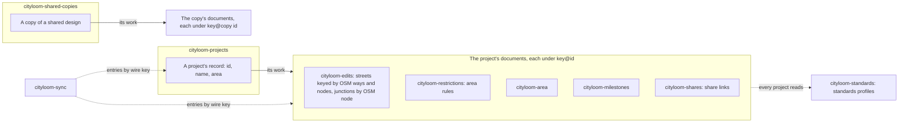

# Data model: projects and what the browser keeps

This page says what a project is made of in the browser, and what every key of the browser's storage holds. The paths
of the editor's files are relative to `crates/cityloom_editor/src/`. The editor reaches the browser's storage only
through the `Storage` port (`shared/ports.rs`), whose browser side is the page's `localStorage` (`shared/platform.rs`).

## A project and what belongs to it

A project is a named container of the person's work, tied to one area. Its record is in the list of projects,
`cityloom-projects`. Its work is in documents of its own. Other keys are the person's and are shared by every project.

A project's own keys are those of `SCOPED_KEYS` (`shared/scoped.rs`): `cityloom-edits`, `cityloom-restrictions`,
`cityloom-area`, `cityloom-milestones`, `cityloom-shares`, and the damaged copies of the edits, rules and milestones
documents.
`ScopedStorage` keeps each of them as `<key>@<id>`, where `<id>` is the project's id. Every other key is the person's
and is shared by every project. The first project's id is `first`, and it is scoped like any other:
its edits are `cityloom-edits@first`. Other projects have ids of `p-` and 12 hex digits, or `p<n>` where the storage has
no randomness. `ProjectStore` (`project/store.rs`) takes the root storage, never a scoped one: the list belongs to no
project. `project::store::records` reads a project's streets, junctions, rules, milestones and area from its documents,
and deleting a project blanks each of its `SCOPED_KEYS` documents and marks its records deleted.

A copy of a shared design is listed in `cityloom-shared-copies` and keeps its documents under `<key>@<copy id>`, as a
project does. Its id is `s-` and 12 hex digits, or `s<n>`, never a project's. It is not one of the person's projects:
the home page, the sync and the move of the work from before projects never see it, and nothing of it is marked or sent.

On the way to the server, a record travels under a wire key (`shared/project_id.rs`). The first project's records keep
their bare keys, and any other project's go up as `<project>:<key>`. `split_key` reads a key with no project prefix as
the first project's. `sync::model::mark_all` composes the wire key from the project of the storage that marks
(`Storage::project`).

A page that shows a project read-only (`view=1` in its address, or a copy of a shared design) has a storage made with
`ScopedStorage::only_to_read`. It writes none of the `SCOPED_KEYS` documents, and none of `DESIGN_KEYS`:
`cityloom-sync`, `cityloom-projects`, their damaged copies, and `cityloom-shared-copies`. It still keeps the person's
caches and preferences, such as an area's roads, the goal, the language and the theme.

## Every key the browser keeps

Every `cityloom-*` key the editor reads or writes. "Per project" means the key is kept as `<key>@<id>`. "Syncs" names
the kind of record the sync sends for a person who stores their work on the server. A version is the `version` field of
the document.

| Key                            | What it holds                                                                                                                                                                                                                                                                                          | Per project | Syncs                                                                     | In the design archive                                | Format version                                                     | `-damaged` copy                                                |
| ------------------------------ | ------------------------------------------------------------------------------------------------------------------------------------------------------------------------------------------------------------------------------------------------------------------------------------------------------ | ----------- | ------------------------------------------------------------------------- | ---------------------------------------------------- | ------------------------------------------------------------------ | -------------------------------------------------------------- |
| `cityloom-projects`            | The person's projects, in creation order: `{"version":1,"projects":[…]}`. A project's record is `{id, name, area, created_at, placeholder}`, with `placeholder` left out when false (`project/store.rs`, `project/model.rs`).                                                                          | No          | Yes, kind `project`, keyed by the project's id; a placeholder is not sent | No                                                   | 1                                                                  | `cityloom-projects-damaged`, copied by the next change taken   |
| `cityloom-project`             | The id of the project opened last.                                                                                                                                                                                                                                                                     | No          | No                                                                        | No                                                   | None                                                               | None                                                           |
| `cityloom-edits`               | The street and junction edits: `{version, streets, junctions}`. A street's record is keyed `w<way>~<end>~<end>` (its smallest OSM way, then its two ends: `n<node>`, or `x` and a compass word for an end that is no node); a junction's is keyed `n<node>` (its smallest OSM node) (`city/edits.rs`). | Yes         | Yes, kinds `street` and `junction`                                        | Yes, as `edits`                                      | Written from 5 to 24, at what the content needs; read from 4 to 24 | `cityloom-edits-damaged`, copied before the first write        |
| `cityloom-restrictions`        | The area rules: `{version, next_id, restrictions}`, each rule under its id, `r<n>` or `r-<hex>` (`restriction/store.rs`).                                                                                                                                                                              | Yes         | Yes, kind `rule`                                                          | Yes, as `restrictions`                               | 1                                                                  | `cityloom-restrictions-damaged`, copied before the first write |
| `cityloom-area`                | The area chosen, as an area query. A page opens the area the project's record names, and this one only where the record names none (`city/store.rs`).                                                                                                                                                  | Yes         | Yes, kind `area`, key `current`                                           | No; the archive's `area` and `source` say which area | None                                                               | None                                                           |
| `cityloom-milestones`          | The project's milestones: `{"version":1,"milestones":{…}}`, each record a header and its snapshot, under its id, `m-<hex>` or `m<n>` (`timeline/store.rs`).                                                                                                                                            | Yes         | Yes, kind `milestone`                                                     | No: a milestone is history, not work                 | 1                                                                  | `cityloom-milestones-damaged`, copied before the first write   |
| `cityloom-shares`              | The share links made on this device for the project: `{"version":1,"shares":[…]}`, each `{token, created_at, expires_at}` (`share/store.rs`).                                                                                                                                                          | Yes         | No: the server keeps no token                                             | No                                                   | 1                                                                  | None                                                           |
| `cityloom-shared-copies`       | The copies of shared designs this browser opened, oldest first: `{"version":1,"copies":[…]}`, each `{id, token, name, area, opened_at}`. At most 10 copies, and 2 MiB of their documents together (`project/copies.rs`).                                                                               | No          | No                                                                        | No                                                   | 1                                                                  | None                                                           |
| `cityloom-sync`                | Which records wait to be sent, and the revision pulled up to: `{version, user, epoch, rev, records}`, each entry named `<kind>/<wire key>` (`sync/model.rs`).                                                                                                                                          | No          | No: it is the sync's own state                                            | No                                                   | 1                                                                  | `cityloom-sync-damaged`, copied before the first write         |
| `cityloom-standards`           | The standards profiles and which one is active: `{version, active, next_id, profiles}`, each profile `{id, name, standards}` (`standards/store.rs`). Every project reads the same.                                                                                                                     | No          | No                                                                        | No                                                   | 1                                                                  | `cityloom-standards-damaged`, copied by the next change taken  |
| `cityloom-network:<area key>`  | The street network of an area as the importer made it, in JSON: a cache, one per area (`city/store.rs`).                                                                                                                                                                                               | No          | No                                                                        | No                                                   | None                                                               | None                                                           |
| `cityloom-checksum:<area key>` | The checksum of the tile the area's network was cut from, with the importer's version (`+i<N>`). A changed tile or importer has the area read again (`city/store.rs`).                                                                                                                                 | No          | No                                                                        | No; an export reads it into `source.tile_checksum`   | None                                                               | None                                                           |
| `cityloom-region`              | The region chosen in the settings menu, whose rules the streets share: for now, which side traffic keeps to (`city/store.rs`, `shell/vm.rs`).                                                                                                                                                          | No          | No                                                                        | No                                                   | None                                                               | None                                                           |
| `cityloom-lang`                | The language, `en` or `fr-CA` (`shared/i18n.rs`, `shell/vm.rs`).                                                                                                                                                                                                                                       | No          | No                                                                        | No                                                   | None                                                               | None                                                           |
| `cityloom-theme`               | The theme, `light` or `dark` (`shell/vm.rs`).                                                                                                                                                                                                                                                          | No          | No                                                                        | No                                                   | None                                                               | None                                                           |
| `cityloom-inspector`           | Whether the details panel is `open` or `closed` (`shell/vm.rs`).                                                                                                                                                                                                                                       | No          | No                                                                        | No                                                   | None                                                               | None                                                           |
| `cityloom-notes`               | Whether the notes panel is `open` or `closed` (`shell/vm.rs`).                                                                                                                                                                                                                                         | No          | No                                                                        | No                                                   | None                                                               | None                                                           |
| `cityloom-notes-tab`           | The notes tab shown last (`shell/vm.rs`).                                                                                                                                                                                                                                                              | No          | No                                                                        | No                                                   | None                                                               | None                                                           |
| `cityloom-goal`                | The planning goal chosen on the street and junction pages, blank for none (`shared/goals.rs`).                                                                                                                                                                                                         | No          | No                                                                        | No                                                   | None                                                               | None                                                           |
| `cityloom-welcome`             | `seen` or `show`: whether the street page shows its welcome (`street/view/page.rs`).                                                                                                                                                                                                                   | No          | No                                                                        | No                                                   | None                                                               | None                                                           |

The language is written by `ShellVm::set_locale` and read by `i18n::detect`, by `web/boot.js` and by the script in the
head of each app page. That script also reads the theme, and on the pages that have them the panels and the street
page's welcome, before the module loads. Preferences stay on each device: the sync has no kind for them.

A few names look like keys and are not:

- `cityloom-design` is the `kind` of a design archive (`archive/model.rs`).
- `cityloom-share` is the `kind` of the share format (`share/model.rs`).
- `cityloom-standards` is also the `schema` of an exported standards profile (`standards/store.rs`).
- `cityloom-junction-view` was written by older builds; this build ignores it.
- `cityloom-test-*` keys are used only by tests.

## Damaged documents

Six documents have a damaged copy: `cityloom-edits`, `cityloom-restrictions`, `cityloom-milestones`,
`cityloom-projects`, `cityloom-sync` and `cityloom-standards`, each under its key and `-damaged`. A document is damaged
when it cannot be read as a document of its version. A document from a newer version is not damaged: it is neither read
nor written over.

When a damaged document is about to be replaced, its text is first copied to its `-damaged` key. The edits, rules,
milestones and sync documents copy it before their first write. The list of projects and the standards profiles copy it
only once a change is taken, so a refused change copies nothing. The copy is made only where none is kept: the first
damage is the one worth keeping, and later damage does not overwrite it. Where the copy cannot be kept, the write is
refused. The editor never reads a `-damaged` copy back: it is kept for recovery by hand. A new sync document that
replaces a damaged one counts the records it has no entry for as edited at `stamp(0)`, so the server's copy wins over
them.

## Persistence

A page opened from the map edits one place of the city. Its edits are written back through `CityStore` behind a 250 ms
debounce and flushed when the page is left. Each project keeps its edits in a document of its own,
`cityloom-edits@<project>` (`shared/scoped.rs`), whose records are keyed by what the place was made from (OpenStreetMap
node and way ids), so an edit follows its place into another area that holds it. On the way to the server, the first
project's records keep their bare keys and any other project's go up as `<project>:<key>`.

## The design archive

The Account page can export the design work of a project (the one opened last) as one JSON file, and import such a file
into it. The format is documented in `archive/model.rs`; it carries an integer `format_version` (1) and a `kind` of
`cityloom-design`, the app version, the time, what the design was made on (area, tile checksum, importer version), the
`cityloom-edits` document (read from version 4 and written at the version its content needs) and the
`cityloom-restrictions` document. It does not carry the project's milestones, the sync document, anything of the
account, the language and theme, or the downloaded street networks. The file is named `*.cityloom-design.json`, never
a bare `.citymodel`, which is the area archive that `citymodel_builder` builds.

The archive's `area` and `source` say which area the design was made on (`CityStore::current_area`). They are there
for information: an import never changes the area.

An import checks the whole file before it writes anything. A file that is not JSON, not a CityLoom design archive,
damaged, larger than 10 MB, from a newer format, or holding edits or rules from a newer build is refused with a message
that says so and that nothing was changed. Places that are not on the device are added; a place that is on the device
and differs is replaced only if the person chooses "Use the archive's" for that import. Edits or rules on the device that
are damaged or from a newer build stop the import. Unknown fields are ignored on read, and `notes` and `scenarios` are
reserved names that version 1 neither writes nor reads. Imported records are marked for the sync like any edit.

## The work from before projects

Before projects, a browser kept one set of documents under bare keys: `cityloom-edits`, `cityloom-restrictions`,
`cityloom-area` and their damaged copies. `project::migrate` moves them into the project `first`.

The move runs where `legacy_waiting` says so: the list of projects can be read and changed, it holds no project but
`first`, and a bare `cityloom-edits` or `cityloom-restrictions` is not blank. An area alone starts nothing.
`move_legacy_work` runs it before anything is read on the pages that open in no project: the home page, the About
page, the Account page, and the share page when it opens a link. It names the project with the message
`project-first-name` (First project) in the page's language, and opens it where no project was opened before.

It works in this order:

1. Every bare `SCOPED_KEYS` key it finds is written under `<key>@first` and read back. A write that fails or reads back
   differently is undone, and the move stops there: the project is not listed and nothing old is blanked, so the next
   page that runs it tries again.
2. The project `first` is listed, created at `stamp(0)`, in the area that was kept if it parses and is in Montréal
   (`area_moved`), else in the default area. An area that is not moved stays where it was. A real `first` already
   listed, which a sync brought from a device that moved its work first, keeps its record as it is.
3. The old keys are blanked. `Storage` has no removal: a blank value reads as absent.

A `first` the sync already filled, as a placeholder made for records that came before the project's own, is merged
record by record. A record from before projects is added where `first` lacks it. Where both hold it and they differ,
the old one wins only where the sync document holds a pending entry for it; otherwise the one in `first` stands. An
area already kept under `first` is left as it is. A document on either side that is damaged or from a newer build is
never written over: it stops the move, as a failed write does. A `-damaged` copy already kept under `first` stands, and
the old one stays where it was. A record whose key would not come back as
itself in `first` (such as `p-abc:w1`, which would travel as project `p-abc`'s) is dropped: it is that project's, on
the server.

The move leaves the sync document alone for the records it moves. The first project's records keep their bare wire
keys, so work already on the server is found as it is, and two devices that move their work apart make the same
project. Only the project's own record gets an entry, where it has none, as edited at `stamp(0)`, so any rename made elsewhere
wins over it.

While the move waits, the sync leaves every record but the projects' own alone (`sync::local::usable`): their entries
name bare keys, which are now the first project's, and a record read from its still empty documents would go up
as a removal. After a move that did not finish, `sync::local::legacy_hold` keeps a pending record that the old
documents still hold, and `first`'s do not, from going up as a removal.
