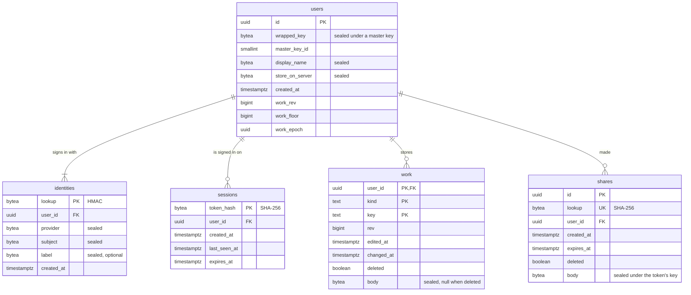

# Data model: the server's database

This page describes the Postgres schema of `cityloom_server` as migrations `0001` to `0006` leave it
(`crates/cityloom_server/migrations/`). The server runs them at start-up. The paths below are relative to
`crates/cityloom_server/`. Where the server and its database run is on [How CityLoom runs](./runtime.md); what the
browser keeps is on [Data model: projects](./data-model-projects.md).

## The tables

The database has five tables. Every other table refers to `users`, and every foreign key is
`user_id references users (id) on delete cascade`.

Every person has at least one identity. `PgRepo::create_user` (`src/db.rs`) inserts the user and the first identity in
one transaction, and `remove_identity` refuses to remove the last one (`Removal::Last`).

The checks:

- `work.kind` is one of `street`, `junction`, `rule`, `area`, `project` and `milestone`.
- `work.key` is 1 to 200 characters long.
- A `work` row is either deleted with no body, or not deleted with a body.
- `shares.lookup` is 32 bytes long.
- A deleted share has no body (`not deleted or body is null`).

The indexes, besides the primary keys and `shares.lookup`'s unique one:

- `identities_user_id` on `identities (user_id)`.
- `sessions_expires_at` on `sessions (expires_at)` and `sessions_user_id` on `sessions (user_id)`.
- `work_user_rev` on `work (user_id, rev)`.
- `shares_expires` on `shares (expires_at)`.
- `shares_user_created` on `shares (user_id, created_at)`.
- `shares_live` on `shares (user_id, expires_at)`, partial: only the rows `where body is not null`.

Later migrations changed the tables of earlier ones:

- `0002_work.sql` adds `work_rev`, `work_floor` and `work_epoch` to `users`, and makes `work`.
- `0003_work_project_kind.sql` and `0004_work_milestone_kind.sql` each drop and add again the check `work_kind_check`:
  the first adds the kind `project`, the second the kind `milestone`.
- `0006_share_bounds.sql` drops the index `shares_user` that `0005_shares.sql` made, and adds `shares_user_created`
  and `shares_live`.

## Keys and secrets

The server's keys come from its environment (`.env.example`). This page names them by their variables only.

- Each person has a data key of 256 random bits. It is stored in `users.wrapped_key`, sealed under a master key.
- `DATA_KEYS` holds the master keys, each 256 bits, with an id. `DATA_KEY_CURRENT` names the one that seals new data
  keys. `users.master_key_id` records which master key sealed the row's data key.
- `LOOKUP_KEY` keys the HMAC that finds an identity (`identities.lookup`).
- `OLD_LOOKUP_KEY` is read only by `cityloom_server rehash`, when the lookup key changes.

A sealed value is AES-256-GCM, stored as one version byte (`1`), a 12-byte nonce, the ciphertext and a 16-byte tag
(`src/crypto.rs`). Its associated data is `<table>.<column>.<row id>`, so a value opens only in the place it was sealed
for: another row, column or table refuses it. The data key's own associated data is `users.wrapped_key.<user id>`.

`cityloom_server rewrap` seals the data keys again under the current master key, and `cityloom_server rehash`
recomputes the identity lookups under a new `LOOKUP_KEY` (`src/db/rotate.rs`). The order of the steps is in
[Getting started](../getting-started.md).

## How each column is stored

"Sealed" means AES-256-GCM under the person's data key, unless the row says otherwise. The row id in the associated
data is given for each.

| Table        | Column            | Stored as                                                                                    | Why                                                                                                                                                                                           |
| ------------ | ----------------- | -------------------------------------------------------------------------------------------- | --------------------------------------------------------------------------------------------------------------------------------------------------------------------------------------------- |
| `users`      | `id`              | In the clear                                                                                 | Every other table refers to it.                                                                                                                                                               |
| `users`      | `wrapped_key`     | Sealed under the master key of `master_key_id`, row id the user id                           | It is the data key.                                                                                                                                                                           |
| `users`      | `master_key_id`   | In the clear                                                                                 | The server picks the master key that opens `wrapped_key` by it, and `rewrap` finds the rows under an older one.                                                                               |
| `users`      | `display_name`    | Sealed, row id the user id                                                                   |                                                                                                                                                                                               |
| `users`      | `store_on_server` | Sealed, row id the user id: `1`, `0`, or `-` while not chosen                                |                                                                                                                                                                                               |
| `users`      | `created_at`      | In the clear                                                                                 | A default of the database: the server never reads it.                                                                                                                                         |
| `users`      | `work_rev`        | In the clear                                                                                 | The account's revision counter, which every push raises and every pull compares.                                                                                                              |
| `users`      | `work_floor`      | In the clear                                                                                 | The highest revision of a purged tombstone, which a pull compares.                                                                                                                            |
| `users`      | `work_epoch`      | In the clear                                                                                 | The id of the account's current copy of the work on the server, new each time storage is turned on, which a pull compares with the epoch the device read last (`410 reset` when they differ). |
| `identities` | `lookup`          | HMAC-SHA256 under `LOOKUP_KEY` of the provider, a `0x00` byte and the subject                | The server finds the identity by it at sign-in, without keeping the subject in the clear.                                                                                                     |
| `identities` | `user_id`         | In the clear                                                                                 | The row belongs to the account.                                                                                                                                                               |
| `identities` | `provider`        | Sealed, row id the lookup in hex                                                             |                                                                                                                                                                                               |
| `identities` | `subject`         | Sealed, row id the lookup in hex                                                             |                                                                                                                                                                                               |
| `identities` | `label`           | Sealed, row id the lookup in hex; may be null                                                |                                                                                                                                                                                               |
| `identities` | `created_at`      | In the clear                                                                                 | The account's sign-ins are listed in its order, and `/api/me` gives it with each.                                                                                                             |
| `sessions`   | `token_hash`      | SHA-256 of the cookie's token; the token is never stored                                     | The server finds the session by it.                                                                                                                                                           |
| `sessions`   | `user_id`         | In the clear                                                                                 | The row belongs to the account.                                                                                                                                                               |
| `sessions`   | `created_at`      | In the clear                                                                                 | Written when the session starts; the server does not read it.                                                                                                                                 |
| `sessions`   | `last_seen_at`    | In the clear                                                                                 | A session used more than a day after this is given 30 more days.                                                                                                                              |
| `sessions`   | `expires_at`      | In the clear                                                                                 | A session past it is refused and deleted, and a daily pass deletes the rest.                                                                                                                  |
| `work`       | `user_id`         | In the clear                                                                                 | The row belongs to the account.                                                                                                                                                               |
| `work`       | `kind`            | In the clear                                                                                 | The server matches on it.                                                                                                                                                                     |
| `work`       | `key`             | In the clear                                                                                 | The server matches on it.                                                                                                                                                                     |
| `work`       | `rev`             | In the clear                                                                                 | A pull sorts and pages by it.                                                                                                                                                                 |
| `work`       | `edited_at`       | In the clear                                                                                 | The later edit wins: the server compares it with a pushed record's.                                                                                                                           |
| `work`       | `changed_at`      | In the clear                                                                                 | Tombstones are purged 90 days after it.                                                                                                                                                       |
| `work`       | `deleted`         | In the clear                                                                                 | A pull from revision 0 leaves tombstones out.                                                                                                                                                 |
| `work`       | `body`            | Sealed, associated data `work.<kind>.<key>.<user id>`; null when deleted                     |                                                                                                                                                                                               |
| `shares`     | `id`              | In the clear                                                                                 | The body's associated data names it.                                                                                                                                                          |
| `shares`     | `lookup`          | SHA-256 of `cityloom.share.lookup`, a `0x00` byte and the token; the token is never stored   | The server finds the share by it.                                                                                                                                                             |
| `shares`     | `user_id`         | In the clear                                                                                 | Only the share's creator may delete it, and the account's shares are counted.                                                                                                                 |
| `shares`     | `created_at`      | In the clear                                                                                 | The shares made in the last day are counted.                                                                                                                                                  |
| `shares`     | `expires_at`      | In the clear                                                                                 | The share ends then, and its marker is deleted 365 days later.                                                                                                                                |
| `shares`     | `deleted`         | In the clear                                                                                 | A deleted share's link says so.                                                                                                                                                               |
| `shares`     | `body`            | Sealed under a key made from the token, associated data `share.body.<id>`; null once dropped | Neither a master key nor a data key opens it.                                                                                                                                                 |

The `work` table's own comment gives the reason for its clear columns: the server matches and sorts on them, and they
say nothing about the person by themselves.

## Work records and browser documents

A person who stores their work on the server has one `work` row for each record the browser sends
(`src/api/work.rs`). The server checks the kind, the key and the time, and passes the body through as the browser sent
it, sealed. Each kind is a part of the project's documents in the browser
(`crates/cityloom_editor/src/sync/local.rs`), described on
[Data model: projects](./data-model-projects.md#every-key-the-browser-keeps):

| `kind`      | The browser document                                      | `key`              |
| ----------- | --------------------------------------------------------- | ------------------ |
| `street`    | A street of the `streets` section of `cityloom-edits`     | The street's key   |
| `junction`  | A junction of the `junctions` section of `cityloom-edits` | The junction's key |
| `rule`      | An area rule of `cityloom-restrictions`                   | The rule's id      |
| `area`      | `cityloom-area`, sent as `{"query": …}`                   | `current`          |
| `milestone` | A milestone of `cityloom-milestones`                      | The milestone's id |
| `project`   | The project's entry of `cityloom-projects`                | The project's id   |

- `key` is the wire key. A record of the first project, whose id is `first`, keeps its bare key. A record of any other
  project has `<project>:<key>` (`crates/cityloom_editor/src/shared/project_id.rs`). A key is 1 to 200 characters of
  letters, digits and `~_.:-` (`src/work.rs`, `valid_key`).
- `rev` is the account's revision when the row last changed. `users.work_rev` is the counter: each record a push
  accepts takes the next revision.
- `edited_at` is when the device made the edit. A time later than the server's clock is stored as the server's time.
- `changed_at` is when the row last changed on the server.
- A record removed in the browser stays as a tombstone: `deleted` is true and `body` is null, so other devices learn of
  the removal. A pull from revision 0 gets no tombstones.
- Tombstones whose `changed_at` is more than 90 days old (`TOMBSTONE_DAYS`) are deleted at the next pull or push, and
  `users.work_floor` is raised to the highest revision deleted. A pull that began above revision 0 and below the floor
  is answered `410 resync`.
- `users.work_epoch` changes each time storage is turned on. A pull that names another epoch is answered `410 reset`.

An account holds at most 5,000 records (`MAX_RECORDS`) and 16 MiB of sealed bodies (`MAX_SEALED_BYTES`). A record's
body is at most 1 MiB (`MAX_RECORD_BYTES`), and a push carries at most 100 records (`MAX_BATCH`).

## Share links

A share link carries a token: 32 random bytes in base64url. The server never stores the token and never logs it. A
`shares` row keeps:

- `lookup`, the hash of the token the row is found by (`src/share.rs`, `Token::lookup`);
- `body`, the snapshot as the browser sent it, sealed under a key made from the token (`Token::body_key`, an
  HMAC-SHA256 keyed with the token). Without the link, the database and the server's keys together open nothing;
- the account that made it, when it was made, when it expires, and whether it was deleted.

A share ends 90 days after it is made (`RETENTION_DAYS`), or earlier when its creator deletes it. Deleting a share that
is still live drops its body and sets `deleted`. Deleting one that has expired drops its body and leaves it expired.
Either way the row stays as a marker, so the link says that the share expired or was deleted, not that there never was
one.

A purge runs once the migrations have run, and then once a day (`share::spawn_purge`, `src/db/share.rs`, `purge`). It
drops the body of every expired share and deletes every marker 365 days past its expiry (`MARKER_DAYS`). A read of an
expired share drops its body at once.

An account holds at most 50 live shares (`MAX_LIVE_SHARES`), counted over `shares_live`, and makes at most 100 shares
in any 24 hours (`MAX_SHARES_PER_DAY`), deleted ones included, counted over `shares_user_created`. Both are counted
while the account's row is locked, over indexes that the markers do not grow.

## Deleting an account and turning storage off

**Deleting an account** deletes its `users` row (`src/db.rs`, `delete_user`). The foreign keys remove the rest at
once: every row of `identities`, `sessions`, `work` and `shares` of the account, the markers of its shares included. A
link to one of its shares then answers `404 not-found`, as a link that never was.

**Turning storage off** (`set_storage`, in one transaction) records the choice, deletes every `work` row of the account
and sets `work_rev` and `work_floor` back to 0. The account, its identities, its sessions and its shares stay. Turning
storage on again gives the account a new `work_epoch`; choosing it while it is already on changes nothing.
`DELETE /api/work` (`src/db/work.rs`, `clear`) also deletes every `work` row and sets the counters back to 0, with a new
`work_epoch`; the app never calls it.

**Backups.** The rows deleted stay in the server's backups until those backups expire, according to Railway's retention
period.
