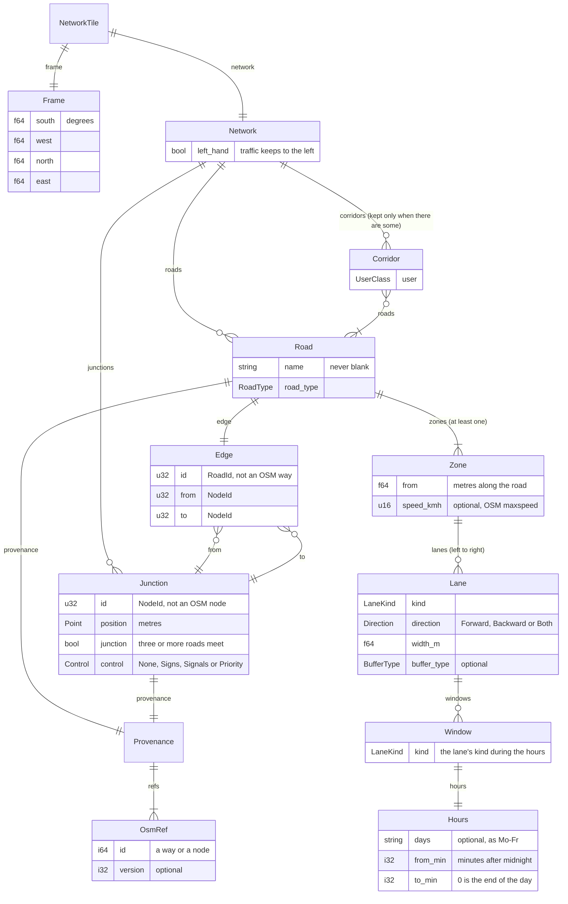
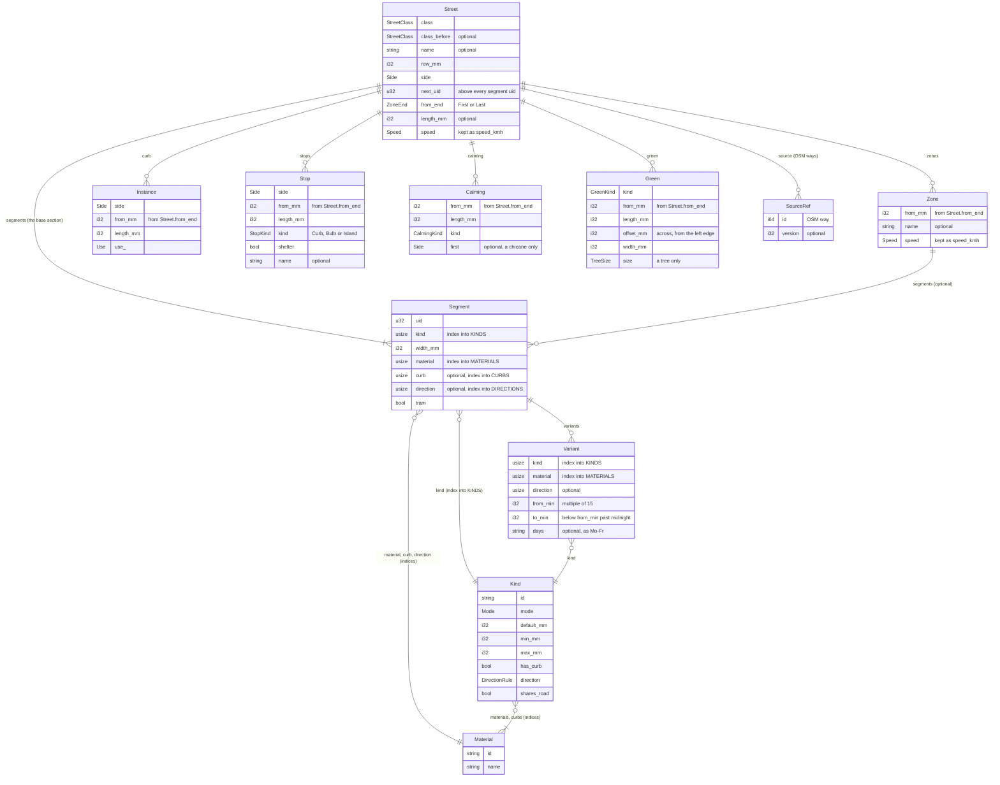
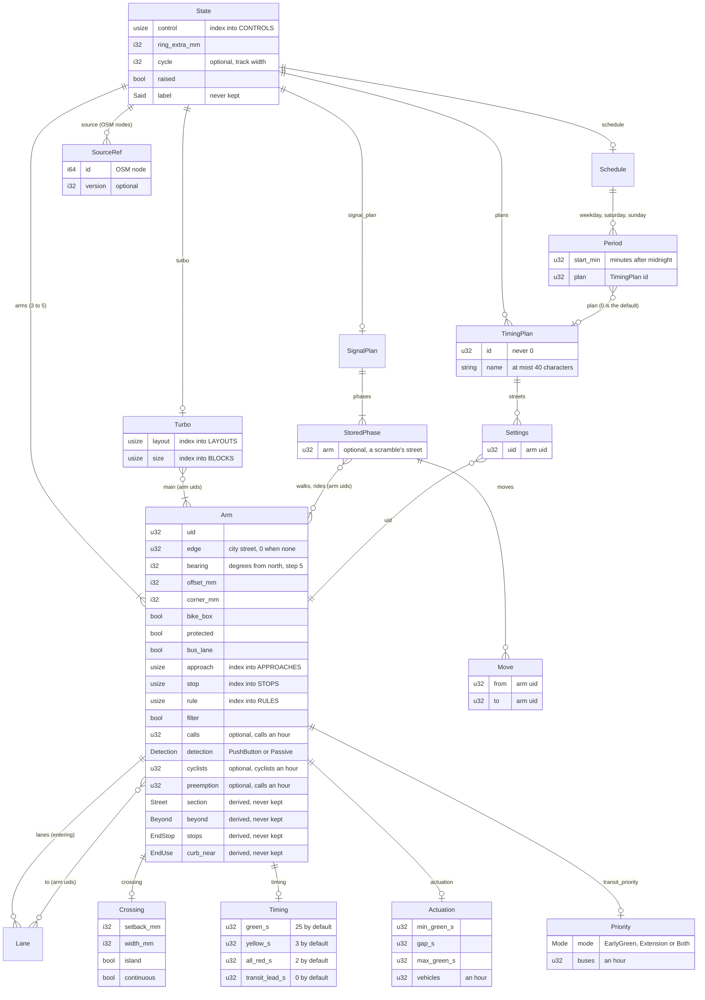
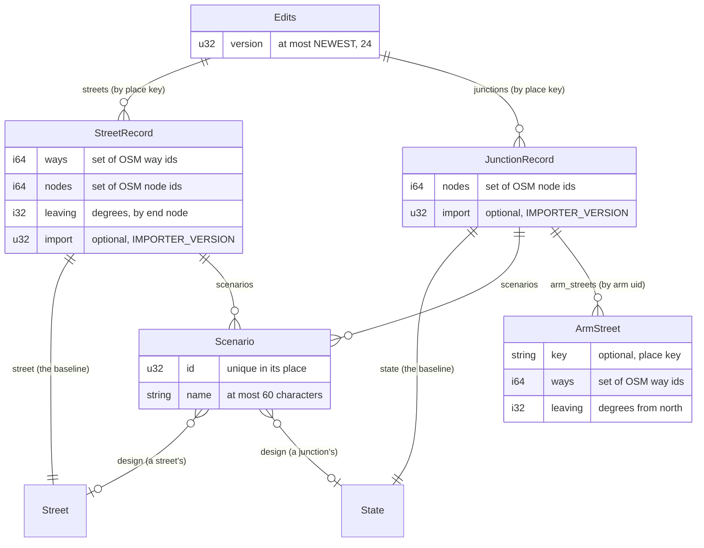

# Data model: streets and junctions

This page draws the data CityLoom works on: the street network the importer makes, and the street and the junction as
the editors keep them, with their scenarios. The paths of the editor's files are relative to
`crates/cityloom_editor/src/`, as on the [overview](./index.md); the paths of the network's are under
`crates/cityloom_model/src/`.

## Where the types live

The types are in two crates:

- `cityloom_model` holds the plain street network that the importer of `citymodel_builder` produces and the editor
  reads (`lib.rs`). It also holds the street as the city keeps it (`street/`) and the catalogue its pieces name
  (`catalogue.rs`): what OpenStreetMap can say of a street, without the editor's rules for changing it.
- The editor holds the rest. It re-exports `Street`, `Segment` and the other street types from
  `cityloom_model::street` (`street/model/mod.rs`) and adds its rules, checks and message keys on extension traits:
  `StreetExt`, `UseExt`, `StopKindExt`, `CalmingKindExt`, `CalmingExt`, `GreenKindExt`, `GreenExt` and `TreeSizeExt`.
  The junction as the editor keeps it (`State`, `Arm` and everything else under `junction/model/`) is the editor's
  alone: `cityloom_model` has only the network's `Junction`. The records of the edits document and their scenarios are
  in `city/` (`city/edits.rs`, `city/scenario.rs`).

The network stands between the importer and the editor so that the editor does not depend on osm2streets: only
`citymodel_builder` runs it. `city/import.rs` reads each road of the network as a street with
`cityloom_model::street::{class_of, pieces, refs}` (`street/from_road.rs`).

## The street network

The network is what the importer makes of OpenStreetMap, cut into tiles. The editor fetches a `NetworkTile`, a network
with its `Frame` (a box on the earth, in degrees), and cuts a place out of it (`place/loader.rs`). Positions in the
network are metres (`f64`) from the south-west corner of the data: `x` east, `y` north.

- `Network` (`network.rs`): whether traffic keeps to the left, the junctions, the roads and the corridors. The
  corridors are kept only when there are some.
- `Junction` (`junction.rs`): a junction or a street end. `id` is a `NodeId`, its id in the network's graph and not an
  OpenStreetMap node. `junction` is true where three or more roads meet, as opposed to a street running off the data or
  ending. `control` is `None`, `Signs`, `Signals` or `Priority`, which lists the roads (`RoadId`) that have priority.
- `Road` (`road.rs`): a street between two nodes, made from one or more OpenStreetMap ways. The importer leaves out a
  road with no name. `road_type` is `Motorway`, `Highway`, `Arterial`, `Collector` or `Local`, folded from OSM's
  `highway` by `RoadType::from_osm` (`road_type.rs`). `points` is the road's centre line.
- `Edge` (`graph.rs`): the road's id, a `RoadId` that is not an OpenStreetMap way, and the nodes it joins, from the first
  to the last. `Network::nodes` and `Network::edges` give the bare graph of `Node`s and `Edge`s.
- `Zone` (`zone.rs`): a stretch of a road with one cross-section. `from` is metres along the road from its `from` end,
  and `speed_kmh` is OSM's `maxspeed` in km/h. A road has at least one zone, the first at 0 and each one after further
  along (`Road::is_zoned`).
- `Lane` (`lane.rs`): lanes are listed left to right, facing from the road's `from` end to its `to` end. `width_m` is in
  metres. `windows` say what else the lane is at certain hours.
- `Window` and `Hours` (`hours.rs`): during `hours`, the lane is of the window's `kind`. Times are minutes after
  midnight, on a quarter hour; a `to_min` of 0 runs to the end of the day. `Hours::parse` refuses hours that overlap or
  run past midnight.
- `Corridor` (`corridor.rs`): the roads that serve one class of user (pedestrian, cyclist, transit or driver), joined
  end to end. `Network::derive_corridors` makes them.
- `Provenance` (`provenance.rs`): the OpenStreetMap things a road or a junction was made from. Each `OsmRef` is a way
  (`WayRef`) or a node (`NodeRef`), with its OSM `id` and the `version` it had when the data was read, when that is
  known (`osm.rs`). A road's are ways and a junction's are nodes; the key an edit is kept under comes from them.

## The street

A street is kept in integer millimetres (`i32`). It is seen from its first end toward its second.

- `Street` (`street/mod.rs`): `class` is `Motorway`, `Arterial`, `Collector`, `Local` or `Pedestrian`, and
  `class_before` the class it had before it became pedestrian. `row_mm` is its width. `segments` is the base section,
  its pieces in order. `next_uid` is above the uid of every piece of every section (`Street::is_sound`). `source` holds
  the OpenStreetMap ways it was made from. `from_end` and `length_mm` say which end the positions along the street are
  measured from and the length they were drawn against; they are written only with zones or with something placed
  along the street.
- `Segment` (`street/segment.rs`): a piece of a section. `kind`, `material`, `curb` and `direction` are indices into the
  catalogue's `KINDS`, `MATERIALS`, `CURBS` and `DIRECTIONS`. `tram` says that a transit lane carries trams rather than
  buses.
- `Variant` (`street/segment.rs`): another type the piece takes between two times of day. Times are minutes after
  midnight, multiples of 15 (`SLOT_MIN`); a `to_min` below `from_min` runs past midnight. A piece's windows never
  overlap: the editor refuses a time that would (`street/model/mod.rs`, `set_variant_time`).
- The catalogue (`catalogue.rs`): each `Kind` says its mode, its widths (default, least and most, in mm), the materials
  and curbs it allows, whether it runs one way (`DirectionRule`) and whether it can change type through the day
  (`shares_road`). `KINDS` holds 18 kinds; `MATERIALS`, `CURBS` and `DIRECTIONS` are lists of `Material`. Everything in
  the catalogue is synthetic. `class_of` (`street/from_road.rs`) gives a road's street class: `Highway` and `Arterial`
  both become `Arterial`.
- `Zone` (`street/zone.rs`): a stretch of the street. `from_mm` is measured from `Street::from_end`, and the stretch
  ends where the next starts. With `segments` absent, the stretch has the base section. A street with no zones is one
  section; `settle_zones` sorts the zones and sets the first to 0.
- `Speed` (`street/speed.rs`): `Undecided`, `NotSet` or `Kmh`, in km/h. It is kept as `speed_kmh`: absent when not yet
  decided and `null` when the road has none. A zone with no speed of its own has the street's (`speed_in`).
- `Instance` (`street/curb.rs`): a use of the curbside: `Parking`, `Loading`, `Tree`, `Planting`, `RainGarden`,
  `Patio`, `BikeParking` or `Platform`. It belongs to the street, not to a section: its position is measured along the
  whole street, on the editor's 100 mm snap, so changing the zones leaves it where it is.
- `Stop` (`street/stop.rs`): a transit stop, `Curb`, `Bulb` or `Island`, with a shelter or not.
- `Calming` (`street/calming.rs`): a raised element: `Table`, `Crossing`, `Chicane` or `ModalFilter`. It has no side;
  `first` is the side of a chicane's first build-out.
- `Green` (`street/green.rs`): a `Tree`, `Bed`, `RainGarden` or `Bioswale`. `offset_mm` is its centre across, from the
  section's left edge. `size` is set exactly when it is a tree.

Curbside uses, stops, raised elements and green elements need the street's `length_mm` to be placed: a street with any
of them but no length is not sound (`Street::is_sound`).

## The junction

A junction is kept as a `State` (`junction/model/mod.rs`), in integer millimetres, whole seconds and degrees.

- `State`: the arms, and how the junction is run. `control` is an index into `CONTROLS`: uncontrolled, priority, stop,
  signal or roundabout. `ring_extra_mm`, `bus` (a bus-only lane across a roundabout, between two arm uids) and `cycle`
  (a cycle track around it) are a roundabout's; `raised` raises the whole carriageway to sidewalk height. `source` holds
  the OpenStreetMap nodes it was made from. `label` is not kept, so a saved state comes back as "Earlier changes".
- `Arm`: one street of the junction, 3 to 5 of them (`MIN_ARMS`, `MAX_ARMS`). `uid` identifies it within the junction.
  `edge` is the city street it is, or 0 when it is not part of a city. `bearing` is in degrees clockwise from north, a
  multiple of `BEARING_STEP` (5). `banned` lists the arm uids it may not turn into, and `bulb` its curb extensions,
  left and right. `approach`, `stop` and `rule` are indices into `APPROACHES`, `STOPS` and `RULES`.
- `Lane`: an entering lane, listed from the driver's left to right, with the arm uids it can go to.
- `Crossing`: the arm's pedestrian crossing: its setback and width in mm, whether it has an island, and whether the
  sidewalk runs on across the street at its own level.
- `Timing`: the arm's signal timing in whole seconds. Until it is set it reads as the default: 25 s green, 3 s yellow,
  2 s all-red, no transit lead.
- `Turbo` (`junction/model/turbo.rs`): a turbo roundabout's layout, with the two arms of its main road. It is kept only
  while `control` is the roundabout.

Four fields of `Arm` are derived from the street and never kept (`#[serde(skip)]`): `section` (the street seen from the
junction), `beyond` (the stretch past the end zone's first boundary), `stops` (the street's transit stops in its end
zone) and `curb_near` (its curbside uses there). The city puts them on the arm when it opens the junction. The read
model (`junction/model/read_model.rs`) and the stops' drawing (`junction/model/stops.rs`) are computed from the `State`
and never kept either.

The signal (`junction/model/signal.rs`, `junction/model/plans.rs`) is kept only while the junction is signalled:

- `SignalPlan` is a plan the person has edited: its `StoredPhase`s in the order they run. Each phase lists the
  movements it serves (`Move`, from an arm to an arm), the crossings walked (`walks`) and the bike movements that run
  (`rides`) with it, all by arm uid. A phase's timing is not kept with it: it is the `Arm.timing` of the arm of its
  first movement, or of `arm` for a phase with no movement (a pedestrian scramble). With no stored plan, the junction
  shows the suggestion, one phase per street with entering lanes. A plan holds at most `MAX_PHASES` (twice
  `MAX_ARMS`). A `Pattern` (`ThroughOnly`, `All`, `ProtectedLeftThenThrough`, `Scramble`) is a ready-made choice of
  what a phase allows; it is not kept.
- The responsive policies are fields of `Arm`, each saved only once set. `calls` is a crossing on call, at that many
  calls an hour, with `detection` a push button or passive detection. `actuation` makes the street's phase actuated:
  its least and most green and its gap in seconds, and the vehicles an hour. `cyclists` puts the bike movement on
  detection, at that many cyclists an hour. `transit_priority` gives the street's buses an early green, a green
  extension or both. `preemption` is the emergency calls an hour that pre-empt the signal.
- Time-of-day plans: a `TimingPlan` is a named copy of the streets' signal settings, one `Settings` per arm by its
  `uid`, under the same names as on `Arm`. The phases are the junction's, shared by every plan. The default plan,
  `DEFAULT_PLAN` (0), is the arms' own settings and is never stored. A junction holds at most `MAX_PLANS` (8) plans,
  the default included, and a name has at most `MAX_NAME_CHARS` (40) characters.
- `Schedule`: which plan runs when, for weekdays, Saturday and Sunday. Each `Period` starts at a minute after midnight
  and runs until the next one starts; a day type has at most `MAX_PERIODS` (12). Starts are kept distinct and in order
  (`Schedule::settle`), so every minute of the week is covered by exactly one period, with no gap and no overlap.

## Scenarios

A place's record in the edits document (`city/edits.rs`) keeps its own design, the baseline, and its scenarios
(`city/scenario.rs`): named alternatives, each a whole design.

- `Edits`: the document, its records keyed by place key (see below).
- `StreetRecord`: the OpenStreetMap ways the street was made from, the nodes of both its end junctions, and, for each
  end that is an OpenStreetMap node, the way the street leaves it in whole degrees clockwise from north. `street` is
  the baseline.
- `JunctionRecord`: the OpenStreetMap nodes the junction was made from, and its `state`, the baseline, with each arm's
  `edge` stored as 0. `arm_streets` gives, for each arm uid, the street at that arm as an `ArmStreet`: its key where it
  has one, its ways and the way it leaves the junction, so the arm finds its street again when the street's key changes.
- `Scenario`: an `id` unique among its place's scenarios (one more than the highest), a name, and the `design`: a
  `Street` in a street record, a `State` in a junction record. A place keeps at most `MAX_SCENARIOS` (8); names are
  trimmed, at most `MAX_NAME_CHARS` (60) characters, and unique ignoring case. `scenarios` is absent when there are
  none.

Which design a page shows is chosen per page load and not kept; the map and the report read the baseline.

## OpenStreetMap sources and identity

`Street.source` and `State.source` are lists of `SourceRef { id, version }` (`osm.rs`): the OpenStreetMap ways of a
street, or the nodes of a junction, with the version each had when the data was read, when that is known. Unlike the
network's `OsmRef`, a `SourceRef` does not say whether it is a way or a node: the place does. `refs`
(`street/from_road.rs`) makes them from a road's or a junction's `Provenance`. The editor calls `SourceRef` `OsmRef`
(`shared/provenance.rs`).

A place's key, which its record is kept under, is built from these ids (`city/keys.rs`):

- a junction's is `n` and the smallest OpenStreetMap node it was made from: `n2`;
- a street's is `w` and its smallest way, then the keys of its two ends in sorted order: `w7~n2~n5`. An end with no
  OpenStreetMap node, where a road leaves the area's box, is `x`, and sorts after a real end. When exactly one end is
  `x`, the key then ends with a compass word, `n`, `e`, `s` or `w`, for the way the street leaves its real end:
  `w7~n2~x~e`. When both ends are `x`, no word is added: `w7~x~x`. The two halves of a closed way join the same two
  real ends; each key then ends with the word for the way that half leaves its first end in sorted order:
  `w7~n1~n2~n`. Any other street with two real ends has no word.

The key is the same whichever tile the place is read from. The other ids stay inside: `NodeId` and `RoadId` number the
network's graph, and a street's or a junction's uid in the city is its place in the city's layout, counting from 1
(`city/model.rs`). Within a street, each piece has a `uid` below `next_uid`; within a junction, each arm has a `uid`, and
the phases, plans and periods name arms by it. A time-of-day plan has an `id` that a rename or the removal of another
plan never changes, and a scenario an `id` unique in its place.

## Format versions

The network and the edits document each have a version:

- `IMPORTER_VERSION` (12, in `cityloom_model`'s `importer.rs`) is the version of what the importer makes of a tile. It
  is raised when the importer's output changes for the same data, so that the areas kept from a tile are read again.
  An area is kept with its tile's checksum as `<checksum>+i<N>` (`with_importer`, `importer_of`). The network's types
  are kept as they are written, so a change to one is a decision about `IMPORTER_VERSION`.
- The edits document's `version` (`city/edits.rs`) is `VERSION` (5) for a document with none of the later features.
  Each feature has its own version, up to `PLANS_VERSION` (24), which is `NEWEST`: `ZONES_VERSION` 6, `SPEED_VERSION`
  7, `CURB_VERSION` 8, `STOP_VERSION` 9, `SIGNAL_VERSION` 10, `GREEN_VERSION` 11, `CALMING_VERSION` 12,
  `ZONE_SPEED_VERSION` 13, `CHICANE_VERSION` 14, `FILTER_VERSION` 15, `SCENARIO_VERSION` 16, `IMPORT_STAMP_VERSION` 17,
  `CALLS_VERSION` 18, `DETECTION_VERSION` 19, `ACTUATION_VERSION` 20, `BICYCLE_VERSION` 21, `TRANSIT_VERSION` 22,
  `PREEMPTION_VERSION` 23 and `PLANS_VERSION` 24. The document is written at the version its content needs
  (`Edits::written_version`), so a build that does not know a feature leaves alone a document that holds it. Versions
  4 to `NEWEST` are read; a newer document is neither read nor written over.
- A record's `import` is the `IMPORTER_VERSION` of the network its place came from. A record without it, or below
  `STALE_BEFORE_IMPORT` (11), is stale.
