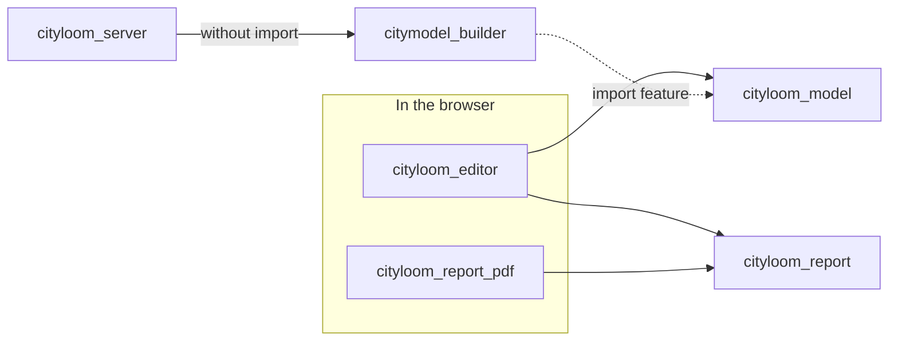

# Architecture

This page is the overview of how CityLoom's code fits together. The Architecture section of the sidebar will hold more
pages beside it. The paths of the editor's files are relative to `crates/cityloom_editor/src/`.

## Vertical slices

The code is organised by feature, one folder per slice, not by layer. New code goes in the slice that owns the feature.

| Slice          | What it holds                                                                                                                                                                                                                                                                          |
| -------------- | -------------------------------------------------------------------------------------------------------------------------------------------------------------------------------------------------------------------------------------------------------------------------------------- |
| `account/`     | The Account page: linked sign-ins, where the work is kept, deleting the account.                                                                                                                                                                                                       |
| `archive/`     | The design archive: export and import of a project's edits and area rules as one file.                                                                                                                                                                                                 |
| `city/`        | The city: its layout, its storage, its projection onto the earth, the edits document and the import of a network.                                                                                                                                                                      |
| `junction/`    | The junction editor, with its geometry, its 2.5D drawing, stops and signals, and its half of the comparison page.                                                                                                                                                                      |
| `map/`         | The city map drawn by MapLibre, the Area rules panel, the network checks, the design review report, and the About page's city.                                                                                                                                                         |
| `place/`       | Where a city comes from: the metropolitan areas, the tile index, and fetching and cutting out the roads of the place a project opens on. There is no place search.                                                                                                                     |
| `project/`     | The projects: the list on the home page, which project a page is opened in (`context.rs`), the copies of shared designs (`copies.rs`) and the move of the work from before projects (`migrate.rs`).                                                                                    |
| `restriction/` | The rules declared over an area of the map.                                                                                                                                                                                                                                            |
| `share/`       | Sharing a project by a link: the share format, the share page (making a project's links, opening one) and its calls to the server.                                                                                                                                                     |
| `shared/`      | The kernel: catalogue, units, ports, translations, `Said`, the comparison page's frame (`compare.rs`, `compare_view.rs`), a place's scenarios (`scenarios.rs`), a project's storage (`scoped.rs`) and the disabled controls of a read-only page (`locked.rs`). It depends on no slice. |
| `shell/`       | What every page shares: the settings menu, the details and notes panels, the language switch, the Sign in menu (`session.rs`), the header's Share menu (`share.rs`) and making a copy of a shared design one of the person's projects.                                                 |
| `standards/`   | Standards profiles: local thresholds that only the street page's checks read in place of the built-in ones.                                                                                                                                                                            |
| `street/`      | The street editor, and its half of the comparison page.                                                                                                                                                                                                                                |
| `sync/`        | Keeps a signed-in person's work on the server, when they chose it, and merges it between devices.                                                                                                                                                                                      |
| `timeline/`    | A project's milestones and their page, `timeline.html`.                                                                                                                                                                                                                                |

A slice may use another slice's `model` (junction uses the street's, city uses both, `sync::local` uses
`project::model`), `city::store`, `city::binding`, `city::projection`, `city::edits` (project, sync),
`restriction::store`, `standards::model` and `standards::store` (street), `place::area` (and `place::Bounds`, the box
that `Area::bounds` gives and `city::projection` takes), `project::copies` (share, for the copy of a shared design; the
shell, to make a copy one of the person's projects), `project::context` (which project a page is opened in, and whether
it is shown read-only) and `shared`. It never uses another slice's view-model, views or text, nor its other modules,
except as this section says:

- The archive panel. The Account page (`account/mod.rs`) builds it with `archive::vm::ArchiveVm::for_page` and mounts
  it with `archive::view::ArchiveView`. The shell's Share menu builds an `ArchiveVm::for_page` for its export
  (`shell/view.rs`).
- The shell's tray. The street page's Notes tray (`street/view/notes_tray.rs`) is made with `shell::tray`.
- The shell's mount. The street, junction, map and account pages mount the shell with `shell::mount`, saying with
  `shell::NotesAtStart` how their notes start. Its target is a `shell::Target`, which `StreetVm`, `JunctionVm` and
  `MapVm` implement; the account page and a junction that cannot be drawn hand it a `shell::Bare`.
- The drawing of an area. The map uses `restriction::draw`, the pure state machine that draws an area's outline
  (`map/vm/mod.rs`, `map/vm/areas.rs`, `map/view/mod.rs`, `map/view/areas_view.rs`).
- The report. `map/vm/report.rs` draws its figures with `street::view::drawing` and `junction::view::figure`.
- A shell test, which builds a `street::vm::StreetVm`.

Of `street/`, `junction/` and `map/`, another slice uses only what is under `model/`, but for the report and that shell
test.

Tests also use more of other slices, to set up what they test:

- `project::ProjectStore` and `project::store::PROJECTS_KEY`: the tests of archive, city, junction, map, share, shell,
  street and sync.
- `restriction::fixtures`: the tests of city, map and street.
- `shell::view::i18n_keys`: the tests of account, junction, map and project.
- `sync::SyncVm` and `sync::Status`: the tests of account.
- `sync::tests` (`Device`, `ServerSim`, `device`, `ada`, `T0`), `sync::local::ids`, `share::links::ProjectShares`,
  `share::store` and `timeline::store`: the tests of project.
- `city::scenario::Action`: the tests of street and junction.

A few stores are used across slices too. `sync::local` uses `project::store` and
`project::migrate::{legacy_waiting, legacy_kept, area_moved}`. `project::store` uses `city::edits`, `city::store` and
`restriction::store`. `sync::local` and `project::store` use `timeline::store`. The Account page (`account/mod.rs`)
runs `project::migrate::move_legacy_work` before it syncs.

The stores and the editors also use `sync::model` (`Id`, `Kind`, `Change`, `Origin`, `Report`, `mark`), which depends
only on `shared`. The shell builds `sync::SyncVm`; every other slice reaches the sync only through `sync::hub` and
`sync::model`. `shared` depends on no slice.

A page made of several slices is put together in `lib.rs`, the composition root, which may use any slice (see
[Pages and entry points](#pages-and-entry-points)).

## Layers inside a slice

A slice holds, as it needs them, these layers:

- The model: the editing rules and pure computation over the domain, with no Leptos and no wording. In the street and
  junction slices it has no DOM, no signals and no I/O. An edit returns a `bool`, and a refusal carries a reason.
- The view-model: it exposes presentation-ready reactive getters and takes commands. It reaches the browser only
  through the [ports](#ports).
- The views: Leptos views that bind to a view-model and forward events. They decide nothing.

In the three largest slices, `street/`, `junction/` and `map/`, each layer is a folder: `model/`, `vm/` and `view/`.
Only `mod.rs` (the entry points), `i18n/` and `CLAUDE.md` stay at the slice's root; `layout_guard.rs` fails otherwise.
In the street and junction slices, `vm/` also holds the words for a screen reader (`text.rs`), the key state machines
(`keys.rs`) and the handle the views take (`watch.rs`); in the map slice, it holds the sub-view-models, the camera, the
report and what is built for the map. `view/` holds the Leptos views, the SVG drawing and the component tests
(`view/tests.rs`).

The other slices keep their files side by side at their root: `model.rs`, `vm.rs`, `view.rs`, `text.rs`, `tests.rs`
and `i18n/`, as each needs. The shell keeps its `vm.rs`, its Leptos views and `tests.rs` side by side.

Drawing is done by pure functions that return SVG strings, set with `inner_html` (`street/view/iso/`,
`junction/view/iso/`, and `map/view/svg.rs` for the About page's city only). Pointer and keyboard logic are pure state
machines with tests. The map page is the exception: it draws with MapLibre and no SVG.

## Pages and entry points

Each page of `web/` has a script that loads the editor's module and calls its entry point:

| Page                | Script        | Entry point                                                                            |
| ------------------- | ------------- | -------------------------------------------------------------------------------------- |
| `index.html`        | `home.js`     | `mount_projects` (`lib.rs`): the person's projects.                                    |
| `about.html`        | `about.js`    | `mount_about` (`lib.rs`), then `prepare_city` and `mount_city`: About CityLoom.        |
| `map.html`          | `map.js`      | `mount_map` (`map/mod.rs`).                                                            |
| `street.html`       | `app.js`      | `open_street` and `mount_street_page` (`street/mod.rs`), `mount_standards` (`lib.rs`). |
| `intersection.html` | `junction.js` | `enter_junction`, `open_junction` and `mount_page` (`junction/mod.rs`).                |
| `account.html`      | `account.js`  | `mount_account` (`account/mod.rs`).                                                    |
| `timeline.html`     | `timeline.js` | `mount_timeline` (`lib.rs`): a project's milestones.                                   |
| `share.html`        | `share.js`    | `mount_share` (`lib.rs`): a project's share links, or a share link being opened.       |
| `compare.html`      | `compare.js`  | `mount_compare` (`lib.rs`): two designs of one street or junction.                     |

`credits.html` loads no module. Each script then mounts the shell (`mount_shell`). The pages that open the city
(`about.js`, `map.js`, `app.js`, `junction.js` and `compare.js`) call `prepare_city` (`place/mod.rs`) before they open
it: it gets the roads of the area the person is working in, unless they are already kept.

`lib.rs` is the composition root, where slices may meet. The home page is `project::mount_list`, handed the share
slice's `share::links::ProjectShares` as its `project::model::ProjectLinks`, so that a project's share links end before
it does. The About page runs `project::migrate::move_legacy_work` and then `map::mount_about`. The timeline, share and
comparison pages are put together there too, and `i18n_for` registers every slice's messages.

A page of a project opens inside it (`project::context::open_page`): the project its address names with
`?project=<id>`, else the one opened last. Where there is none, the page goes to `index.html?missing=1`. The links to
a project's pages carry `project=<id>` (`shared::project_id::link`).

A project is opened read-only when its address holds `&view=1`, or when it is a copy of a shared design
(`project::context::read_only`). The page's storage then refuses every write of the design
(`ScopedStorage::only_to_read`, which `Storage::read_only` reports), every view-model's `read_only()` refuses edits, and
the shell's top bar says so. The links between a project's pages keep `view=1`.

The comparison page, `compare.html?street=<edge>` or `compare.html?junction=<node>`, is opened by the Compare link of a
street's or junction's scenario panel. It shows two designs of the place (the baseline or a scenario) side by side,
with what differs in the second. It is read-only: `mount_compare` only peeks at the project
(`project::context::peek`) and writes nothing. The street or junction slice draws its half (`mount_compare_street`,
`mount_compare_junction`) inside the frame of `shared/compare_view.rs`.

The share page, `share.html?project=<id>`, makes a project's share links: the `share/` slice composes a snapshot of the
project and sends it to the server's `/api/share`. A link, `share.html#<token>`, opens a shared design: the page fetches
the snapshot, keeps it as a copy (`project::copies`) that is never synced and is not one of the person's projects, and
opens its map read-only. [Sharing a design](../sharing.md) says what is kept, for whom and for how long.

## Ports

A view-model reaches the browser only through ports. They are the fields of `Ports`, in `shared/ports.rs`:

- `Navigator`: opens another page of the site.
- `PdfWriter`: writes the design review as a PDF.
- `Downloads`: gives a person a file to keep.
- `Fetcher`: asks a server for something (HTTP).
- `Announcer`: says something to a person who cannot see the page.
- `Storage`: keeps strings between visits.
- `Scheduler`: runs something after a delay.
- `Mapper`: the map the page shows the city on.
- `Page`: the page itself: its address, the browser's language, the clipboard.
- `Account`: the person's account on the server.
- `WorkSync`: the person's work on the server.
- `ArchiveFiles`: a design archive handed over as a file, and a file chosen.
- `ShareApi`: the server's shared designs (`/api/share`).

`shared/ports.rs` also holds their fakes, and `test_ports()` and `test_ports_with_time()` give a set of them: this is how
view-models are tested natively, without a browser. `shared/platform.rs` is their browser side: `browser_ports()` and
`browser_ports_in(project)`, whose storage is the project's.

## Translation

The model never holds wording. It says things as `Said` data (a message key and arguments) that the current language
renders, so a history follows a language switch. Each slice that owns messages has `i18n/en.ftl` and `i18n/fr.ftl`
(Fluent), and a test fails when the two differ. The French terms are in `docs/glossary-fr-ca.md`.

## WebAssembly modules

The browser runs two WebAssembly modules, both driven by `wasm-bindgen`:

- the editor, `cityloom_editor`, which every page but `credits.html` loads;
- the PDF writer, `cityloom_report_pdf`, loaded only the first time a report is asked for, so that its large dependency
  (krilla) stays out of the editor's module. The editor hands it the report as plain data (`cityloom_report`).

The street network is prepared ahead of time, not in the browser: `citymodel_builder` runs
[osm2streets](https://github.com/a-b-street/osm2streets) once over the whole metropolitan area and cuts the network
(`cityloom_model`) into JSON tiles that the editor fetches and cuts a place out of. Only `citymodel_builder` depends on
osm2streets, behind its `import` feature, so osm2streets never reaches the browser. The server, `cityloom_server`, is
not built to WebAssembly. [Project layout](../project-layout.md#the-crates) lists every crate.

How the crates depend on one another, outside their tests (an arrow reads "depends on"):

`city/import.rs` turns a network into the city's layout: roads become streets, and a meeting of three to five arms that
the junction editor can draw becomes a junction.

## Accounts and the server

A person can sign in with OpenStreetMap, Google, Microsoft or Apple (OpenID Connect, Authorization Code with PKCE).
An identity is the provider and its subject; an email is never used to find or join an account. Providers are
linked by hand on the Account page.

Everything the server stores about a person is encrypted: each field is sealed with AES-256-GCM under a key made for
that person, which is itself sealed under a master key held in the server's environment, and bound to its table, column
and row. Identities are found by an HMAC of the provider and subject. Deleting an account removes its rows at once;
copies in backups disappear when the backups expire. Signed out, the site works exactly as before, and it still
works when the server's account side is unavailable.

The server also keeps shared designs at `/api/share`: the snapshot a share link opens, kept 90 days, as
[Sharing a design](../sharing.md) explains.

## Cloud edits

A person who chose "Store my work on the server" has the work of every project kept under their account: the projects
themselves, their street and junction edits, area rules, chosen area and milestones. Every device they sign in on gets
them. The browser's storage stays the working copy, so the editors work offline and catch up when the network returns.
Each place is a record with a revision the account's counter gives it; a device asks for what is above the last
revision it saw, and sends what it changed. When two devices changed the same place, the later edit wins on both, and
the device whose change lost says so. The record bodies are sealed like everything else the server stores, bound to
their kind, key and account; the place keys (OpenStreetMap ids), the rule ids and the edit times are not sealed,
because the server matches and sorts on them. Turning storage off deletes the server copy and keeps the browser's;
deleting the account deletes the server copy too. Preferences (theme, language, panels) stay on each device.

## JavaScript

Logic belongs in Rust. The page scripts in `web/` (`home.js`, `about.js`, `map.js`, `app.js` for the street page,
`junction.js`, `account.js`, `timeline.js`, `share.js` and `compare.js`) are start-up glue: they load the module, call
`mount_*` and mount the shell. The street, junction and comparison scripts also set up the hatch patterns; the street
and junction scripts flush the page's edits on `pagehide`, and `map.js` creates the map. `boot.js` shows a notice when a
page's module cannot be loaded or started, `city.js` reads which place a page was opened for, and `report.js` loads the
PDF writer. The one exception to the rule is `web/mapcanvas.js`, the adapter that owns the MapLibre map.

## Data model

[Data model: projects and what the browser keeps](data-model-projects.md) says what a project is made of and what every
key of the browser's storage holds, how the edits are kept, what the design archive carries, and how the work from
before projects was moved into the first project.
