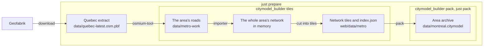
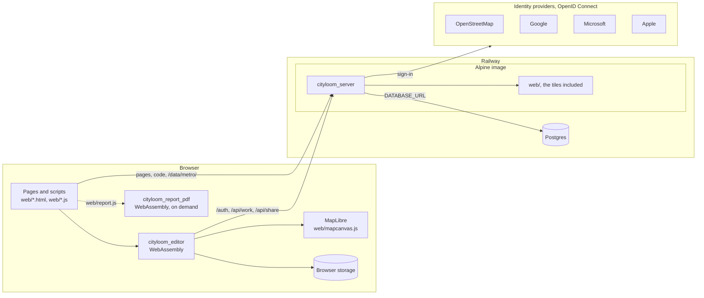
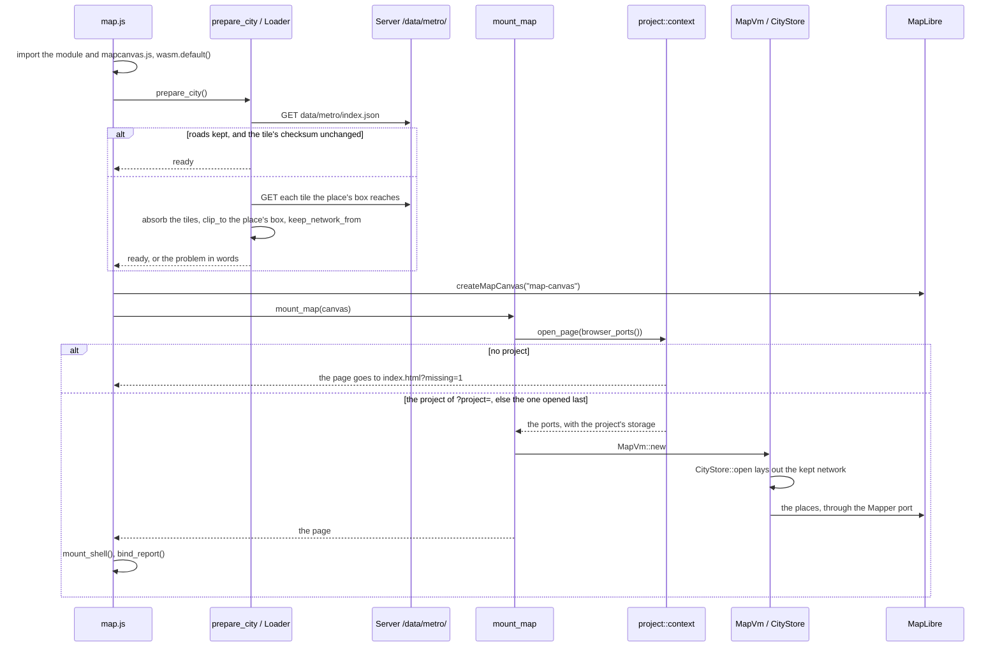
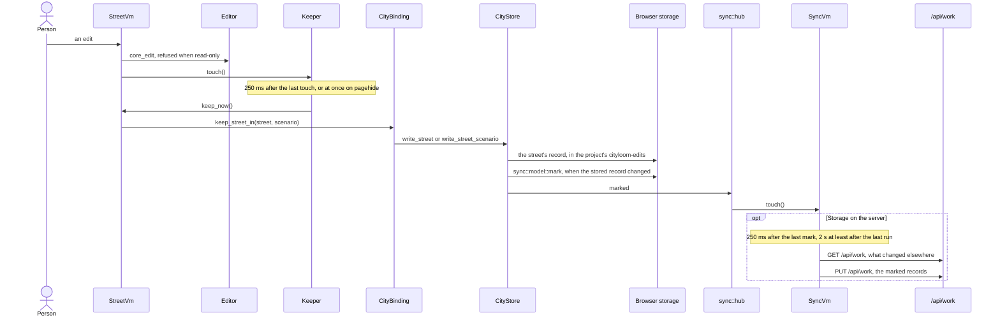
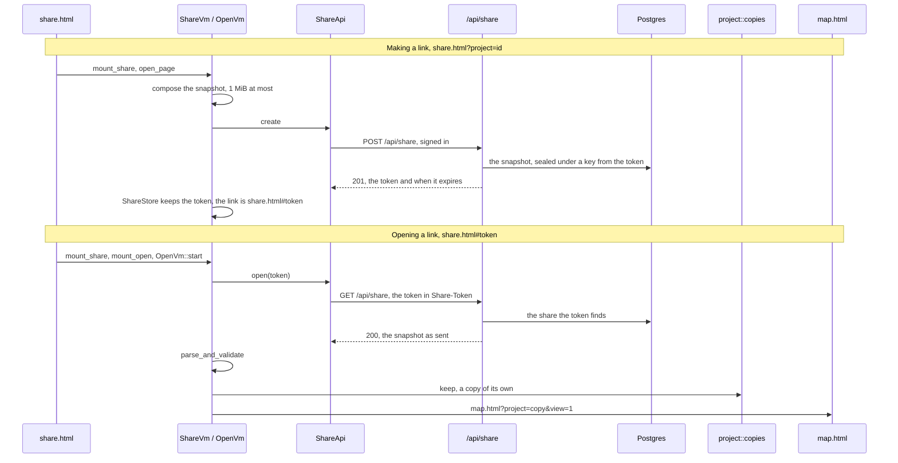

# How CityLoom runs

This page follows CityLoom as it runs: how the street network is prepared from OpenStreetMap, what is deployed, and
what happens when a page opens, when a person edits a street, and when a design is shared. How the code is organised is
on the [overview](./index.md). The paths of the editor's files are relative to `crates/cityloom_editor/src/`.

## From OpenStreetMap to tiles

The street network is prepared ahead of time by `citymodel_builder`, never in the browser. `just prepare` runs every
step: it downloads Geofabrik's Quebec extract into `data/` unless it is already there, keeps the roads with osmium-tool,
imports them once with osm2streets, cuts the network into tiles, and packs the tiles into the area archive.

- osmium-tool is a program of its own, not part of the repository. It keeps the roads of the metropolitan area (the
  steps `area`, `highways`, `tracks` and `merge`), in `data/metro-work`.
- The importer, `citymodel_builder::importer` (feature `import`), runs osm2streets over the whole area's filtered roads
  in one import.
- The network is cut into a grid of 51 by 34 tiles, each its core widened by 0.5 km, written as
  `web/data/metro/<x>_<y>.json`. `index.json` lists them with their checksums.
- The archive is one deterministic tar: `cityloom.idx` (magic `CLOOMIDX`, version 2, a SHA-256 trailer), then
  `networks/<x>_<y>.json`.

`just pack` runs only the last step. `cargo run -p citymodel_builder --release -- tiles` or `-- pack` runs one step.
The steps write their logs in `data/logs`.

Who uses what the steps make:

- The editor reads the tiles from `/data/metro/` (see [A page opening](#a-page-opening)).
- The `deploy` job of `.github/workflows/postsubmit.yml` runs on a push to main once every check passed. It keeps
  `web/data/metro` in a cache whose key hashes the sources that make the tiles. When the cache misses, it installs
  osmium-tool and runs `just prepare`. It then runs `just deploy`, which uploads `web/` with the tiles in it, not the
  archive.
- A server reads the archive only when `CITYLOOM_AREAS` names a folder holding exactly one `.citymodel`. At start-up it
  checks the archive and unpacks it into `DATA_ROOT/<area>/` (`lib.rs::unpack_areas` in `cityloom_server`), and serves
  `/data/metro/` from there. Without it, `/data/metro/` comes from `web/data/`.
- The E2E tier of the browser tests (`just e2e-archive`) packs `e2e/fixtures/generated/plateau.json` with
  `citymodel_builder pack` into `target/e2e-archive`, and runs against a server that unpacks it.

## The deployed system

The site runs as one server, `cityloom_server`, on Railway, beside a Postgres database. The browser runs the pages and
the two WebAssembly modules; the server sends them, and keeps accounts, stored work and shared designs.

- `scripts/build.sh` builds both modules into `web/pkg` with `wasm-bindgen --target web`, and fails if the editor links
  the PDF writer. `web/report.js` loads `cityloom_report_pdf` the first time a report is asked for, and the editor
  reaches it through `globalThis.cityloomReportPdf`. `createMapCanvas` in `web/mapcanvas.js` makes the MapLibre map,
  from the copy `scripts/build.sh` puts in `web/vendor`.
- `just deploy` (`scripts/deploy.sh`) refuses to run without `web/data/metro/index.json`. It runs `scripts/build.sh`,
  builds `cityloom_server` for `x86_64-unknown-linux-musl` and checks it holds no fake provider
  (`scripts/check-no-fake.sh`). It then copies `web/`, the server and `deploy/Dockerfile` into a folder of their own
  and uploads it with `railway up` to the `cityloom` service.
- The image, `deploy/Dockerfile`, is `alpine:3` with `ca-certificates`. Nothing is compiled in it. It runs
  `./cityloom_server` with `WEB_ROOT=/app/web` and `CACHE_CONTROL=no-cache`, on the port Railway gives in `PORT`.
- The server's routes are `/auth/{provider}/start`, `/auth/{provider}/callback` and `/auth/signout`; `/api/me`,
  `/api/providers` and `/api/me/storage`; `/api/work` (`GET`, `PUT`, `DELETE`); and `/api/share` (`POST`, `GET`,
  `DELETE`). Every other address is the static site. Scripts, styles and WebAssembly are sent under `/v/<build>/`, where
  `<build>` is a hash of their content that the server computes.
- The four providers are OpenStreetMap, Google, Microsoft and Apple (`osm`, `google`, `microsoft`, `apple`), all as one
  OpenID Connect client.
- Postgres holds the tables `users`, `identities`, `sessions`, `work` and `shares` (`cityloom_server/migrations/`). On
  Railway, `DATABASE_URL` refers to the Postgres service's. Without `DATABASE_URL`, `/auth/*` and `/api/*` answer 503
  and the site is still served.

How accounts, stored work and shared designs are kept, and how they are encrypted, is on the
[overview](./index.md#accounts-and-the-server).

## A page opening

The map page shows how a page of a project opens. Its script, `web/map.js`, loads the module, gets the roads, then
hands the module the map.

- `prepare_city` (`place/mod.rs`) reads the page's project without sending the page anywhere
  (`project::context::peek`). It builds `CityStore::current` and runs `place::loader::Loader::load`, then resolves with
  an empty string, or with the problem in words. A place no tile holds is not covered (`place-not-covered`).
- `Loader::load` fetches `data/metro/index.json`. Roads already kept stay unless the index gives another checksum for
  the tile that holds the place. Otherwise it fetches every tile the place's box reaches (`tiles_touching`), merges them
  with `Network::absorb`, cuts the place's box out with `Network::clip_to`, and keeps the result with
  `CityStore::keep_network_from`.
- `mount_map` runs `any_spawner::Executor::init_wasm_bindgen()`, then `project::context::open_page`. The project is the
  one `?project=<id>` names, else the one opened last. When the address names a project that is not here, or names none
  and none was opened before, the page goes to `index.html?missing=1` and `mount_map` gives nothing. `open_page` scopes
  the storage to the project (`ScopedStorage::guarded`) and remembers the project as the one opened last.
- With `view=1` in the address (`shared::project_id::VIEW`), or when the project is a copy of a shared design, the
  storage is only read (`ScopedStorage::only_to_read`) and `project::context::read_only` is true.
- `MapVm::new` opens `CityStore::current`. `CityStore::open` lays out the network kept under `cityloom-network` with
  `Layout::from_network`. MapLibre draws the city through the `Mapper` port (`BrowserMapper`, over the canvas).

The street page's script, `web/app.js`, calls `prepare_city`, then `open_street`, `mount_street_page`,
`mount_standards` and `mount_shell`. `open_street` (and `open_junction` for the junction page) calls `open_page` too.
When the city has no such street, the page goes to the project's `map.html`. The street is drawn as SVG by the pure
renderers of `street/view/iso/`, not by MapLibre.

## An edit

An edit changes the model at once. It is written to the browser's storage a moment later, and sent to the server only
when the person chose "Store my work on the server" on the Account page.

- `StreetVm::edit` changes the street (`Editor`) through `core_edit`, then calls `touch`. Nothing is kept while the
  page is read-only. `JunctionVm` does the same for a junction, with `write_junction`.
- `Keeper` (`shared/keeper.rs`) writes 250 ms after the last `touch`, through the `Scheduler` port. `flush` writes at
  once when a write is waiting. A write that fails is said once (`not-kept`).
- On `pagehide`, `web/app.js` calls the page's `flush`. The shell also calls `sync::hub::flush()`, so every editor
  writes what it holds, and then `SyncVm::leave`, which sends what waits as a `keepalive` request cut to 60,000 bytes.
- `CityStore::write_street` opens the city as it is stored now, and keeps the one record in the project's edits
  document, `cityloom-edits@<project>` (`shared/scoped.rs`). When the stored record changed, it calls
  `sync::model::mark`, which marks the record in the sync document and calls `sync::hub::marked`.
- The shell builds the page's `SyncVm`, which hears marks through `sync::hub::on_marked`. Its `touch` does nothing
  unless the person is signed in with storage on the server. A run asks `/api/work` for what changed since the last
  one, then sends the marked records with `WorkSync::push`, a `PUT /api/work`.

How the server keeps stored work, and what happens when two devices changed the same place, is on the
[overview](./index.md#cloud-edits).

## Sharing a design

A share link carries a snapshot of a project. Making one needs an account; opening one does not. What is kept, for
whom and for how long is in [Sharing a design](../sharing.md).

- `web/share.js` calls `mount_share` (`lib.rs`). When the address opens a link (`share::model::opens_a_link`), it moves
  the work from before projects (`project::migrate::move_legacy_work`) and calls `share::mount_open`. Otherwise it
  opens the page's project with `project::context::open_page` and draws its share links.
- `ShareVm::create` composes the project's `cityloom-edits` and `cityloom-restrictions` into one `cityloom-share`
  document (`share::model::compose`), calls `ShareApi::create`, and keeps the token in `cityloom-shares` on this device
  (`ShareStore::add`). The link is `<origin>/share.html#<token>`: the token rides in the fragment.
- `ShareApi` is the port to `/api/share`: `create`, `open` and `delete` are `POST`, `GET` and `DELETE`, the token in
  the `Share-Token` header. The server keeps a share 90 days (`RETENTION_DAYS`). It seals the body under a key made
  from the token (`Token::body_key`) and never stores the token. `GET` needs no session.
- `OpenVm::start` fetches the share, checks it whole (`share::model::parse_and_validate`), and keeps it with
  `project::copies::keep`. The copy is listed in `cityloom-shared-copies`, is never synced, and is not one of the
  person's projects. The page then goes to `map.html?project=<copy>&view=1`. A copy opens read-only whatever its
  address says.
