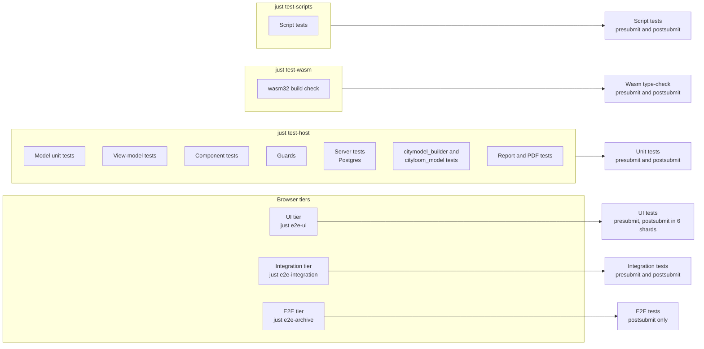

# Testing

This page is the one place that says how CityLoom is tested: the levels of tests, where a new test goes, the test data,
when the tests run and what must pass before a pull request is merged. How the code is organised (slices, MVVM, ports)
is in [Architecture](architecture/index.md); how to set up and run the commands is in
[Getting started](getting-started.md). The paths of the editor's files are relative to `crates/cityloom_editor/src/`.

## The levels at a glance

The diagram shows the recipe that runs each level, and the CI job that runs it.

`just test` runs `just test-host` and then `just test-wasm`. `just e2e` builds once and runs the three tiers. `just check`
runs both.

| Level                                    | What it proves                                                                  | Where it lives                                                                                   | How to run                              | What it needs                       |
| ---------------------------------------- | ------------------------------------------------------------------------------- | ------------------------------------------------------------------------------------------------ | --------------------------------------- | ----------------------------------- |
| Model unit tests                         | The editing rules and pure computation                                          | `#[cfg(test)] mod tests` beside the code                                                         | `just test-host`, `cargo test <module>` | Nothing                             |
| View-model tests                         | What a view-model shows and what its commands do                                | The `vm` modules' tests, e.g. `street/vm/mod.rs`                                                 | `just test-host`                        | The port fakes                      |
| Component tests                          | What a view renders                                                             | Each slice's `tests.rs`                                                                          | `just test-host`                        | Nothing                             |
| wasm32 build check                       | The code only the browser build compiles still compiles                         | The workspace without `cityloom_server` and `citymodel_builder`                                  | `just test-wasm`                        | The `wasm32-unknown-unknown` target |
| Server tests                             | The server's routes, its database and its sealing                               | `crates/cityloom_server/tests/`                                                                  | `just test-host`                        | `DATABASE_URL`                      |
| `citymodel_builder` and `cityloom_model` | The importer, the tiles, the archive and the pipeline's commands                | `crates/citymodel_builder/tests/`, `crates/cityloom_model/src/`                                  | `just test-host`                        | Nothing                             |
| Report and PDF tests                     | The design review and the PDF written from it                                   | `crates/cityloom_report/src/lib.rs`, `crates/cityloom_report_pdf/tests/pdf.rs`                   | `just test-host`                        | Nothing                             |
| Script tests                             | CI's change selector, the factory's gates and guard, the issue system           | `scripts/include/tests/`                                                                         | `just test-scripts`                     | Python 3                            |
| Browser tests, UI tier                   | One page in a real browser, the network stubbed                                 | `e2e/tests/`, `e2e/tiers.json` (`ui`)                                                            | `just e2e-ui`                           | The built wasm and server, Chromium |
| Browser tests, integration tier          | The pages against the real server and a database                                | `e2e/tests/`, `e2e/tiers.json` (`integration`)                                                   | `just e2e-integration`                  | The same, and `DATABASE_URL`        |
| Browser tests, E2E tier                  | The path from the packed archive to the page, and the real server's delivery    | `e2e/tests/`, `e2e/tiers.json` (`e2e`, `archive_also`)                                           | `just e2e-archive`                      | The same, and the packed archive    |
| Guards                                   | Rules about the code itself: wording, layout, colours, the Atlas table, sealing | `i18n_guard.rs`, `layout_guard.rs`, `atlas_contract.rs`, `shared/contrast.rs`, `no_plaintext.rs` | `just test-host`                        | `DATABASE_URL` for `no_plaintext`   |

## The levels

### Model unit tests

Each model file keeps its tests beside the code, in a `#[cfg(test)] mod tests`: for example the files of
`street/model/`, and `crates/cityloom_model/src/cut.rs`, `graph.rs`, `osm.rs`, `importer.rs` and `corridor.rs`. A
model holds no Leptos and no wording. An edit returns `bool`, and a refusal carries a reason, so a test calls the rule
and reads what it returns. `cargo test shell::vm` runs one module; a full test name also works.

### View-model tests

A view-model reaches the browser only through the ports, so its tests run natively against fakes of them, in
`shared/ports.rs`:

- `test_ports()` gives a set of ports with a `RecordingAnnouncer` (what a screen reader was told) and a
  `MemoryStorage`, which the test can read.
- `test_ports_with_time()` adds a `ManualScheduler`: delayed work runs only when the test calls `advance(ms)`.
- Other helpers in the same file add the rest, such as `test_ports_with_fetcher()`, whose `FakeFetcher` keeps each
  request until the test answers it.

The view-models' tests are the `mod tests` of `street/vm/mod.rs`, `junction/vm/mod.rs` and `map/vm/mod.rs`, among
others. The sync is tested the same way against a server in memory: `ServerSim`, `Device` and `device()` in
`sync/tests.rs`.

### Component tests

A component test renders a view to HTML on the host, with `shared::testing::html` (`shared/testing.rs`), and reads the
markup. They are in each slice's `tests.rs`: `account`, `archive`, `junction/view`, `map/view`, `project`, `share`,
`shell`, `standards`, `street/view`, `sync` and `timeline`.

### The wasm32 build check

`just test-wasm` runs
`cargo build --target wasm32-unknown-unknown --workspace --exclude cityloom_server --exclude citymodel_builder`. It
runs no test: it type-checks the code under `cfg(target_arch = "wasm32")`, which `cargo test` on the host does not
compile.

### Server tests

The server's tests are `crates/cityloom_server/tests/`: `api`, `areas`, `auth_flow`, `data_mount`, `db`,
`no_plaintext`, `providers`, `rotate`, `share_api`, `share_db`, `static_files`, `unavailable`, `work_api` and
`work_db`, with their helpers in `tests/support/mod.rs`.

- A test that needs the database is a `#[sqlx::test]`. It gets a fresh database on the Postgres that `DATABASE_URL`
  names. `areas`, `data_mount`, `providers`, `static_files` and `unavailable` have none.
- `TestApp` (in `tests/support/mod.rs`) is the server's router over a `PgRepo` with fixed test keys and a fixed clock.
  Its `Browser` keeps cookies in front of the router, and `sign_in` signs it in through the fake provider.
- `api`, `auth_flow`, `providers`, `rotate`, `share_api` and `work_api` need the server's `test-provider` feature.
  `just test-host` turns it on whenever the server is tested.

`just test-host` refuses to run without `DATABASE_URL`, whichever crates it tests.

### `citymodel_builder` and `cityloom_model` tests

`crates/citymodel_builder/tests/` holds the pipeline's tests (`archive`, `commands`, `ctrl_c`, `download`, `prepare`,
`progress` and `tiles`) and the importer's, which are one test crate, `tests/importer/`: `import.rs`, `real_city.rs`,
`clip_agrees.rs` and `projection.rs`, with small OpenStreetMap extracts such as `boulevard.osm` and `split_block.osm`.
`cityloom_model`'s tests are inline (see [Model unit tests](#model-unit-tests)). `cityloom_model::IMPORTER_VERSION` is
raised whenever the importer's output changes for the same data.

### Report and PDF tests

- `cityloom_report` has its tests inline, in `crates/cityloom_report/src/lib.rs`.
- `crates/cityloom_report_pdf/tests/pdf.rs` writes PDFs with `write_pdf` and reads them back with lopdf.
- The editor's tests write the report through the PDF writer: `cityloom_report_pdf` is one of the editor's
  dev-dependencies, so it stays out of the editor's own build. `scripts/build.sh` fails if the editor's JavaScript
  exports `report_pdf`.
- In the browser, `e2e/tests/report.spec.ts` reads the PDF a page makes with `pdfjs-dist`.

### Script tests

`just test-scripts` runs `python3 -m unittest discover -s scripts/include/tests`, with the standard library only. The
tests are `test_ci_changes.py` (CI's change selector, and that every spec is in one tier and one group),
`test_factory_config.py`, `test_factory_gate.py` and `test_factory_guard.py` (the software factory) and
`test_issue_system.py` (the labels, the issue forms and the labeler rules agree).

### Browser tests

The browser tests are Playwright specs, `e2e/tests/*.spec.ts`, run against the built `web/pkg` and a server built with
the fake provider. `e2e/tiers.json` gives each spec exactly one tier:

- **UI** (35 specs): one page, the network stubbed, the static server only; no database, no archive. `just e2e-ui`.
- **Integration**: `account-server`, `share` and `sync`, against the real server and a Postgres (`DATABASE_URL`).
  `just e2e-integration`.
- **E2E**: `archive`, `delivery` and `serve`, over a server that unpacks the packed archive, and the real server's
  delivery of the site. `just e2e-archive`.
- **`archive_also`**: `map` and `street` are UI specs that the E2E tier runs again over the unpacked archive.

`e2e/playwright.config.ts` makes one Playwright project per tier, and throws when a spec is in no tier or in two. With
`E2E_ARCHIVE=1` only the E2E project runs, with the `archive_also` specs added. Every project is Desktop Chrome at 1440
by 900. In CI a failed test is retried once, `test.only` fails the run, and two workers run. The server is
`target/e2e/cityloom_server`, the copy `scripts/pin-server.sh` makes, started with `FAKE_PROVIDER=1` and fixed test
keys. Outside CI and archive mode, Playwright reuses a server already on the port. `E2E_PORT` moves the port.

`just e2e` builds the wasm and the server and makes the fixtures' tiles, then runs the three tiers. Given arguments, it
runs those specs whatever their tier: `just e2e tests/street.spec.ts`.

### The guards

The guards are tests about the code itself. They run with the host tests.

- **`i18n_guard.rs`** fails on wording in the files of its `MIGRATED` list (`LEFT_OUT` names the few left out, each
  with its reason), on a message id used that is not in both languages, on a file of a translated slice in neither
  list, and on a dead entry of `ALLOWED_LITERALS` or `NOT_MESSAGE_IDS`.
- **`layout_guard.rs`** keeps the files of `street/`, `junction/` and `map/` in `model/`, `vm/` and `view/`: their
  roots hold only `mod.rs`, `CLAUDE.md` and `i18n/`.
- **`atlas_contract.rs`** holds the Atlas table (`shared::atlas::MEASURES`) as a contract: every measure it lists is
  built, nothing else is, and every measure is named in both languages.
- **`shared/contrast.rs`** measures the colour tokens of the CSS against WCAG 1.4.3 (text) and 1.4.11 (the rest).
- **`no_plaintext.rs`** (in the server's tests) reads every column of `users`, `identities`, `sessions`, `work` and
  `shares` as raw bytes and finds nothing the person signed in with.

The first four are `#[cfg(test)]` modules of the editor.

## Where a new test goes

| What changes                                     | The test                                                             | Where                                                                                        | What else changes                                                                                      |
| ------------------------------------------------ | -------------------------------------------------------------------- | -------------------------------------------------------------------------------------------- | ------------------------------------------------------------------------------------------------------ |
| An editing rule                                  | A model unit test: the rule's result, and its reason when it refuses | The model file's `mod tests`                                                                 |                                                                                                        |
| A view-model command, or what a view-model shows | A view-model test against `test_ports()` or `test_ports_with_time()` | The view-model's `mod tests`                                                                 |                                                                                                        |
| A key or pointer state machine                   | A unit test of the machine, which is pure                            | Beside it, e.g. `street/vm/plan.rs` (`PlanGesture`, `is_boundary_drag`), `street/vm/keys.rs` | A drag in the page also needs a browser spec                                                           |
| A drag in a page                                 | A browser spec that drives the mouse                                 | e.g. `e2e/tests/curb.spec.ts`, `stops.spec.ts`, `street.spec.ts`                             |                                                                                                        |
| A view's markup                                  | A component test                                                     | The slice's `tests.rs`                                                                       |                                                                                                        |
| A server endpoint                                | A server test, `#[sqlx::test]` with `TestApp`                        | `crates/cityloom_server/tests/*_api.rs`                                                      | A new file the pages load: `tests/static_files.rs` checks every reference                              |
| An importer case                                 | An importer test with a small `.osm` extract                         | `crates/citymodel_builder/tests/importer/`                                                   | Raise `IMPORTER_VERSION` when the output changes; an OSM XML file needs a `<bounds>` element           |
| A string                                         | The slice's parity test, and `i18n_guard`                            | Both `.ftl` files of the slice                                                               | A literal that is not wording goes in `ALLOWED_LITERALS` or `NOT_MESSAGE_IDS`, with its reason         |
| A new page or a new spec                         | A browser spec                                                       | `e2e/tests/<name>.spec.ts`                                                                   | One tier in `e2e/tiers.json`, one group in `scripts/ci/spec-map.json`; a new source folder gets a rule |
| A new colour pair for text or a control          | A contrast test                                                      | `shared/contrast.rs`                                                                         |                                                                                                        |

Only the browser tests reach these, so a change to them needs a spec:

- Pointer drags in a real page. Real pointer events are bound only in the views (`on:pointerdown` in
  `street/view/curb_strip.rs` and `street/view/calming_strip.rs`), and only Playwright drives them
  (`mouse.down` or `dragTo` in `a11y`, `curb`, `restrictions`, `stops` and `street`). The junction has nothing to drag.
- MapLibre's WebGL drawing: the map is drawn with MapLibre, not SVG (`e2e/tests/webgl.spec.ts`).
- The browser side of the ports: the `cfg(target_arch = "wasm32")` code of `shared/platform.rs`. `browser_ports()`
  builds natively, but its browser code is only type-checked by `just test-wasm`.
- The start-up glue in `web/*.js`.

## Test data

### OpenStreetMap fixtures and tiles

The browser tests' road data are `e2e/fixtures/plateau.osm.pbf`, `turbo.osm.pbf`, `open-ends.osm.pbf` and
`open-ends.osm`. `just e2e-fixtures` imports each into one network tile, `e2e/fixtures/generated/<name>.json`
(`citymodel_builder fixture`; ignored by git). It is a private recipe, so `just` does not list it; every browser recipe
runs it first. In CI, the `build` job runs it once and hands the tiles on in the `browser-build` artifact, with the
wasm, `web/vendor` and the pinned server.

### `fixtures.ts`

`e2e/tests/fixtures.ts` is what every spec imports.

- `PLATEAU_TILE`, `TURBO_TILE` and `OPEN_ENDS_TILE` are the generated tiles, and `tileFrom(file)` answers a request
  for a tile with one.
- Every test fails on a page error or a console error. Errors from `/api/me`, `/api/providers` and `/api/work` are let
  through, and from `/api/me/*` when the test carries the `failing-account-api` annotation.
- Each test gets a fresh browser context, so storage starts empty.
- An automatic fixture serves the Plateau tile as the default metro tile, except with `E2E_ARCHIVE`, where the server
  answers from the archive.
- Storage starts with `cityloom-lang=en` and the first project.

### The fake sign-in provider

The server's `test-provider` feature (`crates/cityloom_server/Cargo.toml`) adds `src/fake_provider.rs`, an OpenID
provider served by the server itself. Tests choose who signs in with the `fake-login` cookie. The browser tests start
the server with `FAKE_PROVIDER=1`, and `account-server.spec.ts` uses a unique `sub` per test.

### The throwaway Postgres

`just db` starts a container named `cityloom-db` (`postgres:18`) on 127.0.0.1:55432 and prints the
`export DATABASE_URL=…` line to run; `just db-stop` removes it. Each `#[sqlx::test]` makes its own database on it. In
CI, the unit-test and integration jobs run a `postgres:18` service.

### The e2e archive

`scripts/e2e-archive.sh` copies `e2e/fixtures/generated/plateau.json` as the one metro tile, `0_0`, packs it with
`citymodel_builder pack` into `target/e2e-archive/areas/plateau.citymodel`, and runs
`E2E_ARCHIVE=1 npx playwright test --project=e2e`. The server unpacks the archive through `CITYLOOM_AREAS` and
`DATA_ROOT`, both in `target/e2e-archive`.

## Quality attributes

### Accessibility

The target is WCAG 2.2 AA.

- `e2e/tests/a11y.spec.ts` runs axe (`@axe-core/playwright`) with the tags `wcag2a`, `wcag2aa`, `wcag21a`, `wcag21aa`
  and `wcag22aa`. `compare.spec.ts` runs axe too.
- `e2e/tests/junction-a11y.spec.ts` measures the junction's targets at 1440, 1050, 600 and 280 px wide.
- `shared/contrast.rs` measures the colour tokens of the CSS (see [The guards](#the-guards)).

### Translation

- Each slice's parity test checks that its two `.ftl` files have the same messages with the same variables
  (`shared::i18n::parity_problems`): `account`, `archive`, `city`, `junction`, `map`, `place`, `project`,
  `restriction`, `share`, `shell`, `street` and `sync`.
- `i18n_guard` finds wording left in the code (see [The guards](#the-guards)).
- `shared::i18n::typography` applies the OQLF's spacing to fr-CA, and is tested beside it.
- `e2e/tests/language.spec.ts` switches a page to fr-CA from the account menu.

### Security

- `PgRepo` seals what it writes and opens what it reads. A shared design's body is sealed under `Token::body_key`.
  `no_plaintext.rs` checks the rows hold nothing in the clear.
- `just check-no-fake` builds the release server and runs `scripts/check-no-fake.sh`, which fails on the fake
  provider's markers, `fake-login` and `fake-apple`.
- CI's `Release server has no fake provider` job also builds the server with `test-provider` and expects that script to
  fail on it: a positive control, so the markers cannot drift unseen.

## When tests run

### Presubmit

`.github/workflows/presubmit.yml` runs on every pull request, with `RUSTFLAGS=-D warnings`, so a new compiler warning
fails it. A change to documentation alone (`website/**`, `docs/**`, `**/*.md`, `LICENSE*`) does not start it.

Its `changes` job runs `scripts/ci/ci_changes.py`, which decides what runs from the files the pull request changes:

- The Rust tests of the crates it touches and of the crates that depend on them. A change to something every crate
  reads, such as `web/`, `Cargo.lock`, the `justfile` or a workflow, runs every crate. The wasm check and the
  release-server check follow the same crates.
  A version bump alone (the version line of `crates/cityloom_editor/Cargo.toml` and its entry in `Cargo.lock`) is not a
  change to those files.
- Only the browser specs its files can affect: the first rule of `scripts/ci/spec-map.json` that matches a file
  decides, by group. A file no rule matches runs every spec.
  A page's own files in `web/` run that page's group and `@cross`, the cross-page specs. What every page loads
  (`app.css`, `boot.js`, `city.js`), the server and `crates/citymodel_builder/**`, which makes the fixtures' tiles, run
  every spec.
- Each chosen spec runs in its tier, and a tier with no chosen spec does not run. There is no E2E job.

The jobs are Format, Script tests, Unit tests, Wasm type-check, Release server has no fake provider, Build for the
browser tests, UI tests, Integration tests and Version bump, and `CI`, which gathers them.

### Postsubmit

`.github/workflows/postsubmit.yml` runs on every push to `main` (with the same `paths-ignore`) and by hand. It has no
`changes` job: it runs every job and every spec, with the UI tier in six Playwright shards, and the E2E tier through
`scripts/e2e-archive.sh`. It also sets `RUSTFLAGS=-D warnings`, and its runs are never cancelled. Its `All checks` job
fails when a job failed or was cancelled, and `Deploy to Railway` waits for it. The deploy runs on a push to `main`
only; a run by hand never deploys.

### Documentation

`.github/workflows/docs.yml` runs when a change touches `website/**` or the workflow. It checks `website/` with
Prettier (from `e2e/`), then builds the site in both languages; a broken link or anchor fails the build. It publishes
the site to GitHub Pages from `main`. A change to `docs/**` or to a `*.md` outside `website/` starts no workflow.

### SonarCloud

`.github/workflows/sonar.yml` runs on pull requests and on `main`, with the same `paths-ignore`. It runs
`just sonar-reports`: coverage from the host tests (without `cityloom_server`) and Clippy's findings with
`--cap-lints warn`. It has no `-D warnings`.

## What must pass before a merge

- **`CI`**, presubmit's last job. It fails when any job failed or was cancelled, and passes the ones `changes` skipped.
- **SonarCloud.** It is not part of `CI` and never blocks a merge. The merge agent (`.claude/agents/merge.md`) still
  requires no open issue and no hotspot on the pull request, and the quality gate `OK`. The gate's other conditions are
  coverage of new code of at least 80 % and duplication of at most 3 %.
- **The version.** `scripts/check-version.sh` requires the version in `crates/cityloom_editor/Cargo.toml` to be above
  the base's. A change made only of documentation and CI configuration (`CI_CONFIGURATION` in `ci_changes.py`:
  `.github/**`, `scripts/ci/**`, `scripts/include/**`, `.claude/**`) needs none, and the job is skipped.
- **The Documentation check**, for a change to `website/`. `CI` does not cover it.
- **The merge itself.** The deploy agent (`.claude/agents/deploy.md`) merges only when every check passed or was
  skipped and GitHub says `CLEAN`. In the software factory, a person approves the pull request's head first.
- **The factory's gates** (`.claude/factory/gate.py`, described in `.claude/factory/README.md`), for an issue the
  factory builds:
  - `red`: the new tests compile, every new test fails, and every old test passes;
  - `green`: every test passes with `-D warnings`, formatting and the version hold, and no test file, `#[cfg(test)]`
    block, check or factory file changed since the red commit;
  - `docs`: only documentation changed, every page has its page in the other language, and the site passes Prettier
    and builds.

## Policies

- **Test first.** Write the failing test, then the code. In the software factory only the test-writer writes tests:
  `guard.py` refuses the implementer's change to one, and a test it believes wrong is a question for a person.
- **Never weaken a test to make it pass.** No `#[ignore]`, `test.skip` or `test.fixme`, no looser assertion, no
  longer timeout, no added retry (`.claude/agents/merge.md`).
- **A flaky test is a bug.** It gets an issue and is fixed, not run again until it passes. For example, CLM-22: a test
  of `junction::model::calls` gave a run over a hostile document one second, and failed a deploy run on a busy
  machine. The limit was measured, not just loosened: 0.16 s alone, 1.16 s beside the whole suite, 16.4 s with the
  quadratic read it guards against. It became `AT_ONCE`, 10 s, which still catches that read.

## Known gaps and risks

What the tests and CI do not cover today:

- A drag in a page is tested only by the browser tests; the unit tests reach only the pure state machines behind it.
- The E2E tier runs only in postsubmit, after the merge.
- The documentation build is not part of the `CI` check.
- Only Chromium is tested: every Playwright project is Desktop Chrome, and `just setup` installs only Chromium.
- In CI a failed browser test is retried once, so a flaky test can pass.
- SonarCloud measures coverage from the host tests only: not the wasm-only code, not the browser tests, and not
  `cityloom_server`, `cityloom_report` or `cityloom_report_pdf`, which `sonar-project.properties` leaves out. It does
  not block a merge.
- No status check is required on `main`; the workflows say so.
- The E2E tier's archive is one Plateau tile. No test runs on the real Montréal data, which only the deploy job makes.
- Real sign-in providers are never exercised end to end: the specs use the fake provider, and the
  [manual checks](getting-started.md#manual-checks-once-per-provider) are done by hand.
- Clippy is never denied in CI: only SonarCloud runs it, with `--cap-lints warn`.
- A pull request from a fork gets no SonarCloud analysis.
- The `timeline` and `standards` slices have messages but no parity test of their `.ftl` files.

The coverage matrix (CLM-45) will extend this section.
