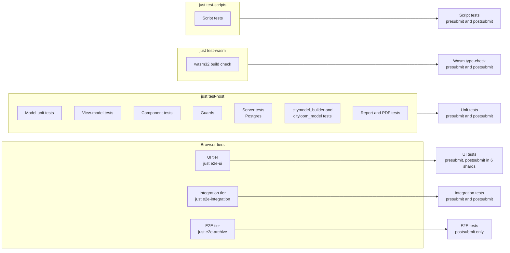

# Testing

These pages are the one place that says how CityLoom is tested: the [levels of tests](levels.md),
[where a new test goes](#where-a-new-test-goes), the [test data](test-data.md), the
[quality attributes](quality-attributes.md), [when the tests run](when-tests-run.md) and
[what must pass before a pull request is merged](when-tests-run.md#what-must-pass-before-a-merge). How the code is
organised (slices, MVVM, ports) is in [Architecture](../architecture/index.md); how to set up and run the commands is in
[Getting started](../getting-started.md). How many tests there are, by level, by crate and tier, and by feature, is in
the [Test inventory](test-inventory.md), and how the tests of each feature spread over the levels is in the
[Coverage matrix](coverage-matrix.md). On this page, in [Levels of tests](levels.md) and in
[Quality attributes](quality-attributes.md), the paths of the editor's files are relative to
`crates/cityloom_editor/src/`.

## The levels at a glance

The diagram shows the recipe that runs each level, and the CI job that runs it.

`just test` runs `just test-host` and then `just test-wasm`. `just e2e` builds once and runs the three tiers. `just check`
runs both. `just test-host` always needs `DATABASE_URL`, whichever crates it tests; `cargo test -p <crate>` runs one
crate's tests without it, for every crate but `cityloom_server`, whose database tests need it.

| Level                                    | What it proves                                                                                                                           | Where it lives                                                                                                                         | How to run                                             | What it needs                       |
| ---------------------------------------- | ---------------------------------------------------------------------------------------------------------------------------------------- | -------------------------------------------------------------------------------------------------------------------------------------- | ------------------------------------------------------ | ----------------------------------- |
| Model unit tests                         | The editing rules and pure computation                                                                                                   | `#[cfg(test)] mod tests` beside the code                                                                                               | `cargo test -p <crate> <module>`                       | Nothing                             |
| View-model tests                         | What a view-model shows and what its commands do                                                                                         | The `vm` modules' tests, e.g. `street/vm/mod.rs`                                                                                       | `cargo test -p cityloom_editor`                        | The port fakes                      |
| Component tests                          | What a view renders                                                                                                                      | Each slice's `tests.rs`, and beside the controls in `crates/cityloom_ui/src/`                                                          | `cargo test -p cityloom_editor -p cityloom_ui`         | Nothing                             |
| wasm32 build check                       | The code only the browser build compiles still compiles                                                                                  | The workspace without `cityloom_server` and `citymodel_builder`                                                                        | `just test-wasm`                                       | The `wasm32-unknown-unknown` target |
| Server tests                             | The server's routes, its database and its sealing                                                                                        | `crates/cityloom_server/tests/`                                                                                                        | `just test-host`                                       | `DATABASE_URL`                      |
| `citymodel_builder` and `cityloom_model` | The importer, the tiles, the archive and the pipeline's commands                                                                         | `crates/citymodel_builder/tests/`, `crates/cityloom_model/src/`                                                                        | `cargo test -p citymodel_builder -p cityloom_model`    | Nothing                             |
| Report and PDF tests                     | The design review and the PDF written from it                                                                                            | `crates/cityloom_report/src/lib.rs`, `crates/cityloom_report_pdf/tests/pdf.rs`                                                         | `cargo test -p cityloom_report -p cityloom_report_pdf` | Nothing                             |
| Script tests                             | CI's change selector, the factory's gates and guard, the issue system, the Architecture pages, the feature list                          | `scripts/include/tests/`                                                                                                               | `just test-scripts`                                    | Python 3                            |
| Browser tests, UI tier                   | One page in a real browser, the network stubbed                                                                                          | `e2e/tests/`, `e2e/tiers.json` (`ui`)                                                                                                  | `just e2e-ui`                                          | The built wasm and server, Chromium |
| Browser tests, integration tier          | The pages against the real server and a database                                                                                         | `e2e/tests/`, `e2e/tiers.json` (`integration`)                                                                                         | `just e2e-integration`                                 | The same, and `DATABASE_URL`        |
| Browser tests, E2E tier                  | The path from the packed archive to the page, and the real server's delivery                                                             | `e2e/tests/`, `e2e/tiers.json` (`e2e`, `archive_also`)                                                                                 | `just e2e-archive`                                     | The same, and the packed archive    |
| Guards                                   | Rules about the code itself: wording, layout, dependencies between slices and layers, shared controls, colours, the Atlas table, sealing | `i18n_guard.rs`, `layout_guard.rs`, `dependency_guard.rs`, `ui_guard.rs`, `atlas_contract.rs`, `shared/contrast.rs`, `no_plaintext.rs` | `just test-host`                                       | `DATABASE_URL` for `no_plaintext`   |

## Where a new test goes

| What changes                                     | The test                                                             | Where                                                                                             | What else changes                                                                                      |
| ------------------------------------------------ | -------------------------------------------------------------------- | ------------------------------------------------------------------------------------------------- | ------------------------------------------------------------------------------------------------------ |
| An editing rule                                  | A model unit test: the rule's result, and its reason when it refuses | The model file's `mod tests`                                                                      |                                                                                                        |
| A view-model command, or what a view-model shows | A view-model test against `test_ports()` or `test_ports_with_time()` | The view-model's `mod tests`                                                                      |                                                                                                        |
| A key or pointer state machine                   | A unit test of the machine, which is pure                            | Beside it, e.g. `street/vm/plan.rs` (`PlanGesture`, `is_boundary_drag`), `street/vm/keys.rs`      | A drag in the page also needs a browser spec                                                           |
| A drag in a page                                 | A browser spec that drives the mouse                                 | e.g. `e2e/tests/curb.spec.ts`, `stops.spec.ts`, `street.spec.ts`                                  |                                                                                                        |
| A view's markup                                  | A component test                                                     | The slice's `tests.rs`; for a shared control, its file's `mod tests` in `crates/cityloom_ui/src/` |                                                                                                        |
| A server endpoint                                | A server test, `#[sqlx::test]` with `TestApp`                        | `crates/cityloom_server/tests/*_api.rs`                                                           | A new file the pages load: `tests/static_files.rs` checks every reference                              |
| An importer case                                 | An importer test with a small `.osm` extract                         | `crates/citymodel_builder/tests/importer/`                                                        | Raise `IMPORTER_VERSION` when the output changes; an OSM XML file needs a `<bounds>` element           |
| A string                                         | The slice's parity test, and `i18n_guard`                            | Both `.ftl` files of the slice                                                                    | A literal that is not wording goes in `ALLOWED_LITERALS` or `NOT_MESSAGE_IDS`, with its reason         |
| A new page or a new spec                         | A browser spec                                                       | `e2e/tests/<name>.spec.ts`                                                                        | One tier in `e2e/tiers.json`, one group in `scripts/ci/spec-map.json`; a new source folder gets a rule |
| A new colour pair for text or a control          | A contrast test                                                      | `shared/contrast.rs`                                                                              |                                                                                                        |

Only the browser tests reach these, so a change to them needs a spec:

- Pointer drags in a real page. Pointer events are bound only in the views, and the map's mouse events in
  `web/mapcanvas.js`; only Playwright drives them, with `mouse.down`: the street's plan (`on:pointerdown` in
  `street/view/plan/component.rs`) in `a11y`, `curb`, `stops` and `street`, and an area's corners on the map (the
  `mousedown` handler of `web/mapcanvas.js`) in `restrictions`. The junction has nothing to drag.
- MapLibre's WebGL drawing: the map is drawn with MapLibre, not SVG (`e2e/tests/webgl.spec.ts`).
- The browser side of the ports: the `cfg(target_arch = "wasm32")` code of `shared/platform.rs`. `browser_ports()`
  builds natively, but its browser code is only type-checked by `just test-wasm`.
- The start-up glue in `web/*.js`.

## Policies

- **Test first.** Write the failing test, then the code. In the software factory only the test-writer writes tests:
  `guard.py` refuses the implementer's change to one, and a test it believes wrong is a question for a person.
- **Never weaken a test to make it pass.** No `#[ignore]`, `test.skip` or `test.fixme`, no looser assertion, no
  longer timeout, no added retry (`.claude/agents/merge.md`).
- **A flaky test is a bug.** It gets an issue and is fixed, not run again until it passes. For example, CLM-22: a test
  of `junction::model::calls` gave a run over a hostile document one second, and failed a deploy run on a busy
  machine. The limit was measured, not just loosened: 0.16 s alone, 1.16 s beside the whole suite, 16.4 s with the
  quadratic read it guards against. It became `AT_ONCE`, 10 s, which still catches that read.

## Known gaps and risks

This part lists the gaps in the tests, and the other limits of the tests and CI today. The
[coverage matrix](coverage-matrix.md) counts the tests of each feature at each level.

### Gaps: what the guide asks for and no test does yet

Each gap is under the row of [Where a new test goes](#where-a-new-test-goes) that it breaks, or under the list there
of what only the browser tests reach. A line says what no test of the named level covers, that level, and the number
of the gap's issue.

- **An editing rule**
  - Street (`street/model/mod.rs`, `street/model/replay.rs`): a region that changes the side of the road mirrors the
    directions of a piece's time-of-day types, and lays out again the own sections of an untouched street's stretches.
    An edit made again on other stretches carries the material, the tram tracks and the times of day, and places a
    piece whose neighbours the stretch lacks at the start, before the nearest piece on its right, or at the nearer
    end. Level: model. CLM-78.
  - Junction (`junction/model/mod.rs`, `junction/model/plans.rs`): the refusals of a phase for a pedestrian street, of
    a bus lane between streets that are not there, and of a time-of-day period added or given a plan off a signal,
    given a plan the junction lacks, or removed or moved where there is none. Giving up a roundabout that can no
    longer be drawn. What the history says when a change of control loses the timing with the bike boxes, the
    protected corners or both. Level: model. CLM-81.
  - Map (`map/model/corridor.rs`): a change made on several streets, and its undo, when the browser cannot keep one of
    them. Level: model. CLM-84.
- **A view-model command, or what a view-model shows**
  - Street (`street/vm/mod.rs`, `street/vm/level.rs`, `street/vm/compare.rs`, `city/binding.rs`): the message for a
    typed length that is not a number, the drag of a raised element or of a planting begun with none chosen, the
    path's step for a named stop, the comparison's lines for a piece added, removed or of another kind and for what
    else differs, and a scenario the browser cannot keep. Level: view-model. CLM-79.
  - Junction (`junction/vm/text.rs`, `junction/vm/compare.rs`): what a screen reader is told of a stop in the bus lane
    and of one on no entering lane, and the comparison's lines for a changed turbo layout, raised table or corner.
    Level: view-model. CLM-82.
  - Map (`map/vm/mod.rs`, `map/vm/report.rs`): Shift+Enter in the search, an undo that the browser could keep only in
    part, and the report's lines for a changed class, for pieces added or removed, for other changes, and for the
    failing checks of a junction that cannot be drawn. Level: view-model. CLM-85.
  - Standards (`standards/vm.rs`): opening and closing a profile's form, closing the exported text, and the warning of
    a width range looser than the built-in one. Level: view-model. CLM-87.
  - Timeline (`timeline/vm.rs`, `timeline/text.rs`): asking who is signed in for a milestone's author, a comparison
    with work that cannot be read, the restore of a milestone gone meanwhile, and the words for an empty milestone,
    for a junction, for a rule, for a street with no name, and for every aspect but the width. Level: view-model.
    CLM-91.
  - Archive (`archive/vm.rs`): what the panel says when this device's own work is damaged or newer, or when the
    browser cannot keep the import. Level: view-model. CLM-93.
  - Sync (`sync/vm.rs`): a run told that the session has ended, and a sync document written by a newer CityLoom.
    Level: view-model. CLM-94.
  - Projects (`project/vm.rs`): what the home page says when a project cannot be deleted. Level: view-model. CLM-95.
- **A key or pointer state machine**
  - Street (`street/vm/plan.rs`): the plan's drag of a stop, of a raised element and of a tree or planting, the cancel
    of a thing's drag, and the drag of a boundary that is refused. Level: view-model. CLM-77.
- **A drag in a page**
  - Street (`street/view/curb_strip.rs`, `calming_strip.rs` and `green_strip.rs`): the drag of anything along a strip
    and, on the plan, the drag of a raised element, of a tree or planting and of an end of the picked stretch. Level:
    UI tier. CLM-76.
- **A view's markup**
  - Street (`street/view/add_menu.rs`): the search results of the Add a piece menu. Level: component. CLM-80.
  - Junction (`junction/view/inspector.rs`): the signal and the lanes of a street that nothing enters from, and the
    cell of an approach with no wait. Level: component. CLM-83.
  - Map (`map/view/details.rs`): the list of the checks a place fails. Level: component. CLM-86.
  - Standards (`standards/view.rs`): the question before a profile is removed, the widths set, the warnings, and the
    exported text with its download link. Level: component. CLM-88.
  - Timeline (`timeline/view.rs`): the question before a milestone is deleted. Level: component. CLM-92.
- **An importer case**
  - `citymodel_builder` (`crates/citymodel_builder/src/importer/merge.rs`): two carriageways of different road types
    stay two streets, and a road turned round keeps a two-way lane two-way. Level: `citymodel_builder` and
    `cityloom_model`. CLM-96.
- **A string**
  - Standards: the parity test of `standards/i18n/en.ftl` and `fr.ftl`. Level: component. CLM-89.
  - Timeline: the parity test of `timeline/i18n/en.ftl` and `fr.ftl`. Level: component. CLM-90.
- **A new colour pair for text or a control**
  - The editors' danger buttons (`--danger` in `web/editor.css`), and the focus ring of the map's attribution links
    (`--attrib-ring` in `web/app.css`). Level: guard. CLM-97.
- **Only the browser tests reach these**: the browser side of the ports
  - Share page (`copy_text` in `shared/platform.rs`): the clipboard, which its Copy link button uses. Level:
    integration tier. CLM-98.

### Other limits and risks

- The E2E tier runs only in postsubmit, after the merge.
- The documentation build is not part of the `CI` check.
- Only Chromium is tested: every Playwright project is Desktop Chrome, and `just setup` installs only Chromium.
- In CI a failed browser test is retried once, so a flaky test can pass.
- SonarCloud measures coverage from the host tests only: not the wasm-only code, not the browser tests, and not
  `cityloom_server`, `cityloom_report` or `cityloom_report_pdf`, which `sonar-project.properties` leaves out. Its
  figures are in [Line coverage](coverage-matrix.md#line-coverage). It does not block a merge.
- No status check is required on `main`; the workflows say so.
- The E2E tier's archive is one Plateau tile. No test runs on the real Montréal data, which only the deploy job makes.
- Real sign-in providers are never exercised end to end: the specs use the fake provider, and the
  [manual checks](../getting-started.md#manual-checks-once-per-provider) are done by hand.
- Clippy is never denied in CI: only SonarCloud runs it, with `--cap-lints warn`.
- A pull request from a fork gets no SonarCloud analysis.
