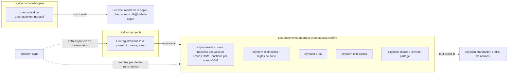

# Modèle de données : les projets et ce que garde le navigateur

Cette page dit de quoi un projet est fait dans le navigateur, et ce que contient chaque clé du stockage du navigateur.
Les chemins des fichiers de l’éditeur sont relatifs à `crates/cityloom_editor/src/`. L’éditeur n’atteint le stockage du
navigateur que par le port `Storage` (`shared/ports.rs`), dont le côté navigateur est le `localStorage` de la page
(`shared/platform.rs`).

## Un projet et ce qui lui appartient

Un projet est un conteneur nommé du travail de la personne, lié à un lieu. Son enregistrement se trouve dans la liste
des projets, `cityloom-projects`. Son travail se trouve dans des documents qui lui sont propres. Les autres clés sont
celles de la personne et sont communes à tous les projets.

Les clés propres à un projet sont celles de `SCOPED_KEYS` (`shared/scoped.rs`) : `cityloom-edits`,
`cityloom-restrictions`, `cityloom-area`, `cityloom-milestones`, `cityloom-shares`, et les copies endommagées des
documents des modifications, des règles et des jalons. `ScopedStorage` garde chacune sous la forme `<key>@<id>`, où
`<id>` est l’identifiant du projet. Toute autre clé est celle de la personne et est commune à tous les projets.
L’identifiant du premier projet est `first`, et il est traité comme tout autre : ses modifications sont
`cityloom-edits@first`. Les autres projets ont pour identifiant `p-` et 12 chiffres hexadécimaux, ou `p<n>` là où le
stockage n’a pas de hasard. `ProjectStore` (`project/store.rs`) prend le stockage racine, jamais celui d’un projet : la
liste n’appartient à aucun projet. `project::store::records` lit les rues, les jonctions, les règles, les jalons et le
lieu d’un projet dans ses documents, et la suppression d’un projet vide chacun de ses documents de `SCOPED_KEYS` et
marque ses enregistrements comme supprimés.

Une copie d’un aménagement partagé est inscrite dans `cityloom-shared-copies` et garde ses documents sous
`<key>@<copy id>`, comme un projet. Son identifiant est `s-` et 12 chiffres hexadécimaux, ou `s<n>`, jamais celui d’un
projet. Elle n’est pas un des projets de la personne : la page d’accueil, la synchronisation et le déplacement du
travail d’avant les projets ne la voient jamais, et rien d’elle n’est marqué ni envoyé.

En route vers le serveur, un enregistrement voyage sous une clé de transmission (`shared/project_id.rs`). Les
enregistrements du premier projet gardent leurs clés nues, et ceux de tout autre projet partent sous la forme
`<project>:<key>`. `split_key` lit une clé sans préfixe de projet comme une clé du premier projet.
`sync::model::mark_all` compose la clé de transmission à partir du projet du stockage qui marque (`Storage::project`).

Une page qui montre un projet en lecture seule (`view=1` dans son adresse, ou une copie d’un aménagement partagé) a un
stockage fait par `ScopedStorage::only_to_read`. Elle n’écrit aucun des documents de `SCOPED_KEYS`, ni aucune clé de
`DESIGN_KEYS` : `cityloom-sync`, `cityloom-projects`, leurs copies endommagées, et `cityloom-shared-copies`. Elle garde
quand même les caches et les préférences de la personne, comme les routes d’un lieu, l’objectif, la langue et le thème.

## Toutes les clés que garde le navigateur

Toutes les clés `cityloom-*` que l’éditeur lit ou écrit. « Propre au projet » veut dire que la clé est gardée sous la
forme `<key>@<id>`. « Synchronisée » nomme le genre d’enregistrement que la synchronisation envoie pour une personne qui
stocke son travail sur le serveur. Une version est le champ `version` du document.

| Clé                            | Contenu                                                                                                                                                                                                                                                                                                                                                                | Propre au projet | Synchronisée                                                                                    | Dans l’archive de conception                                                  | Version du format                                              | Copie endommagée                                                            |
| ------------------------------ | ---------------------------------------------------------------------------------------------------------------------------------------------------------------------------------------------------------------------------------------------------------------------------------------------------------------------------------------------------------------------- | ---------------- | ----------------------------------------------------------------------------------------------- | ----------------------------------------------------------------------------- | -------------------------------------------------------------- | --------------------------------------------------------------------------- |
| `cityloom-projects`            | Les projets de la personne, dans l’ordre de création : `{"version":1,"projects":[…]}`. L’enregistrement d’un projet est `{id, name, area, created_at, placeholder}`, sans `placeholder` quand il est faux (`project/store.rs`, `project/model.rs`).                                                                                                                    | Non              | Oui, genre `project`, indexé par l’identifiant du projet; un projet provisoire n’est pas envoyé | Non                                                                           | 1                                                              | `cityloom-projects-damaged`, copiée par la prochaine modification acceptée  |
| `cityloom-project`             | L’identifiant du projet ouvert en dernier.                                                                                                                                                                                                                                                                                                                             | Non              | Non                                                                                             | Non                                                                           | Aucune                                                         | Aucune                                                                      |
| `cityloom-edits`               | Les modifications de rues et de jonctions : `{version, streets, junctions}`. L’enregistrement d’une rue est indexé `w<way>~<end>~<end>` (sa plus petite voie OSM, puis ses deux extrémités : `n<node>`, ou `x` et un mot de boussole pour une extrémité qui n’est pas un nœud); celui d’une jonction est indexé `n<node>` (son plus petit nœud OSM) (`city/edits.rs`). | Oui              | Oui, genres `street` et `junction`                                                              | Oui, sous `edits`                                                             | Écrite de 5 à 24, selon ce que le contenu exige; lue de 4 à 24 | `cityloom-edits-damaged`, copiée avant la première écriture                 |
| `cityloom-restrictions`        | Les règles de zone : `{version, next_id, restrictions}`, chaque règle sous son identifiant, `r<n>` ou `r-<hex>` (`restriction/store.rs`).                                                                                                                                                                                                                              | Oui              | Oui, genre `rule`                                                                               | Oui, sous `restrictions`                                                      | 1                                                              | `cityloom-restrictions-damaged`, copiée avant la première écriture          |
| `cityloom-area`                | Le lieu choisi, sous forme de requête de lieu. Une page ouvre le lieu que nomme l’enregistrement du projet, et celui-ci seulement là où l’enregistrement n’en nomme aucun (`city/store.rs`).                                                                                                                                                                           | Oui              | Oui, genre `area`, clé `current`                                                                | Non; les champs `area` et `source` de l’archive disent de quel lieu il s’agit | Aucune                                                         | Aucune                                                                      |
| `cityloom-milestones`          | Les jalons du projet : `{"version":1,"milestones":{…}}`, chaque enregistrement un en-tête et son instantané, sous son identifiant, `m-<hex>` ou `m<n>` (`timeline/store.rs`).                                                                                                                                                                                          | Oui              | Oui, genre `milestone`                                                                          | Non : un jalon est de l’histoire, pas du travail                              | 1                                                              | `cityloom-milestones-damaged`, copiée avant la première écriture            |
| `cityloom-shares`              | Les liens de partage faits sur cet appareil pour le projet : `{"version":1,"shares":[…]}`, chacun `{token, created_at, expires_at}` (`share/store.rs`).                                                                                                                                                                                                                | Oui              | Non : le serveur ne garde aucun jeton                                                           | Non                                                                           | 1                                                              | Aucune                                                                      |
| `cityloom-shared-copies`       | Les copies d’aménagements partagés que ce navigateur a ouvertes, la plus ancienne d’abord : `{"version":1,"copies":[…]}`, chacune `{id, token, name, area, opened_at}`. Au plus 10 copies, et 2 Mio de leurs documents en tout (`project/copies.rs`).                                                                                                                  | Non              | Non                                                                                             | Non                                                                           | 1                                                              | Aucune                                                                      |
| `cityloom-sync`                | Les enregistrements qui attendent d’être envoyés, et la révision jusqu’à laquelle on a tiré : `{version, user, epoch, rev, records}`, chaque entrée nommée `<kind>/<wire key>` (`sync/model.rs`).                                                                                                                                                                      | Non              | Non : c’est l’état propre de la synchronisation                                                 | Non                                                                           | 1                                                              | `cityloom-sync-damaged`, copiée avant la première écriture                  |
| `cityloom-standards`           | Les profils de normes et celui qui est actif : `{version, active, next_id, profiles}`, chaque profil `{id, name, standards}` (`standards/store.rs`). Tous les projets lisent les mêmes.                                                                                                                                                                                | Non              | Non                                                                                             | Non                                                                           | 1                                                              | `cityloom-standards-damaged`, copiée par la prochaine modification acceptée |
| `cityloom-network:<area key>`  | Le réseau de rues d’un lieu tel que l’importeur l’a fait, en JSON : un cache, un par lieu (`city/store.rs`).                                                                                                                                                                                                                                                           | Non              | Non                                                                                             | Non                                                                           | Aucune                                                         | Aucune                                                                      |
| `cityloom-checksum:<area key>` | La somme de contrôle de la tuile dont le réseau du lieu a été découpé, avec la version de l’importeur (`+i<N>`). Une tuile ou un importeur qui a changé fait relire le lieu (`city/store.rs`).                                                                                                                                                                         | Non              | Non                                                                                             | Non; une exportation la lit dans `source.tile_checksum`                       | Aucune                                                         | Aucune                                                                      |
| `cityloom-region`              | La région choisie dans le menu des réglages, dont les rues partagent les règles : pour l’instant, le côté où la circulation se tient (`city/store.rs`, `shell/vm.rs`).                                                                                                                                                                                                 | Non              | Non                                                                                             | Non                                                                           | Aucune                                                         | Aucune                                                                      |
| `cityloom-lang`                | La langue, `en` ou `fr-CA` (`shared/i18n.rs`, `shell/vm.rs`).                                                                                                                                                                                                                                                                                                          | Non              | Non                                                                                             | Non                                                                           | Aucune                                                         | Aucune                                                                      |
| `cityloom-theme`               | Le thème, `light` ou `dark` (`shell/vm.rs`).                                                                                                                                                                                                                                                                                                                           | Non              | Non                                                                                             | Non                                                                           | Aucune                                                         | Aucune                                                                      |
| `cityloom-inspector`           | Si le panneau des détails est `open` ou `closed` (`shell/vm.rs`).                                                                                                                                                                                                                                                                                                      | Non              | Non                                                                                             | Non                                                                           | Aucune                                                         | Aucune                                                                      |
| `cityloom-notes`               | Si le panneau des notes est `open` ou `closed` (`shell/vm.rs`).                                                                                                                                                                                                                                                                                                        | Non              | Non                                                                                             | Non                                                                           | Aucune                                                         | Aucune                                                                      |
| `cityloom-notes-tab`           | L’onglet des notes affiché en dernier (`shell/vm.rs`).                                                                                                                                                                                                                                                                                                                 | Non              | Non                                                                                             | Non                                                                           | Aucune                                                         | Aucune                                                                      |
| `cityloom-goal`                | L’objectif de planification choisi sur les pages de la rue et de la jonction, vide s’il n’y en a aucun (`shared/goals.rs`).                                                                                                                                                                                                                                            | Non              | Non                                                                                             | Non                                                                           | Aucune                                                         | Aucune                                                                      |
| `cityloom-welcome`             | `seen` ou `show` : si la page de la rue affiche son accueil (`street/view/page.rs`).                                                                                                                                                                                                                                                                                   | Non              | Non                                                                                             | Non                                                                           | Aucune                                                         | Aucune                                                                      |

La langue est écrite par `ShellVm::set_locale` et lue par `i18n::detect`, par `web/boot.js` et par le script dans
l’en-tête de chaque page de l’application. Ce script lit aussi le thème et, sur les pages qui en ont, les panneaux et
l’accueil de la page de la rue, avant que le module se charge. Les préférences restent sur chaque appareil : la
synchronisation n’a aucun genre pour elles.

Quelques noms ressemblent à des clés et n’en sont pas :

- `cityloom-design` est le `kind` d’une archive de conception (`archive/model.rs`).
- `cityloom-share` est le `kind` du format de partage (`share/model.rs`).
- `cityloom-standards` est aussi le `schema` d’un profil de normes exporté (`standards/store.rs`).
- `cityloom-junction-view` était écrite par des versions antérieures; cette version l’ignore.
- Les clés `cityloom-test-*` ne servent qu’aux tests.

## Documents endommagés

Six documents ont une copie endommagée : `cityloom-edits`, `cityloom-restrictions`, `cityloom-milestones`,
`cityloom-projects`, `cityloom-sync` et `cityloom-standards`, chacune sous sa clé suivie de `-damaged`. Un document est
endommagé quand il ne peut pas être lu comme un document de sa version. Un document d’une version plus récente n’est
pas endommagé : il n’est ni lu ni écrasé.

Quand un document endommagé est sur le point d’être remplacé, son texte est d’abord copié sous sa clé `-damaged`. Les
documents des modifications, des règles, des jalons et de la synchronisation le copient avant leur première écriture.
La liste des projets et les profils de normes ne le copient qu’une fois une modification acceptée : une modification
refusée ne copie rien. La copie n’est faite que là où aucune n’est déjà gardée : le premier dommage est celui qui vaut
d’être gardé, et un dommage ultérieur ne l’écrase pas. Là où la copie ne peut pas être gardée, l’écriture est refusée.
L’éditeur ne relit jamais une copie `-damaged` : elle est gardée pour une récupération à la main. Un nouveau document de
synchronisation qui en remplace un endommagé compte les enregistrements pour lesquels il n’a aucune entrée comme
modifiés à `stamp(0)`, de sorte que la copie sur le serveur l’emporte sur eux.

## Persistance

Une page ouverte depuis la carte modifie un lieu de la ville. Ses modifications sont réécrites par `CityStore`, avec un
délai antirebond de 250 ms, et enregistrées quand on quitte la page. Chaque projet garde ses modifications dans un
document à lui, `cityloom-edits@<project>` (`shared/scoped.rs`), dont les enregistrements sont indexés d’après ce dont
le lieu a été fait (identifiants de nœuds et de voies OpenStreetMap); une modification suit donc son lieu dans une
autre zone qui le contient. En route vers le serveur, les enregistrements du premier projet gardent leurs clés nues, et
ceux de tout autre projet partent sous la forme `<project>:<key>`.

## L’archive de conception

La page Compte peut exporter le travail de conception d’un projet (celui ouvert en dernier) dans un seul fichier JSON,
et y importer un tel fichier. Le format est décrit dans `archive/model.rs`; il porte un `format_version` entier (1) et
un `kind` valant `cityloom-design`, la version de l’application, l’heure, ce sur quoi la conception a été faite (zone,
somme de contrôle de la tuile, version de l’importeur), le document `cityloom-edits` (lu à partir de la version 4 et
écrit à la version que son contenu exige) et le document `cityloom-restrictions`. Il ne contient ni les jalons du
projet, ni le document de synchronisation, ni rien du compte, ni la langue et le thème, ni les réseaux de rues
téléchargés. Le fichier se nomme `*.cityloom-design.json`, jamais un simple `.citymodel`, qui est l’archive de zone que
construit `citymodel_builder`.

Les champs `area` et `source` de l’archive disent sur quel lieu la conception a été faite (`CityStore::current_area`).
Ils sont là à titre d’information : une importation ne change jamais le lieu.

Une importation vérifie tout le fichier avant d’écrire quoi que ce soit. Un fichier qui n’est pas du JSON, qui n’est pas
une archive de conception CityLoom, qui est endommagé, qui dépasse 10 Mo, qui vient d’un format plus récent ou qui
contient des modifications ou des règles d’une version plus récente est refusé avec un message qui le dit et qui précise
que rien n’a été modifié. Les lieux absents de l’appareil sont ajoutés; un lieu présent qui diffère n’est remplacé que si
la personne choisit « Utiliser ceux de l’archive » pour cette importation. Des modifications ou des règles de l’appareil
qui sont endommagées ou d’une version plus récente arrêtent l’importation. Les champs inconnus sont ignorés à la
lecture, et `notes` et `scenarios` sont des noms réservés que la version 1 n’écrit ni ne lit. Les enregistrements
importés sont marqués pour la synchronisation comme toute modification.

## Le travail d’avant les projets

Avant les projets, un navigateur gardait un seul ensemble de documents sous des clés nues : `cityloom-edits`,
`cityloom-restrictions`, `cityloom-area` et leurs copies endommagées. `project::migrate` les déplace dans le projet
`first`.

Le déplacement s’exécute là où `legacy_waiting` le dit : la liste des projets peut être lue et modifiée, elle ne
contient aucun projet sauf `first`, et un `cityloom-edits` ou un `cityloom-restrictions` nu n’est pas vide. Un lieu seul
ne déclenche rien. `move_legacy_work` l’exécute avant toute lecture sur les pages qui ne s’ouvrent dans aucun projet :
la page d’accueil, la page À propos, la page Compte, et la page de partage quand elle ouvre un lien. Il nomme le projet
avec le message `project-first-name` (Premier projet) dans la langue de la page, et l’ouvre là où aucun projet n’a été
ouvert avant.

Il procède dans cet ordre :

1. Chaque clé nue de `SCOPED_KEYS` qu’il trouve est écrite sous `<key>@first` et relue. Une écriture qui échoue ou qui
   se relit autrement est annulée, et le déplacement s’arrête là : le projet n’est pas inscrit et rien d’ancien n’est
   vidé, de sorte que la prochaine page qui l’exécute réessaie.
2. Le projet `first` est inscrit, créé à `stamp(0)`, dans le lieu qui était gardé s’il se lit et se trouve à Montréal
   (`area_moved`), sinon dans le lieu par défaut. Un lieu qui n’est pas déplacé reste où il était. Un vrai `first` déjà
   inscrit, qu’une synchronisation a apporté d’un appareil qui a déplacé son travail en premier, garde son
   enregistrement tel quel.
3. Les anciennes clés sont vidées. `Storage` n’a pas de suppression : une valeur vide se lit comme absente.

Un `first` que la synchronisation a déjà rempli, comme projet provisoire fait pour des enregistrements arrivés avant
celui du projet, est fusionné enregistrement par enregistrement. Un enregistrement d’avant les projets est ajouté là
où `first` ne l’a pas. Là où les deux l’ont et diffèrent, l’ancien ne l’emporte que là où le document de
synchronisation contient une entrée en attente pour lui; sinon celui de `first` reste. Un lieu déjà gardé sous `first`
est laissé tel quel. Un document de l’un ou l’autre côté qui est endommagé ou d’une version plus récente n’est jamais
écrasé : il arrête le déplacement, comme une écriture qui échoue. Une copie `-damaged` déjà gardée sous `first` reste,
et l’ancienne reste où elle était. Un enregistrement dont la clé ne reviendrait pas identique dans `first` (comme
`p-abc:w1`, qui voyagerait comme le `w1` du projet `p-abc`) est abandonné : il appartient à ce projet, sur le serveur.

Le déplacement ne touche pas au document de synchronisation pour les enregistrements qu’il déplace. Les
enregistrements du premier projet gardent leurs clés de transmission nues : le travail déjà sur le serveur est retrouvé
tel quel, et deux appareils qui déplacent leur travail chacun de leur côté font le même projet. Seul l’enregistrement
du projet lui-même reçoit une entrée, là où il n’en a aucune, comme modifié à `stamp(0)`, de sorte que tout
renommage fait ailleurs l’emporte sur lui.

Pendant que le déplacement attend, la synchronisation laisse de côté tous les enregistrements sauf ceux des projets
eux-mêmes (`sync::local::usable`) : leurs entrées nomment des clés nues, qui sont maintenant celles du premier projet,
et un enregistrement lu dans ses documents encore vides partirait comme une suppression. Après un déplacement qui n’a
pas abouti, `sync::local::legacy_hold` empêche un enregistrement en attente que les anciens documents contiennent
encore, et que ceux de `first` n’ont pas, de partir comme une suppression.
