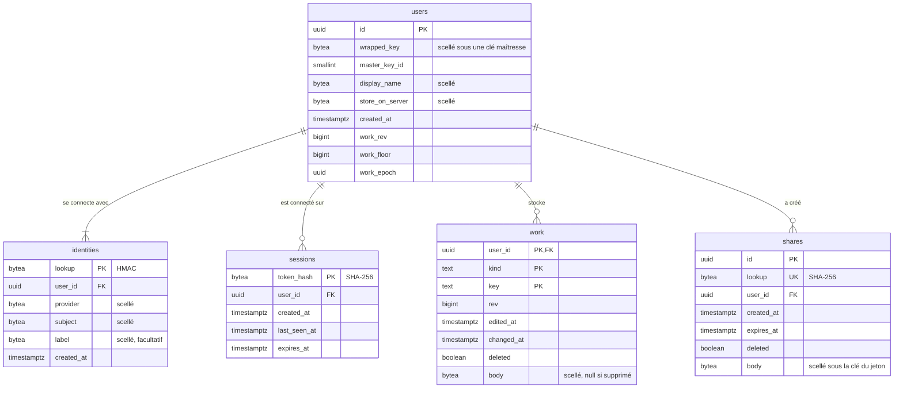

# Modèle de données : la base de données du serveur

Cette page décrit le schéma Postgres de `cityloom_server` tel que le laissent les migrations `0001` à `0006`
(`crates/cityloom_server/migrations/`). Le serveur les exécute au démarrage. Les chemins ci-dessous sont relatifs à
`crates/cityloom_server/`. L’endroit où le serveur et sa base de données fonctionnent est décrit dans
[Fonctionnement de CityLoom](./runtime.md); ce que garde le navigateur, dans
[Modèle de données : projets](./data-model-projects.md).

## Les tables

La base de données compte cinq tables. Toutes les autres tables renvoient à `users`, et chaque clé étrangère est
`user_id references users (id) on delete cascade` : une suppression en cascade.

Chaque personne a au moins une identité. `PgRepo::create_user` (`src/db.rs`) insère l’utilisateur et sa première
identité dans une seule transaction, et `remove_identity` refuse de retirer la dernière (`Removal::Last`).

Les contraintes de vérification :

- `work.kind` est l’un de `street`, `junction`, `rule`, `area`, `project` et `milestone`.
- `work.key` compte de 1 à 200 caractères.
- Une ligne de `work` est soit supprimée sans contenu, soit non supprimée avec un contenu.
- `shares.lookup` compte 32 octets.
- Un partage supprimé n’a pas de contenu (`not deleted or body is null`).

Les index, outre ceux des clés primaires et l’index unique de `shares.lookup` :

- `identities_user_id` sur `identities (user_id)`.
- `sessions_expires_at` sur `sessions (expires_at)` et `sessions_user_id` sur `sessions (user_id)`.
- `work_user_rev` sur `work (user_id, rev)`.
- `shares_expires` sur `shares (expires_at)`.
- `shares_user_created` sur `shares (user_id, created_at)`.
- `shares_live` sur `shares (user_id, expires_at)`, un index partiel : seulement les lignes `where body is not null`.

Des migrations ultérieures ont modifié les tables de migrations antérieures :

- `0002_work.sql` ajoute `work_rev`, `work_floor` et `work_epoch` à `users`, et crée `work`.
- `0003_work_project_kind.sql` et `0004_work_milestone_kind.sql` suppriment et ajoutent de nouveau chacune la contrainte
  `work_kind_check` : la première ajoute le genre `project`, la seconde le genre `milestone`.
- `0006_share_bounds.sql` supprime l’index `shares_user` que créait `0005_shares.sql`, et ajoute `shares_user_created`
  et `shares_live`.

## Clés et secrets

Les clés du serveur viennent de son environnement (`.env.example`). Cette page ne les nomme que par leurs variables.

- Chaque personne a une clé de données de 256 bits aléatoires. Elle est conservée dans `users.wrapped_key`, scellée sous
  une clé maîtresse.
- `DATA_KEYS` contient les clés maîtresses, chacune de 256 bits, avec un identifiant. `DATA_KEY_CURRENT` nomme celle
  qui scelle les nouvelles clés de données. `users.master_key_id` indique quelle clé maîtresse a scellé la clé de données
  de la ligne.
- `LOOKUP_KEY` est la clé du HMAC qui retrouve une identité (`identities.lookup`).
- `OLD_LOOKUP_KEY` n’est lue que par `cityloom_server rehash`, quand la clé de recherche change.

Une valeur scellée est chiffrée en AES-256-GCM et conservée comme un octet de version (`1`), un nonce de 12 octets, le
texte chiffré et une étiquette de 16 octets (`src/crypto.rs`). Ses données associées sont `<table>.<column>.<row id>`,
de sorte qu’une valeur ne s’ouvre qu’à l’endroit pour lequel elle a été scellée : une autre ligne, une autre colonne ou
une autre table la refuse. Les données associées de la clé de données elle-même sont `users.wrapped_key.<user id>`.

`cityloom_server rewrap` scelle de nouveau les clés de données sous la clé maîtresse en vigueur, et
`cityloom_server rehash` recalcule les empreintes de recherche des identités sous une nouvelle `LOOKUP_KEY`
(`src/db/rotate.rs`). L’ordre des étapes est dans [Démarrage](../getting-started.md).

## Comment chaque colonne est conservée

« Scellé » veut dire chiffré en AES-256-GCM sous la clé de données de la personne, sauf si la ligne dit autre chose.
L’identifiant de ligne des données associées est donné pour chacune.

| Table        | Colonne           | Conservée comme                                                                                    | Pourquoi                                                                                                                                                                                                                  |
| ------------ | ----------------- | -------------------------------------------------------------------------------------------------- | ------------------------------------------------------------------------------------------------------------------------------------------------------------------------------------------------------------------------- |
| `users`      | `id`              | En clair                                                                                           | Toutes les autres tables y renvoient.                                                                                                                                                                                     |
| `users`      | `wrapped_key`     | Scellée sous la clé maîtresse de `master_key_id`, identifiant de ligne celui de l’utilisateur      | C’est la clé de données.                                                                                                                                                                                                  |
| `users`      | `master_key_id`   | En clair                                                                                           | Le serveur choisit par elle la clé maîtresse qui ouvre `wrapped_key`, et `rewrap` trouve les lignes sous une clé plus ancienne.                                                                                           |
| `users`      | `display_name`    | Scellée, identifiant de ligne celui de l’utilisateur                                               |                                                                                                                                                                                                                           |
| `users`      | `store_on_server` | Scellée, identifiant de ligne celui de l’utilisateur : `1`, `0`, ou `-` tant que rien n’est choisi |                                                                                                                                                                                                                           |
| `users`      | `created_at`      | En clair                                                                                           | Une valeur par défaut de la base de données : le serveur ne la lit jamais.                                                                                                                                                |
| `users`      | `work_rev`        | En clair                                                                                           | Le compteur de révisions du compte, que chaque envoi augmente et que chaque récupération compare.                                                                                                                         |
| `users`      | `work_floor`      | En clair                                                                                           | La plus haute révision d’une marque de suppression purgée, que la récupération compare.                                                                                                                                   |
| `users`      | `work_epoch`      | En clair                                                                                           | L’identifiant de la copie actuelle du travail sur le serveur, nouveau chaque fois que le stockage est activé, que la récupération compare à l’époque que l’appareil a lue en dernier (`410 reset` quand elles diffèrent). |
| `identities` | `lookup`          | HMAC-SHA256 sous `LOOKUP_KEY` du fournisseur, d’un octet `0x00` et du sujet                        | Le serveur retrouve l’identité par elle à la connexion, sans garder le sujet en clair.                                                                                                                                    |
| `identities` | `user_id`         | En clair                                                                                           | La ligne appartient au compte.                                                                                                                                                                                            |
| `identities` | `provider`        | Scellée, identifiant de ligne l’empreinte de recherche en hexadécimal                              |                                                                                                                                                                                                                           |
| `identities` | `subject`         | Scellée, identifiant de ligne l’empreinte de recherche en hexadécimal                              |                                                                                                                                                                                                                           |
| `identities` | `label`           | Scellée, identifiant de ligne l’empreinte de recherche en hexadécimal; peut être null              |                                                                                                                                                                                                                           |
| `identities` | `created_at`      | En clair                                                                                           | Les connexions du compte sont listées dans son ordre, et `/api/me` la donne avec chacune.                                                                                                                                 |
| `sessions`   | `token_hash`      | SHA-256 du jeton du témoin; le jeton n’est jamais conservé                                         | Le serveur retrouve la session par elle.                                                                                                                                                                                  |
| `sessions`   | `user_id`         | En clair                                                                                           | La ligne appartient au compte.                                                                                                                                                                                            |
| `sessions`   | `created_at`      | En clair                                                                                           | Écrite au début de la session; le serveur ne la lit pas.                                                                                                                                                                  |
| `sessions`   | `last_seen_at`    | En clair                                                                                           | Une session utilisée plus d’un jour après reçoit 30 jours de plus.                                                                                                                                                        |
| `sessions`   | `expires_at`      | En clair                                                                                           | Une session qui l’a dépassée est refusée et supprimée, et un passage quotidien supprime les autres.                                                                                                                       |
| `work`       | `user_id`         | En clair                                                                                           | La ligne appartient au compte.                                                                                                                                                                                            |
| `work`       | `kind`            | En clair                                                                                           | Le serveur fait la correspondance sur elle.                                                                                                                                                                               |
| `work`       | `key`             | En clair                                                                                           | Le serveur fait la correspondance sur elle.                                                                                                                                                                               |
| `work`       | `rev`             | En clair                                                                                           | Une récupération trie et pagine par elle.                                                                                                                                                                                 |
| `work`       | `edited_at`       | En clair                                                                                           | La modification la plus récente l’emporte : le serveur la compare à celle d’un enregistrement envoyé.                                                                                                                     |
| `work`       | `changed_at`      | En clair                                                                                           | Les marques de suppression sont purgées 90 jours après elle.                                                                                                                                                              |
| `work`       | `deleted`         | En clair                                                                                           | Une récupération depuis la révision 0 laisse de côté les marques de suppression.                                                                                                                                          |
| `work`       | `body`            | Scellée, données associées `work.<kind>.<key>.<user id>`; null si supprimée                        |                                                                                                                                                                                                                           |
| `shares`     | `id`              | En clair                                                                                           | Les données associées du contenu la nomment.                                                                                                                                                                              |
| `shares`     | `lookup`          | SHA-256 de `cityloom.share.lookup`, d’un octet `0x00` et du jeton; le jeton n’est jamais conservé  | Le serveur retrouve le partage par elle.                                                                                                                                                                                  |
| `shares`     | `user_id`         | En clair                                                                                           | Seule la personne qui a créé le partage peut le supprimer, et les partages du compte sont comptés.                                                                                                                        |
| `shares`     | `created_at`      | En clair                                                                                           | Les partages créés le dernier jour sont comptés.                                                                                                                                                                          |
| `shares`     | `expires_at`      | En clair                                                                                           | Le partage prend fin à ce moment, et son marqueur est supprimé 365 jours plus tard.                                                                                                                                       |
| `shares`     | `deleted`         | En clair                                                                                           | Le lien d’un partage supprimé le dit.                                                                                                                                                                                     |
| `shares`     | `body`            | Scellée sous une clé tirée du jeton, données associées `share.body.<id>`; null une fois retirée    | Ni une clé maîtresse ni une clé de données ne l’ouvre.                                                                                                                                                                    |

Le commentaire de la table `work` donne la raison de ses colonnes en clair : le serveur fait la correspondance et trie
sur elles, et elles ne disent rien de la personne à elles seules.

## Enregistrements de travail et documents du navigateur

Une personne qui stocke son travail sur le serveur a une ligne de `work` pour chaque enregistrement qu’envoie le
navigateur (`src/api/work.rs`). Le serveur vérifie le genre, la clé et l’heure, et transmet le contenu tel que le
navigateur l’a envoyé, scellé. Chaque genre est une partie des documents du projet dans le navigateur
(`crates/cityloom_editor/src/sync/local.rs`), décrits dans
[Modèle de données : projets](./data-model-projects.md#toutes-les-clés-que-garde-le-navigateur) :

| `kind`      | Le document du navigateur                                  | `key`                     |
| ----------- | ---------------------------------------------------------- | ------------------------- |
| `street`    | Une rue de la section `streets` de `cityloom-edits`        | La clé de la rue          |
| `junction`  | Une jonction de la section `junctions` de `cityloom-edits` | La clé de la jonction     |
| `rule`      | Une règle de zone de `cityloom-restrictions`               | L’identifiant de la règle |
| `area`      | `cityloom-area`, envoyé comme `{"query": …}`               | `current`                 |
| `milestone` | Un jalon de `cityloom-milestones`                          | L’identifiant du jalon    |
| `project`   | L’entrée du projet dans `cityloom-projects`                | L’identifiant du projet   |

- `key` est la clé de transmission. Un enregistrement du premier projet, dont l’identifiant est `first`, garde sa clé
  nue. Un enregistrement de tout autre projet a `<project>:<key>` (`crates/cityloom_editor/src/shared/project_id.rs`).
  Une clé compte de 1 à 200 caractères parmi les lettres, les chiffres et `~_.:-` (`src/work.rs`, `valid_key`).
- `rev` est la révision du compte quand la ligne a changé pour la dernière fois. `users.work_rev` est le compteur :
  chaque enregistrement qu’un envoi accepte prend la révision suivante.
- `edited_at` est le moment où l’appareil a fait la modification. Une heure plus tardive que l’horloge du serveur est
  conservée comme l’heure du serveur.
- `changed_at` est le moment où la ligne a changé pour la dernière fois sur le serveur.
- Un enregistrement retiré dans le navigateur reste comme marque de suppression : `deleted` est vrai et `body` est null,
  de sorte que les autres appareils apprennent le retrait. Une récupération depuis la révision 0 ne reçoit aucune marque
  de suppression.
- Les marques de suppression dont `changed_at` date de plus de 90 jours (`TOMBSTONE_DAYS`) sont supprimées au prochain
  envoi ou à la prochaine récupération, et `users.work_floor` monte à la plus haute révision supprimée. Une récupération
  commencée au-dessus de la révision 0 et sous ce plancher reçoit la réponse `410 resync`.
- `users.work_epoch` (l’époque) change chaque fois que le stockage est activé. Une récupération qui nomme une autre
  époque reçoit la réponse `410 reset`.

Un compte contient au plus 5 000 enregistrements (`MAX_RECORDS`) et 16 Mio de contenus scellés (`MAX_SEALED_BYTES`).
Le contenu d’un enregistrement fait au plus 1 Mio (`MAX_RECORD_BYTES`), et un envoi porte au plus 100 enregistrements
(`MAX_BATCH`).

## Liens de partage

Un lien de partage porte un jeton : 32 octets aléatoires en base64url. Le serveur ne conserve jamais le jeton et ne le
journalise jamais. Une ligne de `shares` garde :

- `lookup`, l’empreinte du jeton par laquelle la ligne est retrouvée (`src/share.rs`, `Token::lookup`);
- `body`, l’instantané tel que le navigateur l’a envoyé, scellé sous une clé tirée du jeton (`Token::body_key`, un
  HMAC-SHA256 dont la clé est le jeton). Sans le lien, la base de données et les clés du serveur ensemble n’ouvrent
  rien;
- le compte qui l’a créé, le moment de sa création, celui de son expiration, et s’il a été supprimé.

Un partage prend fin 90 jours après sa création (`RETENTION_DAYS`), ou plus tôt quand la personne qui l’a créé le
supprime. Supprimer un partage encore actif retire son contenu et met `deleted` à vrai. Supprimer un partage expiré
retire son contenu et le laisse expiré. Dans les deux cas, la ligne reste comme marqueur, de sorte que le lien dit que
le partage a expiré ou a été supprimé, et non qu’il n’a jamais existé.

Une purge s’exécute une fois les migrations faites, puis une fois par jour (`share::spawn_purge`, `src/db/share.rs`,
`purge`). Elle retire le contenu de chaque partage expiré et supprime chaque marqueur 365 jours après son expiration
(`MARKER_DAYS`). La lecture d’un partage expiré retire son contenu aussitôt.

Un compte a au plus 50 partages actifs (`MAX_LIVE_SHARES`), comptés sur `shares_live`, et crée au plus 100 partages en
24 heures (`MAX_SHARES_PER_DAY`), les partages supprimés compris, comptés sur `shares_user_created`. Les deux sont
comptés pendant que la ligne du compte est verrouillée, sur des index que les marqueurs ne font pas grossir.

## Supprimer un compte et désactiver le stockage

**Supprimer un compte** supprime sa ligne de `users` (`src/db.rs`, `delete_user`). Les clés étrangères retirent le
reste aussitôt : chaque ligne de `identities`, `sessions`, `work` et `shares` du compte, les marqueurs de ses partages
compris. Un lien vers l’un de ses partages répond alors `404 not-found`, comme un lien qui n’a jamais existé.

**Désactiver le stockage sur le serveur** (`set_storage`, dans une seule transaction) enregistre le choix, supprime
chaque ligne de `work` du compte et remet `work_rev` et `work_floor` à 0. Le compte, ses identités, ses sessions et ses
partages restent. Activer de nouveau le stockage donne au compte une nouvelle `work_epoch`; le choisir quand il est déjà
activé ne change rien. `DELETE /api/work` (`src/db/work.rs`, `clear`) supprime aussi chaque ligne de `work` et remet les
compteurs à 0, avec une nouvelle `work_epoch`; l’application ne l’appelle jamais.

**Sauvegardes.** Les lignes supprimées restent dans les sauvegardes du serveur jusqu’à ce que ces sauvegardes expirent,
selon la période de conservation de Railway.
