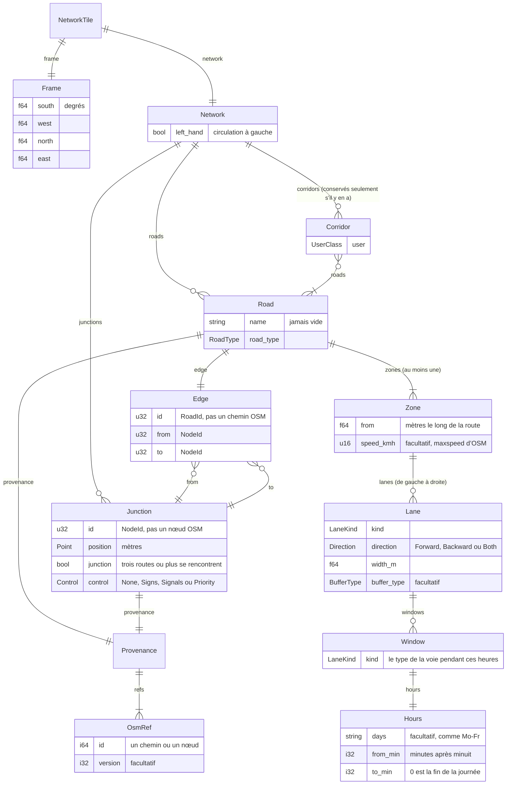
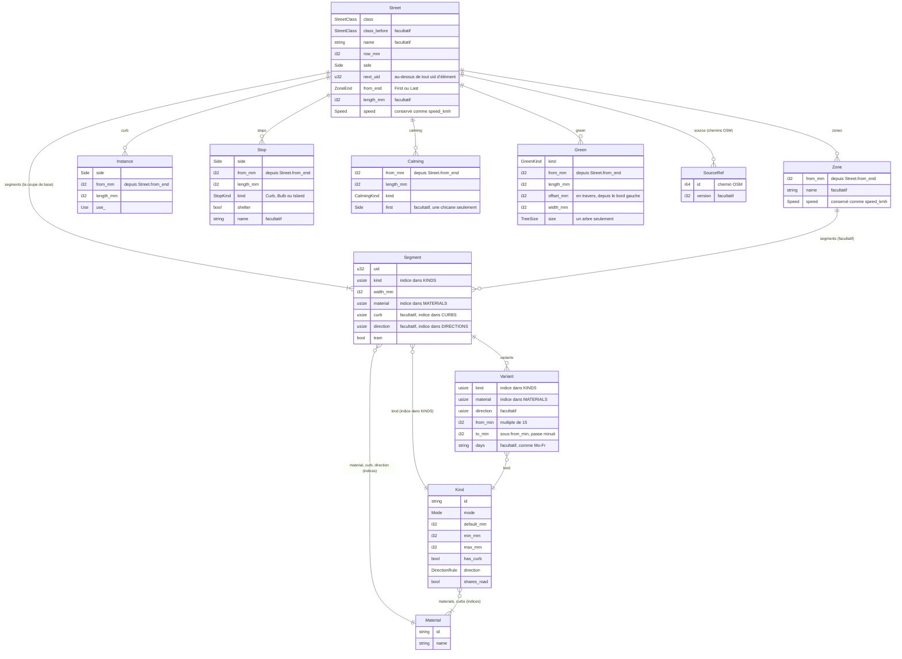
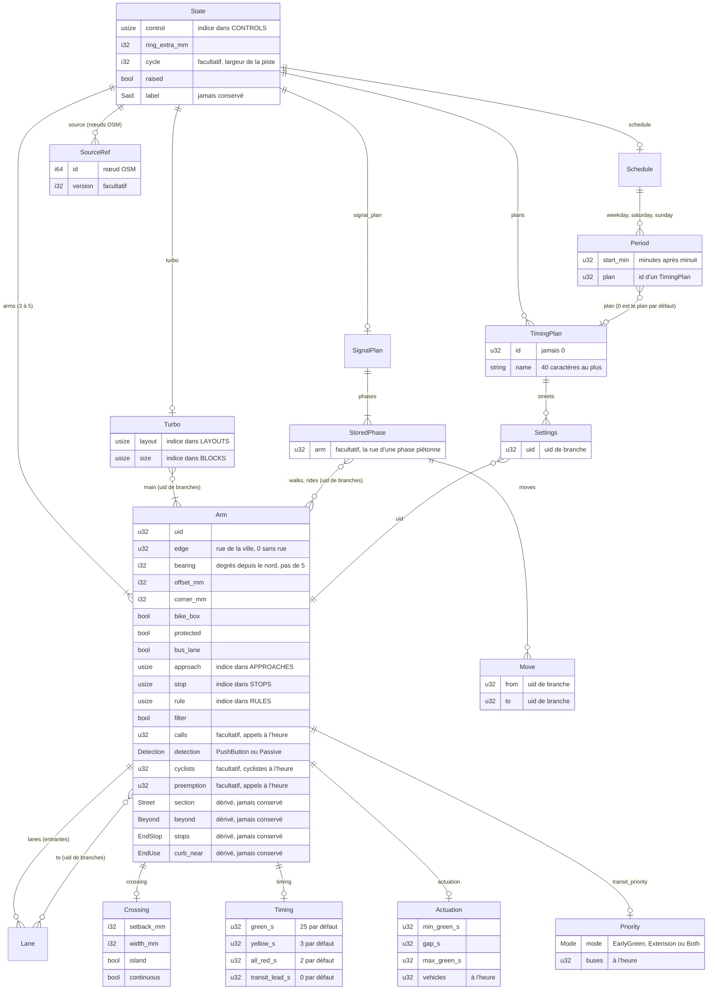
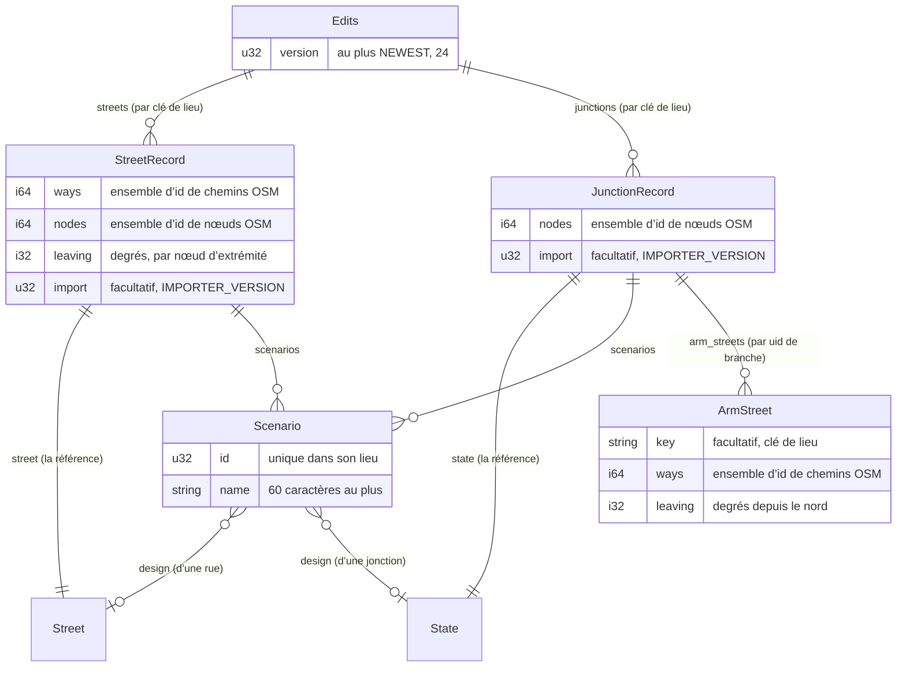

# Modèle de données : rues et jonctions

Cette page dessine les données sur lesquelles travaille CityLoom : le réseau routier que fait l’importateur, ainsi que la
rue et la jonction telles que les éditeurs les conservent, avec leurs scénarios. Les chemins des fichiers de l’éditeur
sont relatifs à `crates/cityloom_editor/src/`, comme dans la [vue d’ensemble](./index.md); ceux du réseau sont sous
`crates/cityloom_model/src/`.

## Où se trouvent les types

Les types se trouvent dans deux caisses :

- `cityloom_model` contient le réseau routier brut que produit l’importateur de `citymodel_builder` et que lit
  l’éditeur (`lib.rs`). Il contient aussi la rue telle que la ville la conserve (`street/`) et le catalogue que nomment
  ses éléments (`catalogue.rs`) : ce qu’OpenStreetMap peut dire d’une rue, sans les règles de l’éditeur pour la
  modifier.
- L’éditeur contient le reste. Il réexporte `Street`, `Segment` et les autres types de la rue depuis
  `cityloom_model::street` (`street/model/mod.rs`) et ajoute ses règles, ses vérifications et ses clés de messages par
  des traits d’extension : `StreetExt`, `UseExt`, `StopKindExt`, `CalmingKindExt`, `CalmingExt`, `GreenKindExt`,
  `GreenExt` et `TreeSizeExt`. La jonction telle que l’éditeur la conserve (`State`, `Arm` et tout le reste sous
  `junction/model/`) n’appartient qu’à l’éditeur : `cityloom_model` n’a que la `Junction` du réseau. Les
  enregistrements du document des modifications et leurs scénarios sont dans `city/` (`city/edits.rs`,
  `city/scenario.rs`).

Le réseau se tient entre l’importateur et l’éditeur pour que l’éditeur ne dépende pas d’osm2streets : seul
`citymodel_builder` l’exécute. `city/import.rs` lit chaque route du réseau comme une rue avec
`cityloom_model::street::{class_of, pieces, refs}` (`street/from_road.rs`).

## Le réseau routier

Le réseau est ce que l’importateur fait d’OpenStreetMap, découpé en tuiles. L’éditeur récupère une `NetworkTile`, un
réseau avec son `Frame` (un cadre sur la Terre, en degrés), et y découpe un lieu (`place/loader.rs`). Les positions dans
le réseau sont en mètres (`f64`) depuis le coin sud-ouest des données : `x` vers l’est, `y` vers le nord.

- `Network` (`network.rs`) : si la circulation se fait à gauche, les jonctions, les routes et les corridors. Les
  corridors ne sont conservés que s’il y en a.
- `Junction` (`junction.rs`) : une jonction ou une extrémité de rue. `id` est un `NodeId`, son identifiant dans le
  graphe du réseau et non un nœud OpenStreetMap. `junction` est vrai là où trois routes ou plus se rencontrent, par
  opposition à une rue qui sort des données ou qui se termine. `control` vaut `None`, `Signs`, `Signals` ou `Priority`,
  qui énumère les routes (`RoadId`) qui ont la priorité.
- `Road` (`road.rs`) : une rue entre deux nœuds, faite d’un ou de plusieurs chemins OpenStreetMap. L’importateur laisse
  de côté une route sans nom. `road_type` vaut `Motorway`, `Highway`, `Arterial`, `Collector` ou `Local`, tiré de la
  valeur `highway` d’OSM par `RoadType::from_osm` (`road_type.rs`). `points` est l’axe de la route.
- `Edge` (`graph.rs`) : l’identifiant de la route, un `RoadId` qui n’est pas un chemin OpenStreetMap, et les nœuds
  qu’elle relie, du premier au dernier. `Network::nodes` et `Network::edges` donnent le graphe nu de `Node` et d’`Edge`.
- `Zone` (`zone.rs`) : un tronçon d’une route qui a une seule coupe transversale. `from` est en mètres le long de la
  route depuis son extrémité `from`, et `speed_kmh` est le `maxspeed` d’OSM, en km/h. Une route a au moins une zone, la
  première à 0 et chacune des suivantes plus loin que la précédente (`Road::is_zoned`).
- `Lane` (`lane.rs`) : les voies sont énumérées de gauche à droite, face à la direction qui va de l’extrémité `from` de
  la route à son extrémité `to`. `width_m` est en mètres. `windows` dit ce que la voie est d’autre à certaines heures.
- `Window` et `Hours` (`hours.rs`) : pendant `hours`, la voie est du type `kind` de la fenêtre. Les heures sont en
  minutes après minuit, au quart d’heure; un `to_min` de 0 va jusqu’à la fin de la journée. `Hours::parse` refuse des
  heures qui se chevauchent ou qui passent minuit.
- `Corridor` (`corridor.rs`) : les routes qui servent une catégorie d’usagers (piétons, cyclistes, transport en commun
  ou conducteurs), reliées bout à bout. `Network::derive_corridors` les crée.
- `Provenance` (`provenance.rs`) : les objets OpenStreetMap dont une route ou une jonction a été faite. Chaque `OsmRef`
  est un chemin (`WayRef`) ou un nœud (`NodeRef`), avec son `id` OSM et la `version` qu’il avait quand les données ont
  été lues, lorsqu’elle est connue (`osm.rs`). Ceux d’une route sont des chemins, ceux d’une jonction des nœuds; la clé
  sous laquelle une modification est conservée en vient.

## La rue

Une rue est conservée en millimètres entiers (`i32`). Elle est vue de sa première extrémité vers sa seconde.

- `Street` (`street/mod.rs`) : `class` vaut `Motorway`, `Arterial`, `Collector`, `Local` ou `Pedestrian`, et
  `class_before` est la classe qu’elle avait avant de devenir piétonne. `row_mm` est sa largeur. `segments` est la
  coupe de base, ses éléments dans l’ordre. `next_uid` est au-dessus de l’uid de chaque élément de chaque coupe
  (`Street::is_sound`). `source` contient les chemins OpenStreetMap dont elle a été faite. `from_end` et `length_mm`
  disent de quelle extrémité se mesurent les positions le long de la rue et la longueur sur laquelle elles ont été
  dessinées; ils ne sont écrits qu’avec des zones ou avec quelque chose de placé le long de la rue.
- `Segment` (`street/segment.rs`) : un élément d’une coupe. `kind`, `material`, `curb` et `direction` sont des indices
  dans les listes `KINDS`, `MATERIALS`, `CURBS` et `DIRECTIONS` du catalogue. `tram` dit qu’une voie de transport en
  commun accueille des tramways plutôt que des autobus.
- `Variant` (`street/segment.rs`) : un autre type que prend l’élément entre deux heures de la journée. Les heures sont
  en minutes après minuit, des multiples de 15 (`SLOT_MIN`); un `to_min` sous `from_min` passe minuit. Les fenêtres
  d’un élément ne se chevauchent jamais : l’éditeur refuse une heure qui le ferait (`street/model/mod.rs`,
  `set_variant_time`).
- Le catalogue (`catalogue.rs`) : chaque `Kind` dit son mode, ses largeurs (par défaut, minimale et maximale, en mm),
  les revêtements et les bordures qu’il permet, s’il va dans un seul sens (`DirectionRule`) et s’il peut changer de type
  au cours de la journée (`shares_road`). `KINDS` contient 18 types; `MATERIALS`, `CURBS` et `DIRECTIONS` sont des
  listes de `Material`. Tout le catalogue est synthétique. `class_of` (`street/from_road.rs`) donne la classe de rue
  d’une route : `Highway` et `Arterial` deviennent tous deux `Arterial`.
- `Zone` (`street/zone.rs`) : un tronçon de la rue. `from_mm` se mesure depuis `Street::from_end`, et le tronçon se
  termine où commence le suivant. Sans `segments`, le tronçon a la coupe de base. Une rue sans zones n’a qu’une coupe;
  `settle_zones` trie les zones et met la première à 0.
- `Speed` (`street/speed.rs`) : `Undecided`, `NotSet` ou `Kmh`, en km/h. Elle est conservée comme `speed_kmh` : absente
  quand elle n’est pas encore décidée et `null` quand la route n’en a pas. Une zone sans limite de vitesse propre a celle
  de la rue (`speed_in`).
- `Instance` (`street/curb.rs`) : un usage du bord de rue : `Parking`, `Loading`, `Tree`, `Planting`, `RainGarden`,
  `Patio`, `BikeParking` ou `Platform`. Il appartient à la rue, pas à une coupe : sa position se mesure le long de toute
  la rue, sur le pas de 100 mm de l’éditeur, si bien que changer les zones le laisse où il est.
- `Stop` (`street/stop.rs`) : un arrêt de transport en commun, `Curb`, `Bulb` ou `Island`, avec ou sans abri.
- `Calming` (`street/calming.rs`) : un élément surélevé : `Table`, `Crossing`, `Chicane` ou `ModalFilter`. Il n’a pas de
  côté; `first` est le côté de la première avancée d’une chicane.
- `Green` (`street/green.rs`) : un `Tree`, un `Bed`, un `RainGarden` ou un `Bioswale`. `offset_mm` est son centre en
  travers, depuis le bord gauche de la coupe. `size` est présent exactement quand il s’agit d’un arbre.

Les usages du bord de rue, les arrêts, les éléments surélevés et les éléments de verdure ont besoin du `length_mm` de la
rue pour être placés : une rue qui en a sans longueur n’est pas valide (`Street::is_sound`).

## La jonction

Une jonction est conservée comme un `State` (`junction/model/mod.rs`), en millimètres entiers, en secondes entières et en
degrés.

- `State` : les branches, et la façon dont la jonction est gérée. `control` est un indice dans `CONTROLS` : sans
  signalisation, priorité, arrêt, feux de circulation ou carrefour giratoire. `ring_extra_mm`, `bus` (une voie réservée
  aux autobus qui traverse un carrefour giratoire, entre deux uid de branches) et `cycle` (une piste cyclable qui en
  fait le tour) appartiennent au carrefour giratoire; `raised` élève toute la chaussée de la jonction à la hauteur du
  trottoir. `source` contient les nœuds OpenStreetMap dont elle a été faite. `label` n’est pas conservé, si bien qu’un
  état enregistré revient comme « Modifications antérieures ».
- `Arm` : une rue de la jonction, de 3 à 5 (`MIN_ARMS`, `MAX_ARMS`). `uid` l’identifie dans la jonction. `edge` est la
  rue de la ville qu’elle est, ou 0 quand elle ne fait pas partie d’une ville. `bearing` est en degrés dans le sens
  horaire depuis le nord, un multiple de `BEARING_STEP` (5). `banned` énumère les uid des branches vers lesquelles elle
  ne peut pas tourner, et `bulb` ses avancées de trottoir, à gauche et à droite. `approach`, `stop` et `rule` sont des
  indices dans `APPROACHES`, `STOPS` et `RULES`.
- `Lane` : une voie entrante, énumérée de la gauche à la droite du conducteur, avec les uid des branches vers lesquelles
  elle peut aller.
- `Crossing` : le passage pour piétons de la branche : son recul et sa largeur en mm, s’il a un îlot, et si le trottoir
  continue à son propre niveau à travers la rue.
- `Timing` : la durée des feux de la branche, en secondes entières. Tant qu’elle n’est pas réglée, elle vaut celle par
  défaut : 25 s de vert, 3 s de jaune, 2 s de rouge intégral, aucune avance pour le transport en commun.
- `Turbo` (`junction/model/turbo.rs`) : la disposition d’un giratoire turbo, avec les deux branches de sa route
  principale. Elle n’est conservée que tant que `control` est le carrefour giratoire.

Quatre champs d’`Arm` sont dérivés de la rue et jamais conservés (`#[serde(skip)]`) : `section` (la rue vue depuis la
jonction), `beyond` (le tronçon au-delà de la première limite de la zone d’extrémité), `stops` (les arrêts de transport
en commun de la rue dans sa zone d’extrémité) et `curb_near` (ses usages du bord de rue à cet endroit). La ville les met
sur la branche quand elle ouvre la jonction. Le modèle de lecture (`junction/model/read_model.rs`) et le dessin des
arrêts (`junction/model/stops.rs`) sont calculés à partir du `State` et ne sont pas conservés non plus.

Les feux (`junction/model/signal.rs`, `junction/model/plans.rs`) ne sont conservés que tant que la jonction a des feux de
circulation :

- `SignalPlan` est un plan de feux que la personne a modifié : ses `StoredPhase` dans l’ordre où elles s’exécutent.
  Chaque phase énumère les mouvements qu’elle sert (`Move`, d’une branche à une branche), les passages traversés
  (`walks`) et les mouvements de vélos qui s’exécutent (`rides`) avec elle, tous par uid de branche. La durée d’une
  phase n’est pas conservée avec elle : c’est le `Arm.timing` de la branche de son premier mouvement, ou de `arm` pour
  une phase sans mouvement (une phase piétonne exclusive). Sans plan conservé, la jonction montre la suggestion, une
  phase par rue qui a des voies entrantes. Un plan a au plus `MAX_PHASES` phases (deux fois `MAX_ARMS`). Un `Pattern`
  (`ThroughOnly`, `All`, `ProtectedLeftThenThrough`, `Scramble`) est un choix tout fait de ce que permet une phase; il
  n’est pas conservé.
- Les politiques adaptatives sont des champs d’`Arm`, chacun enregistré seulement une fois réglé. `calls` est un
  passage sur appel, à autant d’appels à l’heure, avec `detection` un bouton-poussoir ou la détection passive.
  `actuation` rend la phase de la rue à la demande : son vert minimal et maximal et son intervalle en secondes, et les
  véhicules à l’heure. `cyclists` met le mouvement des vélos sur détection, à autant de cyclistes à l’heure.
  `transit_priority` donne aux autobus de la rue un vert hâtif, une prolongation du vert ou les deux. `preemption` est
  le nombre d’appels d’urgence à l’heure qui préemptent les feux.
- Plans selon l’heure : un `TimingPlan` est une copie nommée des réglages de feux des rues, un `Settings` par branche
  selon son `uid`, sous les mêmes noms que sur `Arm`. Les phases sont celles de la jonction, communes à tous les plans.
  Le plan par défaut, `DEFAULT_PLAN` (0), est fait des réglages des branches et n’est jamais enregistré. Une jonction a
  au plus `MAX_PLANS` (8) plans, celui par défaut compris, et un nom a au plus `MAX_NAME_CHARS` (40) caractères.
- `Schedule` : quel plan s’exécute quand, pour les jours de semaine, le samedi et le dimanche. Chaque `Period` (plage
  horaire) commence à une minute après minuit et dure jusqu’au début de la suivante; un type de jour en a au plus
  `MAX_PERIODS` (12). Les débuts sont gardés distincts et dans l’ordre (`Schedule::settle`), si bien que chaque minute
  de la semaine est couverte par exactement une plage horaire, sans trou ni chevauchement.

## Scénarios

L’enregistrement d’un lieu dans le document des modifications (`city/edits.rs`) conserve son propre aménagement, la
référence, et ses scénarios (`city/scenario.rs`) : des solutions de rechange nommées, chacune un aménagement entier.

- `Edits` : le document, ses enregistrements indexés par clé de lieu (voir plus bas).
- `StreetRecord` : les chemins OpenStreetMap dont la rue a été faite, les nœuds de ses deux jonctions d’extrémité et,
  pour chaque extrémité qui est un nœud OpenStreetMap, la direction dans laquelle la rue la quitte, en degrés entiers
  dans le sens horaire depuis le nord. `street` est la référence.
- `JunctionRecord` : les nœuds OpenStreetMap dont la jonction a été faite, et son `state`, la référence, où l’`edge` de
  chaque branche est enregistré à 0. `arm_streets` donne, pour chaque uid de branche, la rue à cette branche sous forme
  d’`ArmStreet` : sa clé quand elle en a une, ses chemins et la direction dans laquelle elle quitte la jonction, pour
  que la branche retrouve sa rue quand la clé de la rue change.
- `Scenario` : un `id` unique parmi les scénarios de son lieu (un de plus que le plus grand), un nom et le `design` :
  une `Street` dans l’enregistrement d’une rue, un `State` dans celui d’une jonction. Un lieu conserve au plus
  `MAX_SCENARIOS` (8) scénarios; les noms sont épurés de leurs espaces de début et de fin, ont au plus
  `MAX_NAME_CHARS` (60) caractères et sont uniques sans égard à la casse. `scenarios` est absent quand il n’y en a pas.

L’aménagement qu’affiche une page est choisi à chaque chargement de la page et n’est pas conservé; la carte et le
rapport lisent la référence.

## Sources OpenStreetMap et identité

`Street.source` et `State.source` sont des listes de `SourceRef { id, version }` (`osm.rs`) : les chemins
OpenStreetMap d’une rue, ou les nœuds d’une jonction, avec la version que chacun avait quand les données ont été lues,
lorsqu’elle est connue. Contrairement à l’`OsmRef` du réseau, un `SourceRef` ne dit pas s’il est un chemin ou un nœud :
le lieu le dit. `refs` (`street/from_road.rs`) les fait à partir de la `Provenance` d’une route ou d’une jonction.
L’éditeur appelle `SourceRef` `OsmRef` (`shared/provenance.rs`).

La clé d’un lieu, sous laquelle son enregistrement est conservé, est construite à partir de ces identifiants
(`city/keys.rs`) :

- celle d’une jonction est `n` suivi du plus petit nœud OpenStreetMap dont elle a été faite : `n2`;
- celle d’une rue est `w` suivi de son plus petit chemin, puis des clés de ses deux extrémités, triées : `w7~n2~n5`.
  Une extrémité sans nœud OpenStreetMap, là où une route sort du cadre du lieu, est `x`, et se trie après une
  extrémité réelle. Quand exactement une extrémité est `x`, la clé se termine alors par un mot de la boussole, `n`,
  `e`, `s` ou `w`, pour la direction dans laquelle la rue quitte son extrémité réelle : `w7~n2~x~e`. Quand les deux
  extrémités sont `x`, aucun mot n’est ajouté : `w7~x~x`. Les deux moitiés d’un chemin fermé relient les deux mêmes
  extrémités réelles; la clé de chacune se termine alors par le mot de la direction dans laquelle cette moitié quitte
  sa première extrémité, dans l’ordre trié : `w7~n1~n2~n`. Toute autre rue à deux extrémités réelles n’a pas de mot.

La clé est la même quelle que soit la tuile dont le lieu est lu. Les autres identifiants restent internes : `NodeId` et
`RoadId` numérotent le graphe du réseau, et l’uid d’une rue ou d’une jonction dans la ville est sa place dans la
disposition de la ville, à partir de 1 (`city/model.rs`). Dans une rue, chaque élément a un `uid` inférieur à
`next_uid`; dans une jonction, chaque branche a un `uid`, et les phases, les plans et les plages horaires nomment les
branches par lui. Un plan selon l’heure a un `id` que ne change jamais un changement de nom ni le retrait d’un autre
plan, et un scénario un `id` unique dans son lieu.

## Versions du format

Le réseau et le document des modifications ont chacun une version :

- `IMPORTER_VERSION` (12, dans `importer.rs` de `cityloom_model`) est la version de ce que l’importateur fait d’une
  tuile. Elle est augmentée quand la sortie de l’importateur change pour les mêmes données, pour que les lieux
  conservés à partir d’une tuile soient lus de nouveau. Un lieu est conservé avec la somme de contrôle de sa tuile
  sous la forme `<checksum>+i<N>` (`with_importer`, `importer_of`). Les types du réseau sont conservés tels qu’ils sont
  écrits, si bien qu’en changer un est une décision sur `IMPORTER_VERSION`.
- La `version` du document des modifications (`city/edits.rs`) est `VERSION` (5) pour un document qui n’a aucune des
  fonctionnalités venues après. Chaque fonctionnalité a sa propre version, jusqu’à `PLANS_VERSION` (24), qui est
  `NEWEST` : `ZONES_VERSION` 6, `SPEED_VERSION` 7, `CURB_VERSION` 8, `STOP_VERSION` 9, `SIGNAL_VERSION` 10,
  `GREEN_VERSION` 11, `CALMING_VERSION` 12, `ZONE_SPEED_VERSION` 13, `CHICANE_VERSION` 14, `FILTER_VERSION` 15,
  `SCENARIO_VERSION` 16, `IMPORT_STAMP_VERSION` 17, `CALLS_VERSION` 18, `DETECTION_VERSION` 19, `ACTUATION_VERSION` 20,
  `BICYCLE_VERSION` 21, `TRANSIT_VERSION` 22, `PREEMPTION_VERSION` 23 et `PLANS_VERSION` 24. Le document est écrit à
  la version qu’exige son contenu (`Edits::written_version`), si bien qu’une version du logiciel qui ne connaît pas une
  fonctionnalité laisse tel quel un document qui la contient. Les versions 4 à `NEWEST` sont lues; un document plus
  récent n’est ni lu ni écrasé.
- L’`import` d’un enregistrement est l’`IMPORTER_VERSION` du réseau dont vient son lieu. Un enregistrement qui n’en a
  pas, ou dont l’`import` est inférieur à `STALE_BEFORE_IMPORT` (11), est périmé.
