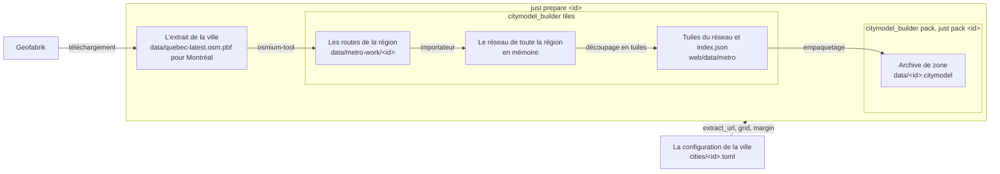
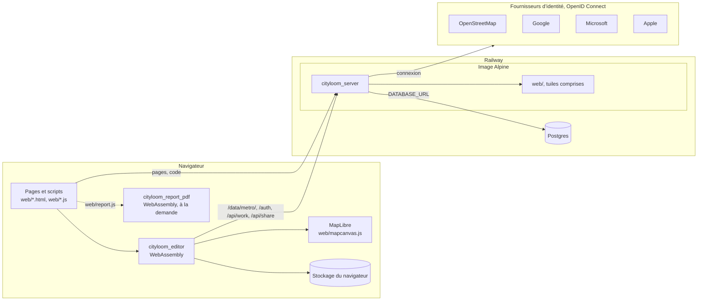
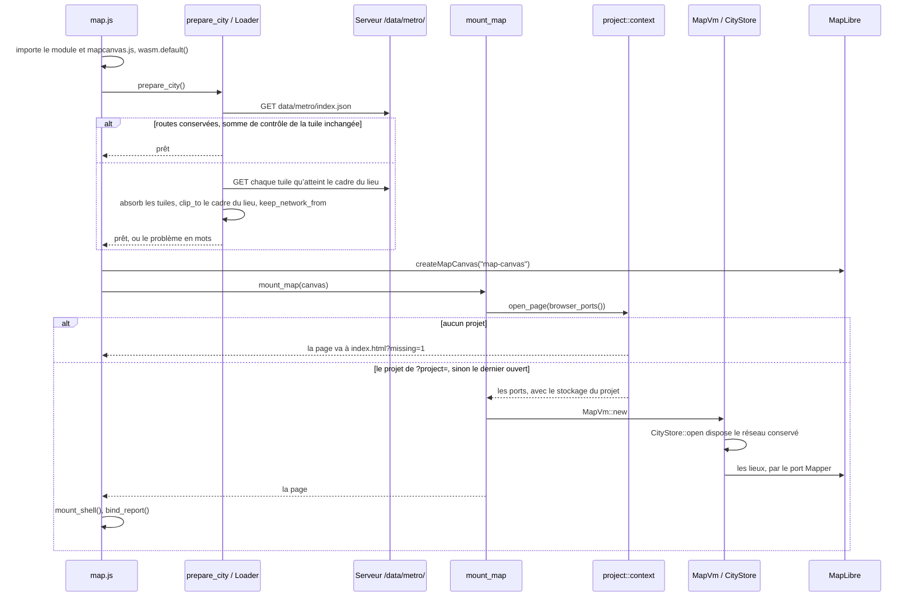
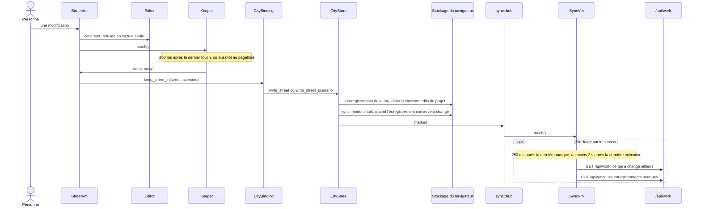
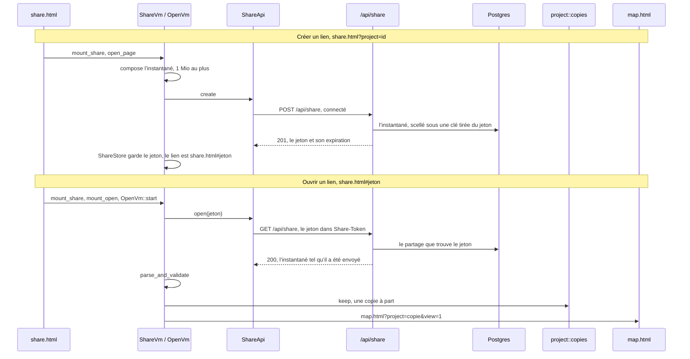

# Fonctionnement de CityLoom

Cette page suit CityLoom pendant qu’il fonctionne : comment le réseau de rues est préparé à partir d’OpenStreetMap, ce
qui est déployé, et ce qui se passe quand une page s’ouvre, quand une personne modifie une rue et quand un aménagement
est partagé. L’organisation du code est décrite dans la [vue d’ensemble](./index.md). Les chemins des fichiers de
l’éditeur sont relatifs à `crates/cityloom_editor/src/`.

## D’OpenStreetMap aux tuiles

Le réseau de rues est préparé à l’avance par `citymodel_builder`, jamais dans le navigateur, une ville à la fois. Une
ville est un fichier de configuration, `cities/<id>.toml`, qui donne l’adresse de son extrait OpenStreetMap, sa grille
de tuiles et leur marge. `just prepare montreal` exécute toutes les étapes pour Montréal : il télécharge dans `data/`
l’extrait de la ville, l’extrait du Québec de Geofabrik, s’il n’y est pas déjà, garde les routes avec osmium-tool, les
importe en une fois avec osm2streets, découpe le réseau en tuiles selon la grille de la ville et empaquette les tuiles
dans l’archive de zone de la ville.

- osmium-tool est un programme à part, qui ne fait pas partie du dépôt. Il garde les routes de la région métropolitaine
  (les étapes `area`, `highways`, `tracks` et `merge`), dans `data/metro-work/<id>`, de sorte que les villes
  n’écrasent pas les fichiers les unes des autres.
- L’importateur, `citymodel_builder::importer` (fonctionnalité `import`), exécute osm2streets sur les routes filtrées de
  toute la région, en une seule importation.
- Le réseau est découpé selon la grille de la ville, chaque tuile étant son cœur élargi de la marge de la ville (pour
  Montréal : 51 sur 34 tuiles, une marge de 0,5 km), écrites sous la forme `web/data/metro/<x>_<y>.json`.
  `index.json` les énumère avec leurs sommes de contrôle. `web/data/metro` contient les tuiles de la dernière ville
  préparée.
- L’archive est un seul fichier tar déterministe : `cityloom.idx` (nombre magique `CLOOMIDX`, version 2, un bloc final
  SHA-256), puis `networks/<x>_<y>.json`.

`just pack <id>` n’exécute que la dernière étape, et refuse les tuiles d’une autre grille que celle de la ville.
`cargo run -p citymodel_builder --release -- tiles <id>` ou `-- pack <id>` exécute une seule étape. Les étapes écrivent leurs journaux dans `data/logs`.

Qui se sert de ce que produisent les étapes :

- L’éditeur lit les tuiles à `/data/metro/` (voir [Ouverture d’une page](#ouverture-dune-page)).
- La tâche `deploy` de `.github/workflows/postsubmit.yml` s’exécute lors d’un envoi sur main, une fois toutes les
  vérifications réussies. Elle garde `web/data/metro` dans un cache dont la clé est un hachage de `cities/montreal.toml` et des
  sources qui font les tuiles. Quand le cache manque, elle installe osmium-tool et exécute `just prepare montreal`. Elle exécute ensuite
  `just deploy`, qui téléverse `web/` avec les tuiles, mais pas l’archive.
- Un serveur ne lit l’archive que si `CITYLOOM_AREAS` désigne un dossier qui contient exactement un `.citymodel`. Au
  démarrage, il vérifie l’archive, l’extrait dans `DATA_ROOT/<area>/` (`lib.rs::unpack_areas` dans `cityloom_server`)
  et sert `/data/metro/` à partir de là. Sans elle, `/data/metro/` vient de `web/data/`.
- Le niveau E2E des tests dans le navigateur (`just e2e-archive`) empaquette `e2e/fixtures/generated/plateau.json` avec
  `citymodel_builder pack`, sans ville mais avec `--area`, `--out`, `--metro` et `--source`, dans `target/e2e-archive`, et s’exécute contre un serveur qui l’extrait.

## Le système déployé

Le site fonctionne comme un seul serveur, `cityloom_server`, sur Railway, à côté d’une base de données Postgres. Le
navigateur exécute les pages et les deux modules WebAssembly; le serveur les envoie, et conserve les comptes, le travail
stocké et les aménagements partagés.

- `scripts/build.sh` construit les deux modules dans `web/pkg` avec `wasm-bindgen --target web`, et échoue si l’éditeur
  lie le générateur de PDF. `web/report.js` charge `cityloom_report_pdf` la première fois qu’un rapport est demandé, et
  l’éditeur l’atteint par `globalThis.cityloomReportPdf`. `createMapCanvas`, dans `web/mapcanvas.js`, crée la carte
  MapLibre, à partir de la copie que `scripts/build.sh` place dans `web/vendor`.
- `just deploy` (`scripts/deploy.sh`) refuse de s’exécuter sans `web/data/metro/index.json`. Il exécute
  `scripts/build.sh`, construit `cityloom_server` pour `x86_64-unknown-linux-musl` et vérifie qu’il ne contient aucun
  faux fournisseur (`scripts/check-no-fake.sh`). Il copie ensuite `web/`, le serveur et `deploy/Dockerfile` dans un
  dossier à part et le téléverse avec `railway up` vers le service `cityloom`.
- L’image, `deploy/Dockerfile`, est `alpine:3` avec `ca-certificates`. Rien n’y est compilé. Elle exécute
  `./cityloom_server` avec `WEB_ROOT=/app/web` et `CACHE_CONTROL=no-cache`, sur le port que Railway donne dans `PORT`.
- Les routes du serveur sont `/auth/{provider}/start`, `/auth/{provider}/callback` et `/auth/signout`; `/api/me`,
  `/api/providers` et `/api/me/storage`; `/api/work` (`GET`, `PUT`, `DELETE`); et `/api/share` (`POST`, `GET`,
  `DELETE`). Toute autre adresse est le site statique. Les scripts, les styles et le WebAssembly sont envoyés sous
  `/v/<build>/`, où `<build>` est un hachage de leur contenu que calcule le serveur.
- Les quatre fournisseurs sont OpenStreetMap, Google, Microsoft et Apple (`osm`, `google`, `microsoft`, `apple`), tous
  par un seul client OpenID Connect.
- Postgres contient les tables `users`, `identities`, `sessions`, `work` et `shares` (`cityloom_server/migrations/`).
  Sur Railway, `DATABASE_URL` renvoie à celle du service Postgres. Sans `DATABASE_URL`, `/auth/*` et `/api/*` répondent
  503 et le site est encore servi.

La façon dont les comptes, le travail stocké et les aménagements partagés sont conservés, et chiffrés, est décrite dans
la [vue d’ensemble](./index.md#comptes-et-serveur).

## Ouverture d’une page

La page Carte montre comment s’ouvre une page d’un projet. Son script, `web/map.js`, charge le module, obtient les
routes, puis remet la carte au module.

- `prepare_city` (`place/mod.rs`) lit le projet de la page sans envoyer la page ailleurs (`project::context::peek`). Il
  construit `CityStore::current` et exécute `place::loader::Loader::load`, puis se résout avec une chaîne vide, ou avec
  le problème en mots. Un lieu qu’aucune tuile ne contient n’est pas couvert (`place-not-covered`).
- `Loader::load` télécharge `data/metro/index.json`. Les routes déjà conservées restent, à moins que l’index ne donne
  une autre somme de contrôle pour la tuile qui contient le lieu. Sinon, il télécharge chaque tuile qu’atteint le cadre
  du lieu (`tiles_touching`), les fusionne avec `Network::absorb`, découpe le cadre du lieu avec `Network::clip_to` et
  conserve le résultat avec `CityStore::keep_network_from`.
- `mount_map` exécute `any_spawner::Executor::init_wasm_bindgen()`, puis `project::context::open_page`. Le projet est
  celui que nomme `?project=<id>`, sinon le dernier ouvert. Quand l’adresse nomme un projet qui n’est pas ici, ou n’en
  nomme aucun et qu’aucun n’a été ouvert avant, la page va à `index.html?missing=1` et `mount_map` ne donne rien.
  `open_page` limite le stockage au projet (`ScopedStorage::guarded`) et retient le projet comme le dernier ouvert.
- Avec `view=1` dans l’adresse (`shared::project_id::VIEW`), ou quand le projet est une copie d’un aménagement partagé,
  le stockage est seulement lu (`ScopedStorage::only_to_read`) et `project::context::read_only` est vrai.
- `MapVm::new` ouvre `CityStore::current`. `CityStore::open` dispose le réseau conservé sous `cityloom-network` avec
  `Layout::from_network`. MapLibre dessine la ville par le port `Mapper` (`BrowserMapper`, sur le canevas).

Le script de la page Rue, `web/app.js`, appelle `prepare_city`, puis `open_street`, `mount_street_page`,
`mount_standards` et `mount_shell`. `open_street` (et `open_junction` pour la page Jonction) appelle aussi `open_page`.
Quand la ville n’a pas cette rue, la page va à la `map.html` du projet. La rue est dessinée en SVG par les fonctions de
rendu pures de `street/view/iso/`, et non par MapLibre.

## Une modification

Une modification change le modèle aussitôt. Elle est écrite dans le stockage du navigateur un moment plus tard, et
envoyée au serveur seulement si la personne a choisi « Stocker mon travail sur le serveur » dans la page Compte.

- `StreetVm::edit` change la rue (`Editor`) par `core_edit`, puis appelle `touch`. Rien n’est conservé tant que la page
  est en lecture seule. `JunctionVm` fait de même pour une jonction, avec `write_junction`.
- `Keeper` (`shared/keeper.rs`) écrit 250 ms après le dernier `touch`, par le port `Scheduler`. `flush` écrit aussitôt
  quand une écriture attend. Une écriture qui échoue est dite une seule fois (`not-kept`).
- Au `pagehide`, `web/app.js` appelle le `flush` de la page. Le shell appelle aussi `sync::hub::flush()`, pour que
  chaque éditeur écrive ce qu’il tient, puis `SyncVm::leave`, qui envoie ce qui attend dans une requête `keepalive`
  réduite à 60 000 octets.
- `CityStore::write_street` ouvre la ville telle qu’elle est conservée maintenant, et conserve le seul enregistrement
  dans le document des modifications du projet, `cityloom-edits@<project>` (`shared/scoped.rs`). Quand l’enregistrement
  conservé a changé, il appelle `sync::model::mark`, qui marque l’enregistrement dans le document de synchronisation et
  appelle `sync::hub::marked`.
- Le shell construit le `SyncVm` de la page, qui entend les marques par `sync::hub::on_marked`. Son `touch` ne fait rien
  à moins que la personne soit connectée et ait choisi le stockage sur le serveur. Une exécution demande à `/api/work`
  ce qui a changé depuis la dernière, puis envoie les enregistrements marqués avec `WorkSync::push`, un
  `PUT /api/work`.

La façon dont le serveur conserve le travail stocké, et ce qui se passe quand deux appareils ont modifié le même lieu,
est décrite dans la [vue d’ensemble](./index.md#modifications-dans-le-nuage).

## Partager un aménagement

Un lien de partage porte un instantané d’un projet. En créer un exige un compte; en ouvrir un, non. Ce qui est
conservé, pour qui et pour combien de temps est décrit dans [Partager un aménagement](../sharing.md).

- `web/share.js` appelle `mount_share` (`lib.rs`). Quand l’adresse ouvre un lien (`share::model::opens_a_link`), il
  déplace le travail d’avant les projets (`project::migrate::move_legacy_work`) et appelle `share::mount_open`. Sinon, il
  ouvre le projet de la page avec `project::context::open_page` et dessine ses liens de partage.
- `ShareVm::create` réunit les documents `cityloom-edits` et `cityloom-restrictions` du projet en un seul document
  `cityloom-share` (`share::model::compose`), appelle `ShareApi::create` et garde le jeton dans `cityloom-shares` sur cet
  appareil (`ShareStore::add`). Le lien est `<origin>/share.html#<token>` : le jeton voyage dans le fragment.
- `ShareApi` est le port vers `/api/share` : `create`, `open` et `delete` sont `POST`, `GET` et `DELETE`, avec le jeton
  dans l’en-tête `Share-Token`. Le serveur conserve un partage 90 jours (`RETENTION_DAYS`). Il scelle le contenu sous
  une clé tirée du jeton (`Token::body_key`) et ne conserve jamais le jeton. `GET` n’exige aucune session.
- `OpenVm::start` télécharge le partage, le vérifie en entier (`share::model::parse_and_validate`) et le conserve avec
  `project::copies::keep`. La copie est inscrite dans `cityloom-shared-copies`, n’est jamais synchronisée et n’est pas
  l’un des projets de la personne. La page va ensuite à `map.html?project=<copy>&view=1`. Une copie s’ouvre en lecture
  seule, quoi que dise son adresse.
