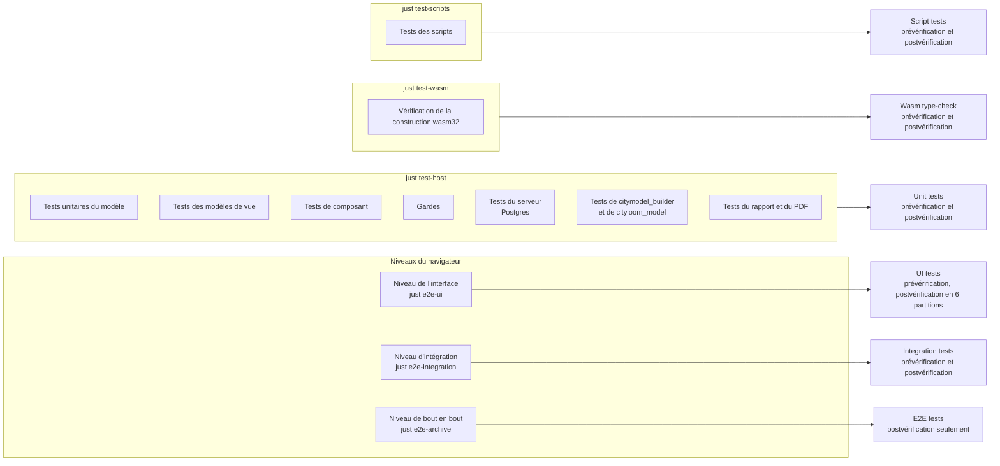

# Tests

Cette page est le seul endroit qui dit comment CityLoom est testé : les paliers de tests, où va un nouveau test, les
données d’essai, quand les tests s’exécutent et ce qui doit réussir avant qu’une demande de fusion soit fusionnée.
L’organisation du code (tranches, MVVM, ports) est décrite dans [Architecture](architecture/index.md); la façon de
préparer et d’exécuter les commandes, dans [Démarrage](getting-started.md). Le nombre de tests, par palier, par caisse
et par niveau, et par fonctionnalité, est dans l’[inventaire des tests](test-inventory.md), et la répartition des
tests de chaque fonctionnalité entre les paliers, dans la [matrice de couverture](coverage-matrix.md). Les chemins des
fichiers de l’éditeur sont relatifs à `crates/cityloom_editor/src/`.

## Les paliers en un coup d’œil

Le diagramme montre la recette qui exécute chaque palier, et la tâche d’intégration continue qui l’exécute.

`just test` exécute `just test-host`, puis `just test-wasm`. `just e2e` construit une fois et exécute les trois
niveaux. `just check` exécute les deux. `just test-host` exige toujours `DATABASE_URL`, quelles que soient les caisses
qu’il teste; `cargo test -p <caisse>` exécute les tests d’une caisse sans elle, pour chaque caisse sauf `cityloom_server`, dont les
tests de base de données l’exigent.

| Palier                                           | Ce qu’il prouve                                                                                                       | Où il se trouve                                                                                                 | Comment l’exécuter                                     | Ce qu’il exige                             |
| ------------------------------------------------ | --------------------------------------------------------------------------------------------------------------------- | --------------------------------------------------------------------------------------------------------------- | ------------------------------------------------------ | ------------------------------------------ |
| Tests unitaires du modèle                        | Les règles d’édition et les calculs purs                                                                              | `#[cfg(test)] mod tests` à côté du code                                                                         | `cargo test -p <caisse> <module>`                      | Rien                                       |
| Tests des modèles de vue                         | Ce que montre un modèle de vue et ce que font ses commandes                                                           | Les tests des modules `vm`, p. ex. `street/vm/mod.rs`                                                           | `cargo test -p cityloom_editor`                        | Les doublures des ports                    |
| Tests de composant                               | Ce que rend une vue                                                                                                   | Le `tests.rs` de chaque tranche, et à côté des commandes dans `crates/cityloom_ui/src/`                         | `cargo test -p cityloom_editor -p cityloom_ui`         | Rien                                       |
| Vérification de la construction wasm32           | Le code que seule la construction pour le navigateur compile compile toujours                                         | L’espace de travail sans `cityloom_server` ni `citymodel_builder`                                               | `just test-wasm`                                       | La cible `wasm32-unknown-unknown`          |
| Tests du serveur                                 | Les routes du serveur, sa base de données et son scellement                                                           | `crates/cityloom_server/tests/`                                                                                 | `just test-host`                                       | `DATABASE_URL`                             |
| `citymodel_builder` et `cityloom_model`          | L’importateur, les tuiles, l’archive et les commandes de la chaîne                                                    | `crates/citymodel_builder/tests/`, `crates/cityloom_model/src/`                                                 | `cargo test -p citymodel_builder -p cityloom_model`    | Rien                                       |
| Tests du rapport et du PDF                       | La revue de conception et le PDF écrit à partir d’elle                                                                | `crates/cityloom_report/src/lib.rs`, `crates/cityloom_report_pdf/tests/pdf.rs`                                  | `cargo test -p cityloom_report -p cityloom_report_pdf` | Rien                                       |
| Tests des scripts                                | Le sélecteur de changements de l’intégration continue, les barrières et la garde de l’usine, le système de billets    | `scripts/include/tests/`                                                                                        | `just test-scripts`                                    | Python 3                                   |
| Tests dans le navigateur, niveau de l’interface  | Une page dans un vrai navigateur, le réseau simulé                                                                    | `e2e/tests/`, `e2e/tiers.json` (`ui`)                                                                           | `just e2e-ui`                                          | Le wasm et le serveur construits, Chromium |
| Tests dans le navigateur, niveau d’intégration   | Les pages contre le vrai serveur et une base de données                                                               | `e2e/tests/`, `e2e/tiers.json` (`integration`)                                                                  | `just e2e-integration`                                 | La même chose, et `DATABASE_URL`           |
| Tests dans le navigateur, niveau de bout en bout | Le chemin de l’archive empaquetée jusqu’à la page, et la livraison par le vrai serveur                                | `e2e/tests/`, `e2e/tiers.json` (`e2e`, `archive_also`)                                                          | `just e2e-archive`                                     | La même chose, et l’archive empaquetée     |
| Gardes                                           | Des règles sur le code lui-même : formulation, organisation, commandes partagées, couleurs, tableau Atlas, scellement | `i18n_guard.rs`, `layout_guard.rs`, `ui_guard.rs`, `atlas_contract.rs`, `shared/contrast.rs`, `no_plaintext.rs` | `just test-host`                                       | `DATABASE_URL` pour `no_plaintext`         |

## Les paliers

### Tests unitaires du modèle

Chaque fichier du modèle garde ses tests à côté du code, dans un `#[cfg(test)] mod tests` : par exemple les fichiers
de `street/model/`, et `crates/cityloom_model/src/cut.rs`, `graph.rs`, `osm.rs`, `importer.rs` et `corridor.rs`. Un
modèle ne contient ni Leptos ni formulation. Une modification renvoie un `bool`, et un refus porte une raison : un test
appelle donc la règle et lit ce qu’elle renvoie. `cargo test shell::vm` exécute un seul module; le nom complet d’un
test fonctionne aussi.

### Tests des modèles de vue

Un modèle de vue n’atteint le navigateur que par les ports : ses tests s’exécutent donc en natif contre leurs
doublures, dans `shared/ports.rs`.

- `test_ports()` donne un ensemble de ports avec un `RecordingAnnouncer` (ce qui a été dit à un lecteur d’écran) et un
  `MemoryStorage`, que le test peut lire.
- `test_ports_with_time()` y ajoute un `ManualScheduler` : le travail différé ne s’exécute que lorsque le test appelle
  `advance(ms)`.
- D’autres fonctions du même fichier ajoutent le reste, comme `test_ports_with_fetcher()`, dont le `FakeFetcher` garde
  chaque requête jusqu’à ce que le test y réponde.

Les tests des modèles de vue sont les `mod tests` de `street/vm/mod.rs`, de `junction/vm/mod.rs` et de
`map/vm/mod.rs`, entre autres. La synchronisation est testée de la même façon, contre un serveur en mémoire :
`ServerSim`, `Device` et `device()` dans `sync/tests.rs`.

### Tests de composant

Un test de composant rend une vue en HTML sur l’hôte, avec `shared::testing::html` (`shared/testing.rs`), et lit le
balisage. Ils se trouvent dans le `tests.rs` de chaque tranche : `account`, `archive`, `junction/view`, `map/view`,
`project`, `share`, `shell`, `standards`, `street/view`, `sync` et `timeline`.

Les tests de composant des commandes partagées sont dans le code, dans `crates/cityloom_ui/src/` : les `mod tests` de
`radio.rs`, de `stepper.rs`, de `section.rs` et de `confirm.rs`, avec la fonction `testing::html` propre à cette caisse
(`testing.rs`). `cargo test -p cityloom_ui` les exécute.

### La vérification de la construction wasm32

`just test-wasm` exécute
`cargo build --target wasm32-unknown-unknown --workspace --exclude cityloom_server --exclude citymodel_builder`. Elle
n’exécute aucun test : elle vérifie les types du code sous `cfg(target_arch = "wasm32")`, que `cargo test` sur l’hôte
ne compile pas.

### Tests du serveur

Les tests du serveur sont dans `crates/cityloom_server/tests/` : `api`, `areas`, `auth_flow`, `data_mount`, `db`,
`no_plaintext`, `providers`, `rotate`, `share_api`, `share_db`, `static_files`, `unavailable`, `work_api` et
`work_db`, avec leurs outils dans `tests/support/mod.rs`.

- Un test qui a besoin de la base de données est un `#[sqlx::test]`. Il reçoit une base de données neuve sur le
  Postgres que nomme `DATABASE_URL`. `areas`, `data_mount`, `providers`, `static_files` et `unavailable` n’en ont
  aucun.
- `TestApp` (dans `tests/support/mod.rs`) est le routeur du serveur sur un `PgRepo`, avec des clés de test fixes et
  une horloge fixe. Son `Browser` garde des témoins devant le routeur, et `sign_in` le connecte par le faux
  fournisseur.
- `api`, `auth_flow`, `providers`, `rotate`, `share_api` et `work_api` exigent la fonctionnalité `test-provider` du
  serveur. `just test-host` l’active chaque fois que le serveur est testé.

`just test-host` refuse de s’exécuter sans `DATABASE_URL`, quelles que soient les caisses qu’il teste.

### Tests de `citymodel_builder` et de `cityloom_model`

`crates/citymodel_builder/tests/` contient les tests de la chaîne (`archive`, `commands`, `ctrl_c`, `download`,
`prepare`, `progress` et `tiles`) et ceux de l’importateur, qui forment une seule caisse de tests, `tests/importer/` :
`import.rs`, `real_city.rs`, `clip_agrees.rs` et `projection.rs`, avec de petits extraits OpenStreetMap comme
`boulevard.osm` et `split_block.osm`. Les tests de `cityloom_model` sont dans le code (voir
[Tests unitaires du modèle](#tests-unitaires-du-modèle)). `cityloom_model::IMPORTER_VERSION` augmente chaque fois que
ce que produit l’importateur change pour les mêmes données.

### Tests du rapport et du PDF

- `cityloom_report` a ses tests dans le code, dans `crates/cityloom_report/src/lib.rs`.
- `crates/cityloom_report_pdf/tests/pdf.rs` écrit des PDF avec `write_pdf` et les relit avec lopdf.
- Les tests de l’éditeur écrivent le rapport par l’écrivain de PDF : `cityloom_report_pdf` est l’une des dépendances
  de développement de l’éditeur, et reste donc hors de la construction de l’éditeur lui-même. `scripts/build.sh` échoue
  si le JavaScript de l’éditeur exporte `report_pdf`.
- Dans le navigateur, `e2e/tests/report.spec.ts` lit le PDF que fait une page avec `pdfjs-dist`.

### Tests des scripts

`just test-scripts` exécute `python3 -m unittest discover -s scripts/include/tests`, avec la bibliothèque standard
seulement. Les tests sont `test_ci_changes.py` (le sélecteur de changements de l’intégration continue, et le fait que
chaque spécification est dans un seul niveau et un seul groupe), `test_factory_config.py`, `test_factory_gate.py` et
`test_factory_guard.py` (l’usine logicielle) et `test_issue_system.py` (les étiquettes, les formulaires de billets et
les règles d’étiquetage concordent).

### Tests dans le navigateur

Les tests dans le navigateur sont des spécifications Playwright, `e2e/tests/*.spec.ts`, exécutées contre le
`web/pkg` construit et un serveur construit avec le faux fournisseur. `e2e/tiers.json` donne à chaque spécification un
seul niveau :

- **Interface** (35 spécifications) : une page, le réseau simulé, le serveur statique seulement; ni base de données ni
  archive. `just e2e-ui`.
- **Intégration** : `account-server`, `share` et `sync`, contre le vrai serveur et un Postgres (`DATABASE_URL`).
  `just e2e-integration`.
- **Bout en bout** : `archive`, `delivery` et `serve`, sur un serveur qui extrait l’archive empaquetée, et la
  livraison du site par le vrai serveur. `just e2e-archive`.
- **`archive_also`** : `map` et `street` sont des spécifications de l’interface que le niveau de bout en bout exécute
  de nouveau sur l’archive extraite.

`e2e/playwright.config.ts` crée un projet Playwright par niveau, et lève une erreur quand une spécification n’est dans
aucun niveau ou dans deux. Avec `E2E_ARCHIVE=1`, seul le projet de bout en bout s’exécute, avec les spécifications
d’`archive_also` en plus. Chaque projet est Desktop Chrome en 1440 sur 900. Dans l’intégration continue, un test en
échec est repris une fois, `test.only` fait échouer l’exécution, et deux processus travaillent. Le serveur est
`target/e2e/cityloom_server`, la copie que fait `scripts/pin-server.sh`, démarré avec `FAKE_PROVIDER=1` et des clés de
test fixes. Hors de l’intégration continue et du mode archive, Playwright réutilise un serveur déjà sur le port.
`E2E_PORT` change le port.

`just e2e` construit le wasm et le serveur et fait les tuiles des données d’essai, puis exécute les trois niveaux.
Avec des arguments, il exécute ces spécifications, quel que soit leur niveau : `just e2e tests/street.spec.ts`.

### Les gardes

Les gardes sont des tests sur le code lui-même. Ils s’exécutent avec les tests sur l’hôte.

- **`i18n_guard.rs`** échoue sur une formulation dans les fichiers de sa liste `MIGRATED` (`LEFT_OUT` nomme les
  quelques fichiers laissés de côté, chacun avec sa raison), sur un identifiant de message utilisé qui n’est pas dans
  les deux langues, sur un fichier d’une tranche traduite qui n’est dans aucune des deux listes, et sur une entrée
  morte d’`ALLOWED_LITERALS` ou de `NOT_MESSAGE_IDS`.
- **`layout_guard.rs`** garde les fichiers de `street/`, `junction/` et `map/` dans `model/`, `vm/` et `view/` : leur
  racine ne contient que `mod.rs`, `CLAUDE.md` et `i18n/`.
- **`ui_guard.rs`** échoue quand une tranche dessine elle-même un groupe de boutons radio, des boutons plus et moins, une
  section des détails avec son titre ou une question, au lieu d’utiliser ceux de `cityloom_ui`.
- **`atlas_contract.rs`** tient le tableau Atlas (`shared::atlas::MEASURES`) pour un contrat : chaque mesure qu’il
  énumère est construite, rien d’autre ne l’est, et chaque mesure est nommée dans les deux langues.
- **`shared/contrast.rs`** mesure les jetons de couleur du CSS selon les critères 1.4.3 (texte) et 1.4.11 (le reste)
  des WCAG.
- **`no_plaintext.rs`** (dans les tests du serveur) lit chaque colonne de `users`, `identities`, `sessions`, `work` et
  `shares` en octets bruts et n’y trouve rien de ce avec quoi la personne s’est connectée.

Les cinq premiers sont des modules `#[cfg(test)]` de l’éditeur.

## Où va un nouveau test

| Ce qui change                                                | Le test                                                                              | Où                                                                                                                    | Ce qui change aussi                                                                                                    |
| ------------------------------------------------------------ | ------------------------------------------------------------------------------------ | --------------------------------------------------------------------------------------------------------------------- | ---------------------------------------------------------------------------------------------------------------------- |
| Une règle d’édition                                          | Un test unitaire du modèle : le résultat de la règle, et sa raison quand elle refuse | Le `mod tests` du fichier du modèle                                                                                   |                                                                                                                        |
| Une commande d’un modèle de vue, ou ce qu’il montre          | Un test du modèle de vue contre `test_ports()` ou `test_ports_with_time()`           | Le `mod tests` du modèle de vue                                                                                       |                                                                                                                        |
| Une machine à états de touches ou de pointeur                | Un test unitaire de la machine, qui est pure                                         | À côté d’elle, p. ex. `street/vm/plan.rs` (`PlanGesture`, `is_boundary_drag`), `street/vm/keys.rs`                    | Un glisser dans la page exige aussi une spécification de navigateur                                                    |
| Un glisser dans une page                                     | Une spécification de navigateur qui pilote la souris                                 | p. ex. `e2e/tests/curb.spec.ts`, `stops.spec.ts`, `street.spec.ts`                                                    |                                                                                                                        |
| Le balisage d’une vue                                        | Un test de composant                                                                 | Le `tests.rs` de la tranche; pour une commande partagée, le `mod tests` de son fichier dans `crates/cityloom_ui/src/` |                                                                                                                        |
| Un point de terminaison du serveur                           | Un test du serveur, `#[sqlx::test]` avec `TestApp`                                   | `crates/cityloom_server/tests/*_api.rs`                                                                               | Un nouveau fichier que chargent les pages : `tests/static_files.rs` vérifie chaque référence                           |
| Un cas de l’importateur                                      | Un test de l’importateur avec un petit extrait `.osm`                                | `crates/citymodel_builder/tests/importer/`                                                                            | Augmenter `IMPORTER_VERSION` quand le résultat change; un fichier OSM XML exige un élément `<bounds>`                  |
| Une chaîne                                                   | Le test de parité de la tranche, et `i18n_guard`                                     | Les deux fichiers `.ftl` de la tranche                                                                                | Un littéral qui n’est pas une formulation va dans `ALLOWED_LITERALS` ou `NOT_MESSAGE_IDS`, avec sa raison              |
| Une nouvelle page ou une nouvelle spécification              | Une spécification de navigateur                                                      | `e2e/tests/<nom>.spec.ts`                                                                                             | Un niveau dans `e2e/tiers.json`, un groupe dans `scripts/ci/spec-map.json`; un nouveau dossier source reçoit une règle |
| Une nouvelle paire de couleurs pour du texte ou une commande | Un test de contraste                                                                 | `shared/contrast.rs`                                                                                                  |                                                                                                                        |

Seuls les tests dans le navigateur atteignent ce qui suit; un changement à ces éléments exige donc une spécification :

- Le glisser au pointeur dans une vraie page. Les événements de pointeur ne sont liés que dans les vues, et les
  événements de souris de la carte dans `web/mapcanvas.js`; seul Playwright les pilote, avec `mouse.down` : le plan de
  la rue (`on:pointerdown` dans `street/view/plan/component.rs`) dans `a11y`, `curb`, `stops` et `street`, et les
  coins d’une zone sur la carte (le gestionnaire `mousedown` de `web/mapcanvas.js`) dans `restrictions`. La jonction
  n’a rien à glisser.
- Le dessin WebGL de MapLibre : la carte est dessinée avec MapLibre, pas en SVG (`e2e/tests/webgl.spec.ts`).
- Le côté navigateur des ports : le code `cfg(target_arch = "wasm32")` de `shared/platform.rs`. `browser_ports()` se
  construit en natif, mais son code pour le navigateur n’est que vérifié par `just test-wasm`.
- Le code de démarrage de `web/*.js`.

## Données d’essai

### Données d’essai OpenStreetMap et tuiles

Les données routières des tests dans le navigateur sont `e2e/fixtures/plateau.osm.pbf`, `turbo.osm.pbf` et
`open-ends.osm.pbf`. `open-ends.osm` est la source OSM XML de `open-ends.osm.pbf`, avec son élément `<bounds>`; les
tests ne le lisent pas. `just e2e-fixtures` importe chaque `.osm.pbf` en une tuile du réseau,
`e2e/fixtures/generated/<nom>.json` (`citymodel_builder fixture`; ignorée par Git). C’est une recette privée, que
`just` n’énumère donc pas; chaque recette de navigateur l’exécute d’abord. Dans l’intégration continue, la tâche
`build` l’exécute une fois et transmet les tuiles dans l’artefact `browser-build`, avec le wasm, `web/vendor` et le
serveur figé.

### `fixtures.ts`

`e2e/tests/fixtures.ts` est ce qu’importe chaque spécification.

- `PLATEAU_TILE`, `TURBO_TILE` et `OPEN_ENDS_TILE` sont les tuiles produites, et `tileFrom(file)` répond par l’une
  d’elles à une demande de tuile.
- Chaque test échoue sur une erreur de la page ou une erreur de la console. Les erreurs de `/api/me`,
  `/api/providers` et `/api/work` sont admises, et celles de `/api/me/*` quand le test porte l’annotation
  `failing-account-api`.
- Chaque test reçoit un contexte de navigateur neuf : le stockage commence vide.
- Une donnée d’essai automatique sert la tuile du Plateau comme tuile métropolitaine par défaut, sauf avec
  `E2E_ARCHIVE`, où le serveur répond à partir de l’archive.
- Le stockage commence avec `cityloom-lang=en` et le premier projet.

### Le faux fournisseur de connexion

La fonctionnalité `test-provider` du serveur (`crates/cityloom_server/Cargo.toml`) ajoute `src/fake_provider.rs`, un
fournisseur OpenID servi par le serveur lui-même. Les tests choisissent qui se connecte avec le témoin `fake-login`.
Les tests dans le navigateur démarrent le serveur avec `FAKE_PROVIDER=1`, et `account-server.spec.ts` utilise un `sub`
unique par test.

### Le Postgres jetable

`just db` démarre un conteneur nommé `cityloom-db` (`postgres:18`) sur 127.0.0.1:55432 et affiche la ligne
`export DATABASE_URL=…` à exécuter; `just db-stop` le supprime. Chaque `#[sqlx::test]` y crée sa propre base de
données. Dans l’intégration continue, les tâches des tests unitaires et d’intégration exécutent un service
`postgres:18`.

### L’archive e2e

`scripts/e2e-archive.sh` copie `e2e/fixtures/generated/plateau.json` comme seule tuile métropolitaine, `0_0`,
l’empaquette avec `citymodel_builder pack` dans `target/e2e-archive/areas/plateau.citymodel`, et exécute
`E2E_ARCHIVE=1 npx playwright test --project=e2e`. Le serveur extrait l’archive par `CITYLOOM_AREAS` et `DATA_ROOT`,
tous deux dans `target/e2e-archive`.

## Attributs de qualité

### Accessibilité

La cible est WCAG 2.2 AA.

- `e2e/tests/a11y.spec.ts` exécute axe (`@axe-core/playwright`) avec les étiquettes `wcag2a`, `wcag2aa`, `wcag21a`,
  `wcag21aa` et `wcag22aa`. `compare.spec.ts` exécute aussi axe.
- `e2e/tests/junction-a11y.spec.ts` mesure les cibles de la jonction à 1440, 1050, 600 et 280 px de large.
- `shared/contrast.rs` mesure les jetons de couleur du CSS (voir [Les gardes](#les-gardes)).

### Traduction

- Le test de parité de chaque tranche vérifie que ses deux fichiers `.ftl` ont les mêmes messages avec les mêmes
  variables (`shared::i18n::tests::parity_problems`) : `account`, `archive`, `city`, `junction`, `map`, `place`,
  `project`, `restriction`, `share`, `shell`, `street` et `sync`.
- `i18n_guard` trouve la formulation restée dans le code (voir [Les gardes](#les-gardes)).
- `shared::i18n::typography` applique au fr-CA les espacements de l’OQLF, et est testée à côté.
- `e2e/tests/language.spec.ts` fait passer une page au fr-CA depuis le menu du compte.

### Sécurité

- `PgRepo` scelle ce qu’il écrit et ouvre ce qu’il lit. Le corps d’un aménagement partagé est scellé sous
  `Token::body_key`. `no_plaintext.rs` vérifie que les lignes ne contiennent rien en clair.
- `just check-no-fake` construit le serveur de publication et exécute `scripts/check-no-fake.sh`, qui échoue sur les
  marqueurs du faux fournisseur, `fake-login` et `fake-apple`.
- La tâche `Release server has no fake provider` de l’intégration continue construit aussi le serveur avec
  `test-provider` et s’attend à ce que ce script échoue sur lui : un contrôle positif, pour que les marqueurs ne
  puissent pas dériver sans qu’on le voie.

## Quand les tests s’exécutent

### Flux de prévérification

`.github/workflows/presubmit.yml` s’exécute pour chaque demande de fusion, avec `RUSTFLAGS=-D warnings` : un nouvel
avertissement du compilateur le fait donc échouer. Un changement qui ne touche que la documentation (`website/**`,
`docs/**`, `**/*.md`, `LICENSE*`) ne le démarre pas.

Sa tâche `changes` exécute `scripts/ci/ci_changes.py`, qui décide de ce qui s’exécute d’après les fichiers que change la
demande de fusion :

- Les tests Rust des caisses qu’elle touche et des caisses qui en dépendent. Un changement à ce que lisent toutes les
  caisses, comme `web/`, `Cargo.lock`, le `justfile` ou un flux de travail, exécute toutes les caisses. La vérification
  wasm et celle du serveur de publication suivent les mêmes caisses.
  Une simple hausse de version (la ligne de version de `crates/cityloom_editor/Cargo.toml` et son entrée dans
  `Cargo.lock`) ne compte pas comme un changement à ces fichiers.
- Seules les spécifications de navigateur que ses fichiers peuvent toucher : la première règle de
  `scripts/ci/spec-map.json` qui correspond à un fichier décide, par groupe. Un fichier qu’aucune règle ne nomme
  exécute toutes les spécifications.
  Les fichiers propres à une page dans `web/` exécutent le groupe de cette page et `@cross`, les spécifications
  communes aux pages. Ce que charge chaque page (`app.css`, `boot.js`, `city.js`), le serveur et
  `crates/citymodel_builder/**`, qui fait les tuiles des données d’essai, exécutent toutes les spécifications.
- Chaque spécification choisie s’exécute dans son niveau, et un niveau sans spécification choisie ne s’exécute pas. Il
  n’y a pas de tâche de bout en bout.

Les tâches sont Format, Script tests, Unit tests, Wasm type-check, Release server has no fake provider, Build for the
browser tests, UI tests, Integration tests et Version bump, et `CI`, qui les rassemble.

### Flux de postvérification

`.github/workflows/postsubmit.yml` s’exécute à chaque poussée sur `main` (avec le même `paths-ignore`) et à la main. Il
n’a pas de tâche `changes` : il exécute toutes les tâches et toutes les spécifications, le niveau de l’interface en six
partitions Playwright, et le niveau de bout en bout par `scripts/e2e-archive.sh`. Il fixe aussi
`RUSTFLAGS=-D warnings`, et ses exécutions ne sont jamais annulées. Sa tâche `All checks` échoue quand une tâche a
échoué ou a été annulée, et `Deploy to Railway` l’attend. Le déploiement ne se fait que pour une poussée sur `main`;
une exécution à la main ne déploie jamais.

### Documentation

`.github/workflows/docs.yml` s’exécute quand un changement touche `website/**` ou le flux de travail. Il vérifie
`website/` avec Prettier (depuis `e2e/`), puis construit le site dans les deux langues; un lien ou une ancre brisé fait
échouer la construction. Il publie le site sur GitHub Pages depuis `main`. Un changement à `docs/**` ou à un `*.md` hors
de `website/` ne démarre aucun flux de travail.

### SonarCloud

`.github/workflows/sonar.yml` s’exécute pour les demandes de fusion et sur `main`, avec le même `paths-ignore`. Il
exécute `just sonar-reports` : la couverture des tests sur l’hôte (sans `cityloom_server`) et les constats de Clippy
avec `--cap-lints warn`. Il n’a pas de `-D warnings`.

## Ce qui doit réussir avant une fusion

- **`CI`**, la dernière tâche du flux de prévérification. Elle échoue quand une tâche a échoué ou a été annulée, et
  laisse passer celles que `changes` a sautées.
- **SonarCloud.** Son analyse ne fait pas partie de `CI` et ne bloque jamais une fusion. L’agent de fusion
  (`.claude/agents/merge.md`) exige tout de même aucun problème ouvert et aucun point chaud sur la demande de fusion,
  et la barrière de qualité à `OK`. Les autres conditions de la barrière sont une couverture du nouveau code d’au
  moins 80 % et une duplication d’au plus 3 %.
- **La version.** `scripts/check-version.sh` exige que la version de `crates/cityloom_editor/Cargo.toml` soit
  supérieure à celle de la base. Un changement qui ne touche que la documentation et la configuration de l’intégration
  continue (`CI_CONFIGURATION` dans `ci_changes.py` : `.github/**`, `scripts/ci/**`, `scripts/include/**`,
  `.claude/**`) n’en exige pas, et la tâche est sautée.
- **La vérification Documentation**, pour un changement à `website/`. `CI` ne la couvre pas.
- **La fusion elle-même.** L’agent de déploiement (`.claude/agents/deploy.md`) ne fusionne que lorsque chaque
  vérification a réussi ou a été sautée et que GitHub indique `CLEAN`. Dans l’usine logicielle, une personne approuve
  d’abord la tête de la demande de fusion.
- **Les barrières de l’usine** (`.claude/factory/gate.py`, décrites dans `.claude/factory/README.md`), pour un billet
  que l’usine construit :
  - `red` : les nouveaux tests compilent, chaque nouveau test échoue, et chaque ancien test réussit;
  - `green` : chaque test réussit avec `-D warnings`, la mise en forme et la version tiennent, et aucun fichier de
    test, bloc `#[cfg(test)]`, vérification ou fichier de l’usine n’a changé depuis le commit rouge;
  - `docs` : seule la documentation a changé, chaque page a sa page dans l’autre langue, et le site passe Prettier et
    se construit.

## Règles

- **Le test d’abord.** Écrire le test qui échoue, puis le code. Dans l’usine logicielle, seul l’agent qui écrit les
  tests en écrit : `guard.py` refuse la modification d’un test par l’agent d’implémentation, et un test qu’il croit
  faux est une question pour une personne.
- **Ne jamais affaiblir un test pour le faire réussir.** Pas de `#[ignore]`, de `test.skip` ni de `test.fixme`, pas
  d’assertion plus lâche, pas de délai plus long, pas de reprise ajoutée (`.claude/agents/merge.md`).
- **Un test instable est un bogue.** Il reçoit un billet et est corrigé, pas exécuté de nouveau jusqu’à ce qu’il
  réussisse. Par exemple, CLM-22 : un test de `junction::model::calls` donnait une seconde à une exécution sur un
  document hostile, et a fait échouer une exécution de déploiement sur une machine chargée. La limite a été mesurée,
  pas simplement relâchée : 0,16 s seul, 1,16 s à côté de toute la suite, 16,4 s avec la lecture quadratique contre
  laquelle il protège. Elle est devenue `AT_ONCE`, 10 s, qui attrape toujours cette lecture.

## Lacunes et risques connus

Cette partie énumère les lacunes des tests, et les autres limites des tests et de l’intégration continue aujourd’hui.
La [matrice de couverture](coverage-matrix.md) compte les tests de chaque fonctionnalité à chaque palier.

### Lacunes : ce que le guide demande et qu’aucun test ne fait encore

Chaque lacune est sous la ligne d’[Où va un nouveau test](#où-va-un-nouveau-test) qu’elle enfreint, ou sous la liste,
au même endroit, de ce que seuls les tests dans le navigateur atteignent. Chacune dit ce qu’aucun test du palier nommé
ne couvre, ce palier et le numéro de son billet.

- **Une règle d’édition**
  - Rue (`street/model/mod.rs`, `street/model/replay.rs`) : une région qui change le côté de la circulation inverse le
    sens des types d’un élément selon l’heure, et dispose de nouveau les coupes propres aux tronçons d’une rue sans
    modification. Une modification refaite sur d’autres tronçons transmet le matériau, les voies de tramway et les
    heures de la journée, et place un élément dont le tronçon n’a pas les voisins au début, avant l’élément le plus
    proche à sa droite, ou au bout le plus proche. Palier : modèle. CLM-78.
  - Jonction (`junction/model/mod.rs`, `junction/model/plans.rs`) : les refus d’une phase pour une rue piétonne, d’une
    voie d’autobus entre des rues qui n’existent pas, et d’une plage horaire ajoutée ou dotée d’un plan là où il n’y a
    pas de feux de circulation, dotée d’un plan que la jonction n’a pas, ou retirée ou déplacée là où il n’y en a pas.
    L’abandon d’un carrefour giratoire qui ne peut plus être dessiné. Ce que dit l’historique quand un changement de
    signalisation fait perdre le réglage des feux avec les sas cyclables, les coins protégés ou les deux. Palier :
    modèle. CLM-81.
  - Carte (`map/model/corridor.rs`) : une modification faite sur plusieurs rues, et son annulation, quand le
    navigateur ne peut pas conserver l’une d’elles. Palier : modèle. CLM-84.
- **Une commande d’un modèle de vue, ou ce qu’il montre**
  - Rue (`street/vm/mod.rs`, `street/vm/level.rs`, `street/vm/compare.rs`, `city/binding.rs`) : le message pour une
    longueur saisie qui n’est pas un nombre, le glisser d’un élément surélevé ou d’une plantation commencé alors
    qu’aucun n’est choisi, l’étape du chemin pour un arrêt nommé, les lignes de la comparaison pour un élément ajouté,
    retiré ou d’un autre genre et pour ce qui diffère aussi, et un scénario que le navigateur ne peut pas conserver.
    Palier : modèle de vue. CLM-79.
  - Jonction (`junction/vm/text.rs`, `junction/vm/compare.rs`) : ce qui est dit à un lecteur d’écran d’un arrêt dans
    la voie réservée aux autobus et d’un arrêt qui n’est sur aucune voie entrante, et les lignes de la comparaison
    pour un changement de la disposition du giratoire turbo, du carrefour surélevé ou d’un coin. Palier : modèle de
    vue. CLM-82.
  - Carte (`map/vm/mod.rs`, `map/vm/report.rs`) : Maj+Entrée dans la recherche, une annulation que le navigateur n’a
    pu conserver qu’en partie, et les lignes du rapport pour une classe modifiée, pour des éléments ajoutés ou
    retirés, pour d’autres changements, et pour les vérifications en échec d’une jonction qui ne peut pas être
    dessinée. Palier : modèle de vue. CLM-85.
  - Normes (`standards/vm.rs`) : l’ouverture et la fermeture du formulaire d’un profil, la fermeture du texte exporté,
    et l’avertissement d’une plage de largeurs plus large que celle de base. Palier : modèle de vue. CLM-87.
  - Chronologie (`timeline/vm.rs`, `timeline/text.rs`) : la demande de qui est connecté, pour l’auteur d’un jalon, une
    comparaison avec un travail qui ne peut pas être lu, la restauration d’un jalon disparu entre-temps, et les mots
    pour un jalon vide, pour une jonction, pour une règle, pour une rue sans nom, et pour chaque aspect sauf la
    largeur. Palier : modèle de vue. CLM-91.
  - Archive (`archive/vm.rs`) : ce que dit le panneau quand le travail de cet appareil est endommagé ou plus récent,
    ou quand le navigateur ne peut pas conserver l’importation. Palier : modèle de vue. CLM-93.
  - Synchronisation (`sync/vm.rs`) : une exécution qui apprend que la session est terminée, et un document de
    synchronisation écrit par un CityLoom plus récent. Palier : modèle de vue. CLM-94.
  - Projets (`project/vm.rs`) : ce que dit la page d’accueil quand un projet ne peut pas être supprimé. Palier :
    modèle de vue. CLM-95.
- **Une machine à états de touches ou de pointeur**
  - Rue (`street/vm/plan.rs`) : le glisser, sur le plan, d’un arrêt, d’un élément surélevé et d’un arbre ou d’une
    plantation, l’annulation du glisser d’un objet, et le glisser d’une limite qui est refusé. Palier : modèle de vue.
    CLM-77.
- **Un glisser dans une page**
  - Rue (`street/view/curb_strip.rs`, `calming_strip.rs` et `green_strip.rs`) : le glisser de quoi que ce soit le long
    d’une bande et, sur le plan, le glisser d’un élément surélevé, d’un arbre ou d’une plantation et d’une extrémité
    du tronçon choisi. Palier : niveau de l’interface. CLM-76.
- **Le balisage d’une vue**
  - Rue (`street/view/add_menu.rs`) : les résultats de recherche du menu Ajouter un élément. Palier : composant.
    CLM-80.
  - Jonction (`junction/view/inspector.rs`) : les feux et les voies d’une rue par où rien n’entre, et la cellule d’une
    approche sans attente. Palier : composant. CLM-83.
  - Carte (`map/view/details.rs`) : la liste des vérifications en échec d’un lieu. Palier : composant. CLM-86.
  - Normes (`standards/view.rs`) : la question avant le retrait d’un profil, les largeurs fixées, les avertissements,
    et le texte exporté avec son lien de téléchargement. Palier : composant. CLM-88.
  - Chronologie (`timeline/view.rs`) : la question avant la suppression d’un jalon. Palier : composant. CLM-92.
- **Un cas de l’importateur**
  - `citymodel_builder` (`crates/citymodel_builder/src/importer/merge.rs`) : deux chaussées de types de route
    différents restent deux rues, et une route retournée garde à double sens une voie à double sens. Palier :
    `citymodel_builder` et `cityloom_model`. CLM-96.
- **Une chaîne**
  - Normes : le test de parité de `standards/i18n/en.ftl` et `fr.ftl`. Palier : composant. CLM-89.
  - Chronologie : le test de parité de `timeline/i18n/en.ftl` et `fr.ftl`. Palier : composant. CLM-90.
- **Une nouvelle paire de couleurs pour du texte ou une commande**
  - Les boutons `danger` des éditeurs (`--danger` dans `web/editor.css`), et l’anneau de focus des liens d’attribution
    de la carte (`--attrib-ring` dans `web/app.css`). Palier : garde. CLM-97.
- **Seuls les tests dans le navigateur atteignent ce qui suit** : le côté navigateur des ports
  - Page de partage (`copy_text` dans `shared/platform.rs`) : le presse-papiers, dont se sert son bouton Copier le
    lien. Palier : niveau d’intégration. CLM-98.

### Autres limites et risques

- Le niveau de bout en bout ne s’exécute que dans le flux de postvérification, après la fusion.
- La construction de la documentation ne fait pas partie de la vérification `CI`.
- Seul Chromium est testé : chaque projet Playwright est Desktop Chrome, et `just setup` n’installe que Chromium.
- Dans l’intégration continue, un test de navigateur en échec est repris une fois : un test instable peut donc
  réussir.
- SonarCloud ne mesure que la couverture des tests sur l’hôte : ni le code propre au wasm, ni les tests dans le
  navigateur, ni `cityloom_server`, `cityloom_report` ou `cityloom_report_pdf`, que `sonar-project.properties` laisse
  de côté. Ses nombres sont dans [Couverture de lignes](coverage-matrix.md#couverture-de-lignes). SonarCloud ne bloque
  pas une fusion.
- Aucune vérification d’état n’est exigée sur `main`; les flux de travail le disent.
- L’archive du niveau de bout en bout est une seule tuile du Plateau. Aucun test ne s’exécute sur les vraies données de
  Montréal, que seule la tâche de déploiement produit.
- Les vrais fournisseurs de connexion ne sont jamais éprouvés de bout en bout : les spécifications utilisent le faux
  fournisseur, et les [vérifications manuelles](getting-started.md#vérifications-manuelles-une-fois-par-fournisseur)
  se font à la main.
- Clippy n’est jamais rendu bloquant dans l’intégration continue : seul SonarCloud l’exécute, avec
  `--cap-lints warn`.
- Une demande de fusion venant d’une bifurcation ne reçoit aucune analyse SonarCloud.
