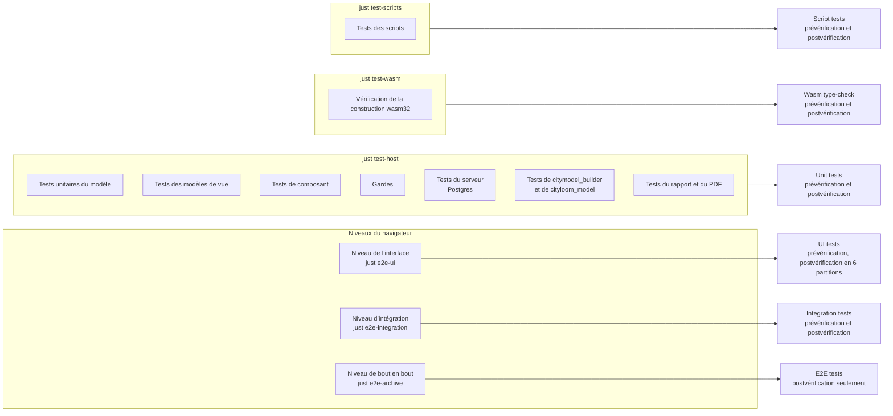

# Tests

Ces pages sont le seul endroit qui dit comment CityLoom est testé : les [paliers de tests](levels.md),
[où va un nouveau test](#où-va-un-nouveau-test), les [données d’essai](test-data.md), les
[attributs de qualité](quality-attributes.md), [quand les tests s’exécutent](when-tests-run.md) et
[ce qui doit réussir avant qu’une demande de fusion soit fusionnée](when-tests-run.md#ce-qui-doit-réussir-avant-une-fusion).
L’organisation du code (tranches, MVVM, ports) est décrite dans [Architecture](../architecture/index.md); la façon de
préparer et d’exécuter les commandes, dans [Démarrage](../getting-started.md). Le nombre de tests, par palier, par
caisse et par niveau, et par fonctionnalité, est dans l’[inventaire des tests](test-inventory.md), et la répartition
des tests de chaque fonctionnalité entre les paliers, dans la [matrice de couverture](coverage-matrix.md). Dans
cette page, dans [Paliers de tests](levels.md) et dans [Attributs de qualité](quality-attributes.md), les chemins des
fichiers de l’éditeur sont relatifs à `crates/cityloom_editor/src/`.

## Les paliers en un coup d’œil

Le diagramme montre la recette qui exécute chaque palier, et la tâche d’intégration continue qui l’exécute.

`just test` exécute `just test-host`, puis `just test-wasm`. `just e2e` construit une fois et exécute les trois
niveaux. `just check` exécute les deux. `just test-host` exige toujours `DATABASE_URL`, quelles que soient les caisses
qu’il teste; `cargo test -p <caisse>` exécute les tests d’une caisse sans elle, pour chaque caisse sauf `cityloom_server`, dont les
tests de base de données l’exigent.

| Palier                                           | Ce qu’il prouve                                                                                                                                                            | Où il se trouve                                                                                                                        | Comment l’exécuter                                     | Ce qu’il exige                             |
| ------------------------------------------------ | -------------------------------------------------------------------------------------------------------------------------------------------------------------------------- | -------------------------------------------------------------------------------------------------------------------------------------- | ------------------------------------------------------ | ------------------------------------------ |
| Tests unitaires du modèle                        | Les règles d’édition et les calculs purs                                                                                                                                   | `#[cfg(test)] mod tests` à côté du code                                                                                                | `cargo test -p <caisse> <module>`                      | Rien                                       |
| Tests des modèles de vue                         | Ce que montre un modèle de vue et ce que font ses commandes                                                                                                                | Les tests des modules `vm`, p. ex. `street/vm/mod.rs`                                                                                  | `cargo test -p cityloom_editor`                        | Les doublures des ports                    |
| Tests de composant                               | Ce que rend une vue                                                                                                                                                        | Le `tests.rs` de chaque tranche, et à côté des commandes dans `crates/cityloom_ui/src/`                                                | `cargo test -p cityloom_editor -p cityloom_ui`         | Rien                                       |
| Vérification de la construction wasm32           | Le code que seule la construction pour le navigateur compile compile toujours                                                                                              | L’espace de travail sans `cityloom_server` ni `citymodel_builder`                                                                      | `just test-wasm`                                       | La cible `wasm32-unknown-unknown`          |
| Tests du serveur                                 | Les routes du serveur, sa base de données et son scellement                                                                                                                | `crates/cityloom_server/tests/`                                                                                                        | `just test-host`                                       | `DATABASE_URL`                             |
| `citymodel_builder` et `cityloom_model`          | L’importateur, les tuiles, l’archive et les commandes de la chaîne                                                                                                         | `crates/citymodel_builder/tests/`, `crates/cityloom_model/src/`                                                                        | `cargo test -p citymodel_builder -p cityloom_model`    | Rien                                       |
| Tests du rapport et du PDF                       | La revue de conception et le PDF écrit à partir d’elle                                                                                                                     | `crates/cityloom_report/src/lib.rs`, `crates/cityloom_report_pdf/tests/pdf.rs`                                                         | `cargo test -p cityloom_report -p cityloom_report_pdf` | Rien                                       |
| Tests des scripts                                | Le sélecteur de changements de l’intégration continue, les barrières et la garde de l’usine, le système de billets, les pages d’Architecture, la liste des fonctionnalités | `scripts/include/tests/`                                                                                                               | `just test-scripts`                                    | Python 3                                   |
| Tests dans le navigateur, niveau de l’interface  | Une page dans un vrai navigateur, le réseau simulé                                                                                                                         | `tests/e2e/tests/`, `tests/e2e/tiers.json` (`ui`)                                                                                      | `just e2e-ui`                                          | Le wasm et le serveur construits, Chromium |
| Tests dans le navigateur, niveau d’intégration   | Les pages contre le vrai serveur et une base de données                                                                                                                    | `tests/e2e/tests/`, `tests/e2e/tiers.json` (`integration`)                                                                             | `just e2e-integration`                                 | La même chose, et `DATABASE_URL`           |
| Tests dans le navigateur, niveau de bout en bout | Le chemin de l’archive empaquetée jusqu’à la page, et la livraison par le vrai serveur                                                                                     | `tests/e2e/tests/`, `tests/e2e/tiers.json` (`e2e`, `archive_also`)                                                                     | `just e2e-archive`                                     | La même chose, et l’archive empaquetée     |
| Gardes                                           | Des règles sur le code lui-même : formulation, organisation, dépendances entre tranches et couches, commandes partagées, couleurs, tableau Atlas, scellement               | `i18n_guard.rs`, `layout_guard.rs`, `dependency_guard.rs`, `ui_guard.rs`, `atlas_contract.rs`, `shared/contrast.rs`, `no_plaintext.rs` | `just test-host`                                       | `DATABASE_URL` pour `no_plaintext`         |

## Où va un nouveau test

| Ce qui change                                                | Le test                                                                              | Où                                                                                                                    | Ce qui change aussi                                                                                                          |
| ------------------------------------------------------------ | ------------------------------------------------------------------------------------ | --------------------------------------------------------------------------------------------------------------------- | ---------------------------------------------------------------------------------------------------------------------------- |
| Une règle d’édition                                          | Un test unitaire du modèle : le résultat de la règle, et sa raison quand elle refuse | Le `mod tests` du fichier du modèle                                                                                   |                                                                                                                              |
| Une commande d’un modèle de vue, ou ce qu’il montre          | Un test du modèle de vue contre `test_ports()` ou `test_ports_with_time()`           | Le `mod tests` du modèle de vue                                                                                       |                                                                                                                              |
| Une machine à états de touches ou de pointeur                | Un test unitaire de la machine, qui est pure                                         | À côté d’elle, p. ex. `street/vm/plan.rs` (`PlanGesture`, `is_boundary_drag`), `street/vm/keys.rs`                    | Un glisser dans la page exige aussi une spécification de navigateur                                                          |
| Un glisser dans une page                                     | Une spécification de navigateur qui pilote la souris                                 | p. ex. `tests/e2e/tests/curb.spec.ts`, `stops.spec.ts`, `street.spec.ts`                                              |                                                                                                                              |
| Le balisage d’une vue                                        | Un test de composant                                                                 | Le `tests.rs` de la tranche; pour une commande partagée, le `mod tests` de son fichier dans `crates/cityloom_ui/src/` |                                                                                                                              |
| Un point de terminaison du serveur                           | Un test du serveur, `#[sqlx::test]` avec `TestApp`                                   | `crates/cityloom_server/tests/*_api.rs`                                                                               | Un nouveau fichier que chargent les pages : `tests/static_files.rs` vérifie chaque référence                                 |
| Un cas de l’importateur                                      | Un test de l’importateur avec un petit extrait `.osm`                                | `crates/citymodel_builder/tests/importer/`                                                                            | Augmenter `IMPORTER_VERSION` quand le résultat change; un fichier OSM XML exige un élément `<bounds>`                        |
| Une chaîne                                                   | Le test de parité de la tranche, et `i18n_guard`                                     | Les deux fichiers `.ftl` de la tranche                                                                                | Un littéral qui n’est pas une formulation va dans `ALLOWED_LITERALS` ou `NOT_MESSAGE_IDS`, avec sa raison                    |
| Une nouvelle page ou une nouvelle spécification              | Une spécification de navigateur                                                      | `tests/e2e/tests/<nom>.spec.ts`                                                                                       | Un niveau dans `tests/e2e/tiers.json`, un groupe dans `scripts/ci/spec-map.json`; un nouveau dossier source reçoit une règle |
| Une nouvelle paire de couleurs pour du texte ou une commande | Un test de contraste                                                                 | `shared/contrast.rs`                                                                                                  |                                                                                                                              |

Seuls les tests dans le navigateur atteignent ce qui suit; un changement à ces éléments exige donc une spécification :

- Le glisser au pointeur dans une vraie page. Les événements de pointeur ne sont liés que dans les vues, et les
  événements de souris de la carte dans `web/mapcanvas.js`; seul Playwright les pilote, avec `mouse.down` : le plan de
  la rue (`on:pointerdown` dans `street/view/plan/component.rs`) dans `a11y`, `curb`, `stops` et `street`, et les
  coins d’une zone sur la carte (le gestionnaire `mousedown` de `web/mapcanvas.js`) dans `restrictions`. La jonction
  n’a rien à glisser.
- Le dessin WebGL de MapLibre : la carte est dessinée avec MapLibre, pas en SVG (`tests/e2e/tests/webgl.spec.ts`).
- Le côté navigateur des ports : le code `cfg(target_arch = "wasm32")` de `shared/platform.rs`. `browser_ports()` se
  construit en natif, mais son code pour le navigateur n’est que vérifié par `just test-wasm`.
- Le code de démarrage de `web/*.js`.

## Règles

- **Le test d’abord.** Écrire le test qui échoue, puis le code. Dans l’usine logicielle, seul l’agent qui écrit les
  tests en écrit : `guard.py` refuse la modification d’un test par l’agent d’implémentation, et un test qu’il croit
  faux est une question pour une personne.
- **Ne jamais affaiblir un test pour le faire réussir.** Pas de `#[ignore]`, de `test.skip` ni de `test.fixme`, pas
  d’assertion plus lâche, pas de délai plus long, pas de reprise ajoutée (`.claude/agents/merge.md`).
- **Un test instable est un bogue.** Il reçoit un billet et est corrigé, pas exécuté de nouveau jusqu’à ce qu’il
  réussisse. Par exemple, CLM-22 : un test de `junction::model::calls` donnait une seconde à une exécution sur un
  document hostile, et a fait échouer une exécution de déploiement sur une machine chargée. La limite a été mesurée,
  pas simplement relâchée : 0,16 s seul, 1,16 s à côté de toute la suite, 16,4 s avec la lecture quadratique contre
  laquelle il protège. Elle est devenue `AT_ONCE`, 10 s, qui attrape toujours cette lecture.

## Lacunes et risques connus

Cette partie énumère les lacunes des tests, et les autres limites des tests et de l’intégration continue aujourd’hui.
La [matrice de couverture](coverage-matrix.md) compte les tests de chaque fonctionnalité à chaque palier.

### Lacunes : ce que le guide demande et qu’aucun test ne fait encore

Chaque lacune est sous la ligne d’[Où va un nouveau test](#où-va-un-nouveau-test) qu’elle enfreint, ou sous la liste,
au même endroit, de ce que seuls les tests dans le navigateur atteignent. Chacune dit ce qu’aucun test du palier nommé
ne couvre, ce palier et le numéro de son billet.

- **Une règle d’édition**
  - Rue (`street/model/mod.rs`, `street/model/replay.rs`) : une région qui change le côté de la circulation inverse le
    sens des types d’un élément selon l’heure, et dispose de nouveau les coupes propres aux tronçons d’une rue sans
    modification. Une modification refaite sur d’autres tronçons transmet le matériau, les voies de tramway et les
    heures de la journée, et place un élément dont le tronçon n’a pas les voisins au début, avant l’élément le plus
    proche à sa droite, ou au bout le plus proche. Palier : modèle. CLM-78.
  - Jonction (`junction/model/mod.rs`, `junction/model/plans.rs`) : les refus d’une phase pour une rue piétonne, d’une
    voie d’autobus entre des rues qui n’existent pas, et d’une plage horaire ajoutée ou dotée d’un plan là où il n’y a
    pas de feux de circulation, dotée d’un plan que la jonction n’a pas, ou retirée ou déplacée là où il n’y en a pas.
    L’abandon d’un carrefour giratoire qui ne peut plus être dessiné. Ce que dit l’historique quand un changement de
    signalisation fait perdre le réglage des feux avec les sas cyclables, les coins protégés ou les deux. Palier :
    modèle. CLM-81.
  - Carte (`map/model/corridor.rs`) : une modification faite sur plusieurs rues, et son annulation, quand le
    navigateur ne peut pas conserver l’une d’elles. Palier : modèle. CLM-84.
- **Une commande d’un modèle de vue, ou ce qu’il montre**
  - Rue (`street/vm/mod.rs`, `street/vm/level.rs`, `street/vm/compare.rs`, `city/binding.rs`) : le message pour une
    longueur saisie qui n’est pas un nombre, le glisser d’un élément surélevé ou d’une plantation commencé alors
    qu’aucun n’est choisi, l’étape du chemin pour un arrêt nommé, les lignes de la comparaison pour un élément ajouté,
    retiré ou d’un autre genre et pour ce qui diffère aussi, et un scénario que le navigateur ne peut pas conserver.
    Palier : modèle de vue. CLM-79.
  - Jonction (`junction/vm/text.rs`, `junction/vm/compare.rs`) : ce qui est dit à un lecteur d’écran d’un arrêt dans
    la voie réservée aux autobus et d’un arrêt qui n’est sur aucune voie entrante, et les lignes de la comparaison
    pour un changement de la disposition du giratoire turbo, du carrefour surélevé ou d’un coin. Palier : modèle de
    vue. CLM-82.
  - Carte (`map/vm/mod.rs`, `map/vm/report.rs`) : Maj+Entrée dans la recherche, une annulation que le navigateur n’a
    pu conserver qu’en partie, et les lignes du rapport pour une classe modifiée, pour des éléments ajoutés ou
    retirés, pour d’autres changements, et pour les vérifications en échec d’une jonction qui ne peut pas être
    dessinée. Palier : modèle de vue. CLM-85.
  - Normes (`standards/vm.rs`) : l’ouverture et la fermeture du formulaire d’un profil, la fermeture du texte exporté,
    et l’avertissement d’une plage de largeurs plus large que celle de base. Palier : modèle de vue. CLM-87.
  - Chronologie (`timeline/vm.rs`, `timeline/text.rs`) : la demande de qui est connecté, pour l’auteur d’un jalon, une
    comparaison avec un travail qui ne peut pas être lu, la restauration d’un jalon disparu entre-temps, et les mots
    pour un jalon vide, pour une jonction, pour une règle, pour une rue sans nom, et pour chaque aspect sauf la
    largeur. Palier : modèle de vue. CLM-91.
  - Archive (`archive/vm.rs`) : ce que dit le panneau quand le travail de cet appareil est endommagé ou plus récent,
    ou quand le navigateur ne peut pas conserver l’importation. Palier : modèle de vue. CLM-93.
  - Synchronisation (`sync/vm.rs`) : une exécution qui apprend que la session est terminée, et un document de
    synchronisation écrit par un CityLoom plus récent. Palier : modèle de vue. CLM-94.
  - Projets (`project/vm.rs`) : ce que dit la page d’accueil quand un projet ne peut pas être supprimé. Palier :
    modèle de vue. CLM-95.
- **Une machine à états de touches ou de pointeur**
  - Rue (`street/vm/plan.rs`) : le glisser, sur le plan, d’un arrêt, d’un élément surélevé et d’un arbre ou d’une
    plantation, l’annulation du glisser d’un objet, et le glisser d’une limite qui est refusé. Palier : modèle de vue.
    CLM-77.
- **Un glisser dans une page**
  - Rue (`street/view/curb_strip.rs`, `calming_strip.rs` et `green_strip.rs`) : le glisser de quoi que ce soit le long
    d’une bande et, sur le plan, le glisser d’un élément surélevé, d’un arbre ou d’une plantation et d’une extrémité
    du tronçon choisi. Palier : niveau de l’interface. CLM-76.
- **Le balisage d’une vue**
  - Rue (`street/view/add_menu.rs`) : les résultats de recherche du menu Ajouter un élément. Palier : composant.
    CLM-80.
  - Jonction (`junction/view/inspector.rs`) : les feux et les voies d’une rue par où rien n’entre, et la cellule d’une
    approche sans attente. Palier : composant. CLM-83.
  - Carte (`map/view/details.rs`) : la liste des vérifications en échec d’un lieu. Palier : composant. CLM-86.
  - Normes (`standards/view.rs`) : la question avant le retrait d’un profil, les largeurs fixées, les avertissements,
    et le texte exporté avec son lien de téléchargement. Palier : composant. CLM-88.
  - Chronologie (`timeline/view.rs`) : la question avant la suppression d’un jalon. Palier : composant. CLM-92.
- **Un cas de l’importateur**
  - `citymodel_builder` (`crates/citymodel_builder/src/importer/merge.rs`) : deux chaussées de types de route
    différents restent deux rues, et une route retournée garde à double sens une voie à double sens. Palier :
    `citymodel_builder` et `cityloom_model`. CLM-96.
- **Une chaîne**
  - Normes : le test de parité de `standards/i18n/en.ftl` et `fr.ftl`. Palier : composant. CLM-89.
  - Chronologie : le test de parité de `timeline/i18n/en.ftl` et `fr.ftl`. Palier : composant. CLM-90.
- **Une nouvelle paire de couleurs pour du texte ou une commande**
  - Les boutons `danger` des éditeurs (`--danger` dans `web/editor.css`), et l’anneau de focus des liens d’attribution
    de la carte (`--attrib-ring` dans `web/app.css`). Palier : garde. CLM-97.
- **Seuls les tests dans le navigateur atteignent ce qui suit** : le côté navigateur des ports
  - Page de partage (`copy_text` dans `shared/platform.rs`) : le presse-papiers, dont se sert son bouton Copier le
    lien. Palier : niveau d’intégration. CLM-98.

### Autres limites et risques

- Le niveau de bout en bout ne s’exécute que dans le flux de postvérification, après la fusion.
- La construction de la documentation ne fait pas partie de la vérification `CI`.
- Seul Chromium est testé : chaque projet Playwright est Desktop Chrome, et `just setup` n’installe que Chromium.
- Dans l’intégration continue, un test de navigateur en échec est repris une fois : un test instable peut donc
  réussir.
- SonarCloud ne mesure que la couverture des tests sur l’hôte : ni le code propre au wasm, ni les tests dans le
  navigateur, ni `cityloom_server`, `cityloom_report` ou `cityloom_report_pdf`, que `sonar-project.properties` laisse
  de côté. Ses nombres sont dans [Couverture de lignes](coverage-matrix.md#couverture-de-lignes). SonarCloud ne bloque
  pas une fusion.
- Aucune vérification d’état n’est exigée sur `main`; les flux de travail le disent.
- L’archive du niveau de bout en bout est une seule tuile du Plateau. Aucun test ne s’exécute sur les vraies données de
  Montréal, que seule la tâche de déploiement produit.
- Les vrais fournisseurs de connexion ne sont jamais éprouvés de bout en bout : les spécifications utilisent le faux
  fournisseur, et les [vérifications manuelles](../getting-started.md#vérifications-manuelles-une-fois-par-fournisseur)
  se font à la main.
- Clippy n’est jamais rendu bloquant dans l’intégration continue : seul SonarCloud l’exécute, avec
  `--cap-lints warn`.
- Une demande de fusion venant d’une bifurcation ne reçoit aucune analyse SonarCloud.
